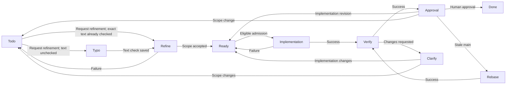
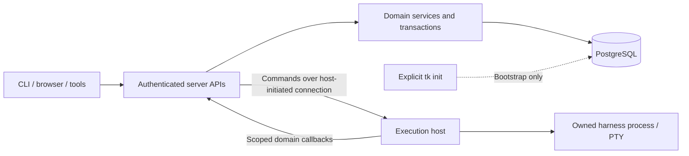

# teleport (`tk`) — Product Specification

**Status:** Product specification for review. Required behavior, delivery stages, and unresolved decisions are identified separately.

**Audience:** Engineers and coding agents implementing the application from a fresh checkout. A reader should be able to identify the required behavior, its acceptance evidence, and any decision that blocks the affected work.

## Contents

- [1. Purpose, authority, and scope](#1-purpose-authority-and-scope)
- [2. Domain model and invariants](#2-domain-model-and-invariants)
- [3. Projects and people](#3-projects-and-people)
- [4. Workflows and human decisions](#4-workflows-and-human-decisions)
- [5. Dependencies, claims, and questions](#5-dependencies-claims-and-questions)
- [6. Scheduling and execution](#6-scheduling-and-execution)
- [7. Git delivery and review](#7-git-delivery-and-review)
- [8. Teleport terminals and recovery](#8-teleport-terminals-and-recovery)
- [9. Attention and permission policy](#9-attention-and-permission-policy)
- [10. Browser workspace](#10-browser-workspace)
- [11. CLI](#11-cli)
- [12. Planning, search, and reporting](#12-planning-search-and-reporting)
- [13. History, interchange, and specification evolution](#13-history-interchange-and-specification-evolution)
- [14. Usage, cost, and performance](#14-usage-cost-and-performance)
- [15. Architecture, persistence, and APIs](#15-architecture-persistence-and-apis)
- [16. Authentication and authorization](#16-authentication-and-authorization)
- [17. Build, initialization, and delivery](#17-build-initialization-and-delivery)
- [18. Acceptance and delivery boundaries](#18-acceptance-and-delivery-boundaries)
- [19. Decision register](#19-decision-register)
- [20. Discrepancy register](#20-discrepancy-register)
- [Appendix A. Permanent action register](#appendix-a-permanent-action-register)

## 1. Purpose, authority, and scope

### 1.1 Product intent

Build a workspace in which humans plan, clarify, supervise, and accept work performed by coding agents. The primary outcome is a usable website-driven loop: enter a ticket, refine it, authorize the proposed scope, let an agent implement it, review the exact result, accept it, then explicitly rebuild/reload the application. Success means fewer tickets requiring a separate visit to an external harness. Measure that through recorded interactions and user-reported escapes, never unrelated application monitoring.

The application is **teleport**. The executable and Homebrew formula are **`tk`**. Refer to work items as **tickets**, not todos. Goal, Epic and Task remain types in the shared ticket hierarchy; Task is the leaf-ticket type. **Todos** names the human-ticket view, while **Todo** remains a workflow status. The agent terminal and independent console are capabilities of teleport, not separate applications.

### 1.2 Interpretation and change control

This document defines the product requirements. Action, acceptance, and decision IDs identify parts of this specification; runtime ticket IDs are allocated independently.

**Must** denotes required observable behavior. **Open** denotes a policy or contract requiring resolution before implementing the affected behavior. **Proposed** denotes a candidate resolution, not an approved rule. Do not implement an open choice as though it were agreed behavior.

**Engineering-owned** identifies routine technical choices delegated to implementation without further product interview: wire formats, route/field names, validation constants, serialization grammars, compatibility mechanisms, fixtures, and routine technical defaults. Choose and document exact contracts before implementing the affected capability, with relevant validation evidence. Preserve every settled product invariant, permission boundary, lifecycle/recovery rule, and explicit limit; delegation does not authorize changing them.

Continue product clarification for unresolved behavior, access, recovery, or lifecycle choices. A material change discovered while designing a technical contract must be surfaced rather than hidden in a default. Explicitly deferred product topics remain deferred; engineering delegation cannot silently resolve their permission or behavior decisions.

When a requirement changes, update its normative section, decision entry, affected actions, and acceptance checks together. Proposed refinements do not change effective requirements until explicitly accepted. Implementation, paid execution, publication, and deployment require their respective authorization; this document is a product contract rather than an operational command.

### 1.3 Scope boundaries

The complete target includes CLI, browser, API/tools, PostgreSQL, agent execution, real terminals, SSO/passkeys, Homebrew delivery, configurable workflows, Ideas, specification evolution, and evidence-based usage/optimization. The first usable milestone is narrower; section 18 defines that boundary without retiring later requirements.

Each installation contains exactly one shared workspace supporting multiple users and projects. Separate organizations use separate installations; multiple isolated workspaces within one installation are outside scope. The complete product supports both local and administrator-registered remote execution hosts. One deployment selects one authoritative database; execution hosts use the server APIs rather than independent writable database copies. Remote/offline database synchronization and billing are outside scope. The planned hosted address is `https://teleport.engineering`; beta/primary hosting is a separate delivery stage.

## 2. Domain model and invariants

### 2.1 Unified work hierarchy

The only execution hierarchy is **Goal → Epic → Task**. These are ticket types sharing an installation-wide positive integer ID namespace, versioning, history, and project ownership. Each installation has a stable server-owned identifier; numeric record IDs from another installation do not identify local records. Root ID `0` is immutable, has no ordinary work semantics, and is excluded from lists, search, counts, and interchange.

- A goal belongs to root. An epic belongs to one goal. A task belongs to one epic and inherits that epic's goal.
- Every task, its epic, and its goal belong to the same project. Direct task-to-goal overrides, arbitrary nested tasks, and a parallel outcome-goal hierarchy are unsupported.
- Each project has its own stable Unassigned goal and Unassigned epic. The epic belongs to that goal. Create/reconcile these defaults idempotently under concurrency, including API/CLI project inference.
- All projects is a view, never an owning project or another set of default records. Resolve a real project before creating work.
- IDs are never reused, including after deletion. Allocate race-safely in a transaction; gaps are permitted.

The Unassigned goal and epic are protected system records. Reject ordinary rename, archive, delete, cancel, type conversion, transfer, or reparent operations against either record, including through bulk actions, imports, reverts, and cascading subtree operations. Keep their project, identity, name, type, and required parent relationship stable. Ordinary child records may move or change under the normal rules, and the defaults retain ordinary derived progress/completion rather than artificial Done status. Tidy excludes the defaults. The explicit project-merge consolidation in section 3.2 is the system-level exception; ordinary mutations cannot bypass protection.

Moving a task changes its epic and inherited goal. Moving an epic changes its goal while its tasks retain their parent IDs. Reject wrong-type, self, cyclic, missing, hidden-immediate-parent, and cross-project relationships. Preserve original creation context and recompute both affected ancestor chains atomically. A hidden ancestor must not hide an otherwise matching visible descendant. Archiving/deleting an ancestor retains existing parent links as authorized context; the hidden-parent rule rejects new/changed assignments rather than blocking unrelated valid edits through an unchanged retained link.

Ordinary Goal/Epic/Task type conversion is limited to a childless record already in semantic Todo, with no claim, reserved/starting/live/stopping/unknown execution or retained unreviewed agent implementation. Check children including archived/deleted records; do not silently drop, reparent or convert a subtree to make the operation fit. Require ordinary current work-write rights, expected versions and a valid same-project parent for the resulting type under normal parent/default rules. Preserve ticket ID/request/history, invalidate incompatible draft advice/agreements and atomically reconcile type-specific fields, workflow validity, relationships, rollups and dependency effects. Reject invalid/stale/busy changes without partial mutation through every direct/import/revert/bulk path. The explicit human-accepted task-to-epic decomposition promotion in section 4.2 follows its own exact reviewed-basis protocol; it does not authorize arbitrary out-of-Todo type changes.

### 2.2 Ticket data and defaults

| Group | Required data and rules |
| --- | --- |
| Identity | ID, monotonically increasing version, created/updated UTC instants. |
| Content | Nonblank title; description and acceptance/success criteria. Preserve original request separately from refinement proposals. |
| Classification | Goal/epic/task type; stable workflow/lane identity; critical/high/medium/low priority. |
| Relationships | Parent, sibling position, project, beneficiaries, creator, executor where applicable, reviewers. |
| Planning | Normalized labels, start/ETA/due calendar dates, integer progress 0–100, optional safe hexadecimal colour. |
| Agent work | Agent intent, harness/model/thinking advice, claim/time, phase, pending question/time, workflow/refinement/dependency context. |
| Activity | Active/paused state, immutable discussion, readiness/completion agreements, review decisions. |
| Visibility | Archived/deleted timestamps independent of status. |

New tickets default to task, Todo, medium priority, agent intent enabled, inactive, and the applicable project-local Unassigned parent. Record the author as creator; do not assign a human executor to agent work. Human-intended tasks default to the current author as human assignee, subject to authenticated identity policy. Explicit initial progress may imply Doing under the transition rules; it cannot make agent work Done or bypass a required agreement.

Duplicate titles are allowed, with warnings for Unicode case-insensitive exact matches, including hidden records. Normalize/deduplicate names and labels without conflating unrelated Unicode identities. Validate the complete proposed state before committing. Empty date input clears a date; omission preserves it. Dates use `YYYY-MM-DD` without timezone shifts; ETA cannot precede an explicit start. Accepted colour lengths remain D14.

**Title, description, and original success criteria may change only when the record is already Todo. Epic/task written guidance follows the same rule.** Use the current pinned semantic role rather than the lane's display title. Returning to Todo and editing are distinct operations. Unchanged content is permitted elsewhere. Refine saves separately versioned proposed scope/criteria; it must not rewrite locked original content or guidance. Apply these rules to import, revert, bulk operations, and every interface.

### 2.3 Progress, ownership, and state separation

Human-intended task progress of 100% means Done; reducing it reopens the task under the transition policy. Agent task progress is a report: 100% never implies Approval or Done. Handoff is explicit and only human approval from Approval completes agent implementation.

Containers derive delivery progress as completed-child count M/N and percentage from non-deleted direct children, including archived children. At least one counted child and all counted children actually Done produce a completed delivery rollup without another human implementation approval; unfinished children prevent that rollup. Reject manual edits of derived progress. Persist this delivery state separately from an epic's planning phase. A completed rollup must not end active Refine/Decompose work or hide it from the board.

A nonempty epic counts as Done for prerequisite eligibility and its parent goal's completed-child rollup only when all counted children are Done and no requested, running, clarification-waiting, or human-acceptance-waiting planning remains. Its child delivery progress can be 100% while it is not yet Done. A permitted new planning job makes the epic incomplete for those purposes until planning closes; recompute affected ancestor state atomically. Cancelled always takes precedence and never satisfies Done. Percentage rounding remains D12.

A goal or epic with no non-deleted children cannot be Done, automatically or through an explicit human completion action. It remains incomplete until it has at least one counted child and all counted children satisfy Done, or may be explicitly Cancelled under the ordinary cancellation rules. Finishing a plan that produces no children does not complete the container. If an authorized operation removes the last counted child, recompute completion, affected ancestors, and dependency reasons; a non-cancelled container no longer qualifies as Done. Preserve its immutable completion history rather than rewriting past events. Enforce this invariant through creation, updates, imports, reversion, visibility changes, and type/parent changes.

Goal delivery completion and objective success are separate facts. Child-based progress/Done records delivery under the rules above; it never automatically proves the intended business/user outcome. Goal reviews record the reviewed objective/target basis, observed outcome values or qualitative evidence, source/as-of context, missing evidence and an explicit human assessment. A current human project Contributor/Maintainer or installation administrator may record that review under ordinary goal-write rights; agents may propose evidence/findings but cannot impersonate its human assessment. Preserve immutable review history against exact goal/objective versions rather than recomputing old assessments from current metrics. An unknown or unsuccessful outcome does not itself reopen completed work, change rollups or start follow-up execution; any follow-up is explicit. Outcome observations append to reviews without rewriting locked original success criteria. Exact objective/observation fields, units and review/calendar arithmetic are engineering-owned under D12/D15.

Agent execution ownership belongs to the claiming agent. Humans may be creators, beneficiaries, and reviewers, but never execution assignees of agent tasks. A selected harness, queued worker, or agent intent alone is not a claim. Hide invalid human assignment controls and reject invalid assignments through every write surface.

Keep workflow status, activity, agent intent, claim, structured question, harness input request, process liveness, and worker pause separate. Silence does not prove completion. A directory entry does not prove a running agent. Answering a ticket question does not send terminal input.

### 2.4 Goals, objectives, and Ideas

A goal is both strategic outcome and delivery container. Objectives are success measures owned by that goal, not independent assignable work or a second hierarchy. Goals support create/list/show/update/history/summary/review/reviews. Monthly/quarterly reviews save an immutable rollup, actor, time, note, and next review date. Later work changes must not rewrite those assessments. Objective fields and review-date arithmetic remain D12.

Ideas are required nonexecuting planning records with their own stable typed identity, text, history, and authorized references. An Idea remains an Idea when accepted; it never converts in place into a goal/epic/task or lends its identity to a newly created ticket. Ideas do not enter task lanes, scheduling, or container completion. Exact identifier encoding remains D15; lifecycle details remain D31.

Support both project-owned Ideas and a workspace-level inbox for Ideas without a project assignment. Store an explicit workspace-inbox versus project placement and immutable creator account; an inbox Idea has no fabricated project, Unassigned goal/epic, or execution hierarchy parent. Its workspace placement does not create another workspace or grant access to existing projects. Workspace-inbox Ideas are visible only to their creator and installation administrators. Other workspace users and project Maintainers receive no inbox access through their roles elsewhere. Project Ideas follow their current project's access boundary; original creator identity does not override that boundary after assignment.

Apply current Idea placement authorization to detail/history/proposals, lists/search/previews/counts, notifications/events/subscriptions, and linked-record navigation. A project-work provenance link never discloses private Idea text/history or grants access to it. Preserve the provenance internally even when the current reader cannot inspect its source. Project assignment explicitly publishes the Idea and retained history/proposals under destination project permissions; show that access change before committing and reconcile subscriptions/caches without stale-response disclosure. Inbox placement never grants agent access.

Assigning/reassigning Idea placement is an explicit versioned, authorized action preserving Idea identity, text, proposal/provenance, and history. Recheck source and destination rights and reconcile access/subscriptions at commit; do not copy it into a second Idea or retarget an active curation identity implicitly. Creating work from an inbox Idea requires explicit real destination project(s) and valid goal/epic/task parents, with current rights for every target. Existing work links do not silently assign the Idea itself to a project. Inbox placement never authorizes cross-project reads or execution.

Moving, archiving, deleting, or restoring a project-owned Idea requires a current authenticated human Maintainer of its source project or installation administrator. Contributor editing rights do not include those controls, and original creator identity grants no exception within a project. Moving into another project additionally requires Contributor-or-higher destination rights. Returning a project Idea to its creator's private inbox requires that creator to hold source Maintainer authority, or an installation administrator; another Maintainer cannot move it into someone else's private inbox.

For private inbox Ideas, the creator or installation administrator may move/archive/delete/restore them; project assignment additionally requires Contributor-or-higher destination rights. Recheck current placement, source/destination authority, and expected version at commit; stale role/placement changes fail without partial writes or access changes. Archive/delete are recoverable visibility changes preserving stable identity/history/proposals/provenance, not deletion/cancellation of linked work. Restoring visibility applies current placement permissions and does not restart curation or grant execution authority.

Authenticated humans may create their own inbox Ideas; inbox editing requires the creator or an installation administrator. Project Idea creation/editing uses current Contributor-or-higher project authority. Viewers can read authorized project Ideas but cannot edit or accept proposals, and agent/service identities cannot impersonate human editing authority. Scoped curation may submit separate proposals without rewriting the human Idea.

Agent curation requires prior explicit assignment to a real project and a human Contributor-or-higher request in that project. Private inbox Ideas support human drafting and human-authored proposals/acceptance but no agent curation, including administrator requests; assigning one publishes its retained content under project permissions before execution. Do not silently assign an Idea, use an unrelated project's credentials, or provision a workspace-wide planning runtime to bypass that boundary.

Curation is a source-read-only project planning job using Refine capacity and the normal host/codebase/grant/isolation, execution-enable, handbrake, permission, ownership, and stop/resumption controls. Bind its service credential to project/Idea/proposal-basis/job/session/operations and explicit related context. It is not a task claim or an executable Idea lane; worker/session reservations share project capacity with other Refine work without entering ticket pickup or hierarchy rollups. It may propose and ask questions, but cannot edit source, create target work, accept proposals, or read private inbox/foreign-project context. Retire owned processes after proposal handoff or safe clarification checkpoint, releasing capacity only after confirmed exit; eligible answered job continuation uses a fresh scoped session. Recheck Idea placement/version and project authority at admission and proposal submission; stale or moved context cannot authorize work in another scope.

Reject Idea move/archive/delete while curation is requested, reserved, starting, running, waiting with an eligible automatic continuation, stopping, or of unknown ownership. The caller must separately stop/cancel the job and confirm owned-process exit before retrying the mutation. Do not change placement/visibility first, implicitly kill or retarget the job, or treat a retired question process as a cancelled logical job. Serialize the final inactive/exit check with curation admission so a concurrent start causes an atomic conflict, not a hidden live session.

Any current human project Contributor/Maintainer or installation administrator may explicitly stop/cancel its Idea-curation job regardless of requester. Persist the audited job-specific intent, suspend automatic continuation, revoke/retire matching session authority, and reconcile owned exit before releasing capacity. Preserve Idea text, questions, submitted proposals, links, and history; cancelling the planning job does not delete/cancel the Idea or linked tickets. Late output cannot revive a stopped/cancelled or differently scoped job. Resume a stopped job only through an explicit authorized action against the same current Idea/project/basis after confirmed exit and all admission checks; a cancelled job or changed placement requires a new curation request. Restoring Idea visibility never resumes one implicitly.

Ordinary authorized content edits retain version checks and immutable history while curation is in progress. They do not rewrite pinned inputs or accepted proposals; submissions and acceptance against stale Idea/context versions fail without target mutations. A curator must refresh through the supported job protocol or obtain a new request rather than silently accepting a changed basis. Exact job/stop/checkpoint contracts follow D15/D08/D18.

Humans may request scoped agent curation, answer questions, and review a separately versioned proposal. Acceptance requires an authenticated human with current Idea editing rights and Contributor-or-higher authority in every destination project; installation administrators satisfy those project rights. Recheck the Idea/proposal versions and all source/target rights together at commit, including concurrent membership/placement changes. Additional Maintainer approval is not required merely to create Todo drafts or add authorized provenance links.

Explicit human acceptance of an exact current proposal creates or links one or more normal hierarchy records while retaining the original Idea and its full history. Record provenance in both directions, identifying the accepted Idea/proposal version and each created/linked ticket; later edits to either record do not rewrite that accepted basis. Existing linked tickets retain their own IDs, status, content gates, and history. New tickets use ordinary validated hierarchy/defaults and begin as Todo drafts; Idea acceptance is not implementation readiness, code approval, or permission to start execution. Agent implementation still requires the separate Maintainer/administrator human approval from Approval.

Keep the Idea visible in its current placement after acceptance, with an Accepted indicator, accepted proposal/version, and authorized links to resulting work. Commit that indicator with acceptance/provenance; do not automatically archive, delete, relocate, or mark the Idea as task Done. Acceptance requires a currently visible, non-deleted Idea; restore hidden Ideas explicitly before accepting rather than allowing a Contributor acceptance to bypass visibility controls.

The indicator records historical accepted proposal(s), not approval of later Idea edits or every subsequent proposal. Preserve the original accepted versions and target links when new drafting occurs. Further curation or proposal acceptance requires a new explicit authorized request/decision and normal version checks; changes to linked ticket status do not automatically rerun, hide, or complete the Idea. Archiving remains a separate explicit action under the applicable creator/Maintainer/administrator rules.

Commit accepted proposal/provenance and all intended creates/links atomically with a stable acceptance identity; retries return the same result rather than duplicating tickets or links. Agents propose but cannot accept or mutate target work through unaccepted Idea output. Reject stale/unauthorized proposals or invalid target relationships without partial creation/linking. Linked-record navigation and previews enforce current authorization without disclosing inaccessible sources or targets.

## 3. Projects and people

### 3.1 Project discovery and configuration

Discover canonical invocation directory and available Git context locally, without network access, within two seconds. Record repository root, relative path, sanitized repository identity, branch, and commit where available. Missing Git is not an error.

Prefer origin, otherwise the alphabetically first remote. Normalize HTTPS, SSH, and SCP-style remotes to host/repository identity, excluding credentials, query, fragment, and `.git`. Equivalent clones share a project. Without a remote use the common Git directory so worktrees share identity; outside Git use the exact canonical directory.

A project stores stable identity/key, name, description, repository/Git folder, working directory, Ready/Done/SDLC guidance, independently selected human/agent workflows, and capacity. Project settings support a project-wide maximum for reserved/live agents and a permitted-harness policy; omitted policies retain legacy unrestricted behavior. Counts include active, starting, stopping and unknown owned sessions and ticket reservations without double-counting their matching session. Zero blocks new admissions; lowering a limit or changing the allowlist does not terminate existing sessions. The existing versioned `setLaneCapacity` operation accepts optional `maxAgents` (0–40), `clearMaxAgents`, `allowedHarnesses` (distinct supported IDs, with an empty list denying all) and `clearHarnessPolicy`; conflicting set/clear inputs fail. Omitted fields preserve existing values, and only a current project Maintainer or administrator can change them. System settings can refresh supported local harness discovery. Per-harness model and thinking-level discovery and enforcement remain planned until an adapter can verify and enforce them; do not report unverified settings as restrictions. Empty project guidance inherits system guidance. Explicit creation selection wins over saved default, then invocation inference. Select by stable key, unique name, repository identity, or `.`; ambiguous names fail. Clearing a default restores inference without moving existing tickets.

Any authenticated workspace user may create a project and automatically receives its Maintainer membership. Commit the project, project-local defaults, and creator membership atomically; retries must not duplicate them. This also applies to authorized first-use creation through invocation discovery. Resolving or retrying creation against an existing project must not grant access to a nonmember; return the authorized result or an access failure under the disclosure policy. Creating metadata does not grant additional execution-host or filesystem authority.

New project names must be unique, comparing case-insensitively after trimming and collapsing whitespace. Check availability while entering a new name; enforce it again atomically when creating. Preserve any existing duplicate names without destructive migration. Prefixes remain separately unique.

Human project access requires explicit membership with a Viewer, Contributor, or Maintainer role. Installation administrators have all project capabilities without a separate project membership. Workspace membership alone grants no project access, and invocation discovery or a matching repository identity never grants membership. Managed agents use the separately scoped project-owned service identities defined in section 16. Lists, search, counts, attention, graph, events, and execution inspection must apply the applicable actor's access boundary; All projects means all projects accessible to that actor. Execution-control details remain D24.

Installation administrators register execution hosts and grant each project's permitted host/directory bindings. Project Maintainers may select a host and codebase directory only within those grants; creating or maintaining a project does not authorize a new host, filesystem root, or storage mapping. Contributors may request execution under the configured binding but cannot expand it. Grant identity, host, directory roots, and authorized project worktree/scratch storage are versioned server configuration.

Named harness assignment and execution require a named project with an existing readable absolute directory containing a recognizable codebase on an administrator-authorized execution host. An empty directory is insufficient. Validate host authority and canonical path containment before inspecting or using a path, including symlink/path-mapping escapes; client directory strings alone are not host authority. Revalidate the grant, codebase, and derived worktree/storage paths at assignment and reservation. Invalid projects still permit inspection, stopping, and unassignment. Generic agent intent without a named harness remains useful for planning. Host-grant revocation and explicit resumption are defined in section 8.1; detailed host enrollment/mapping remains D24.

### 3.2 Transfers and merges

Transfer a goal with all epics/tasks; transfer an epic with all tasks. Include archived/deleted descendants so retained ancestry never crosses projects. A transferred epic uses the explicitly supplied valid destination goal, or the destination project's protected Unassigned goal when omitted. A task-only transfer needs a destination epic, defaulting to that project's Unassigned epic. Resolve defaults in the transfer transaction for the actual destination project; an invalid explicit parent fails rather than silently falling back. Preserve IDs, history, creation context, and frozen session/usage attribution. Re-evaluate agreements whose project basis changes.

Validate the whole transfer and commit parent/project changes, revisions, and ancestor rollups in one transaction. Reject the entire operation if any affected ticket has a claim or reserved/starting/live session. Unknown execution ownership remains blocking until safely reconciled. Serialize the final check against admission; never stop an agent or clear its claim implicitly to transfer work.

Only an authenticated human who currently holds Maintainer authority in both source and destination projects, or an installation administrator, may transfer tickets between them. Project ownership for this rule means current Maintainer authority; creating a ticket or having Contributor access does not confer ownership. Apply the same rule to task, epic and goal transfers, including every hidden descendant in a selected subtree. Preview and commit use the same actor matrix; revalidate both project authorities, affected record versions and destination parents at commit, serialized against membership changes and admission. Source-only or destination-only ownership, stale authorization and agent/service identities are insufficient. Failed authorization leaves the entire transfer unchanged. Audit the initiating human and both projects; transfer grants no additional membership, host or filesystem authority.

Project merge includes hidden assignments, preserves state/history, and retains the former project as an inference alias. Retain the destination project's existing Unassigned pair. Move source-default tasks into the destination Unassigned epic and other source-default epics under the destination Unassigned goal, including archived/deleted contents. Preserve ordinary record IDs; transfer other goal subtrees without flattening their hierarchy.

Only an authenticated human who currently holds Maintainer authority in both source and destination projects, or an installation administrator, may merge projects. Check both authorities when committing, serialized against membership/role changes; a stale preview, ownership of only one project, or agent/service identity is insufficient. Reject failed authorization before any project, membership, relationship, or redirect mutation. Record the initiating human and both project identities in the merge audit. Merge authority does not grant permission to expand administrator-controlled host/directory access.

Before merging, verify that retained code, worktrees and checkout/storage-bound artifacts can be preserved and used under the destination's existing authorized execution setup. If not, block the merge and require separate explicit authorized grant preparation and stopped migration under section 7. Never complete a metadata merge that strands incompatible artifacts for later repair. Administrators alone may expand host/directory/storage grants; do not inherit or union source grants, rescope source credentials, overwrite unrelated files, discard retained changes or silently combine incompatible repositories. Preserve artifact repository/commit provenance and accepted Done/history rather than rewriting it as destination-main evidence. Verify a durable artifact/mapping manifest and current grants at commit, serialized against affected admission/migration/configuration changes; unresolved ownership or uncertain transfer blocks the merge. Preparation is a separate reviewable operation, and a failed/stale merge leaves its metadata/redirect/membership changes unapplied. Migration keeps its normal fresh-check/Approval and explicit-resume gates; merge itself starts no execution.

Retire the former source defaults as read-only redirects to their corresponding destination defaults, with original IDs and immutable history retained permanently. Redirects are not extra hierarchy records and do not enter lists, counts, scheduling, or completion rollups. Authorized lookup shows the redirect explicitly and permits access to retained history; it never grants access to the destination. Mutations addressed to retired IDs fail with authorized redirect guidance rather than silently editing another record.

Normalize current relationships and prerequisite references to the surviving default IDs, validating the complete resulting hierarchy/dependency graph before commit. Reject invalid/self/cyclic references rather than dropping them silently. Preserve historical references, accepted completion bases, and frozen session/usage attribution; recompute current rollups, dependency reasons, and applicable impact warnings under the ordinary rules. Commit content moves, redirect creation, reference reconciliation, and project aliasing atomically and idempotently, with the same claim/session exclusion as transfers. A failed merge leaves both projects unchanged.

Keep destination project memberships and roles unchanged. Source memberships are retained as historical evidence, not copied or promoted into destination access. Source-only members lose access to moved work and its retained history unless separately added to the destination through ordinary membership management; destination members receive access according to their existing roles. Installation administrators retain their installation-level rights. Apply this boundary at merge commit across reads, writes, search, counts, events, active subscriptions, aliases, redirects, and reconnects; stale project context or cached authorization cannot preserve source-only access. A source-scoped service credential never gains destination scope by following an alias. Make the membership effect explicit before the merge; adding source members is a separate authorized action, never an automatic merge side effect.

### 3.3 People and attribution

People have stable ID, case-insensitively unique name, human/agent type, description, and timestamps. Provide create/list/show/update/delete/rename. Creating a referenced person does not create a login account or grant access. With authentication, `me` means the account's linked person, not a supplied worker name or server OS user.

Any authenticated human account may create an unlinked directory person; record its immutable creator account. Only that creator or a current human installation administrator may edit, rename, merge or delete it. Project Contributor/Maintainer status and references from project work confer no directory-management ownership. Recheck current actor state, ownership, link state and expected versions at commit across all write surfaces. A merge requires management authority over both source and destination and retains the destination's creator/metadata; managing only the source is insufficient. Keep normal type/reference/claim/deletion and account-link merge guards. Preserve historical identities and actor/target audit without granting login/project rights or disclosing inaccessible referencing work. A suspended creator does not transfer ownership; installation administrators remain able to manage the record.

Every new human account, including the bootstrap administrator and first-time SSO registration, atomically creates a distinct human person and its stable account link. Retries reuse that account/person pair. Never adopt an existing person by matching name, username or email; choose a valid distinct display name on collision without changing an existing identity. Account creation must not succeed with a missing or partially created person link. The account's linked person supplies `me` and normal human-assignment defaults immediately, while assignment still requires the ordinary project/workflow rights. Display-name changes do not change account authentication, memberships or historical actor identity. Person-only creation remains independent of account provisioning.

Only the authenticated owning account or a current human installation administrator may edit an account-linked person's display name/description. Project Contributor/Maintainer authority alone cannot edit another account's profile. Recheck ownership, current account/administrator state and expected person version at commit across direct, rename, import and composed writes. Profile changes preserve the stable account/person link, username/provider identity, memberships, claims and historical attribution; name collision remains a refusal under the linked-person merge protection. Keep actor/target and before/after metadata in secret-free history without exposing authentication data.

Rename updates current references and affected history without rewriting historical names. For two unlinked people, renaming into an existing name warns and merges into that identity, retaining its metadata. Reject every merge whose source or destination is linked to a login account, including administrator, bulk and import attempts. An account-linked person may be renamed to an unused name, but name collision must not retarget its account link, combine assignment identities or merge login accounts. Validate both people and their link state atomically against concurrent changes. Keep linked people human and reject their deletion while the account link remains, in addition to the ordinary current-ticket/claim reference guards. Replace, clear, and incremental add/remove modes are mutually exclusive.

Switching a task between human and agent intent is permitted only for an unclaimed Todo draft with no reserved, starting, live, or unknown execution and no unreviewed agent implementation. A stopped process alone does not make retained implementation eligible for conversion. Reject conversion that could bypass the required human Approval of agent-produced work; returning an implemented task to Todo does not remove that obligation.

The explicit Send to refine action converts an eligible human Todo task into the project's agent workflow and queues its Refine phase atomically, clearing human assignment. Return to Todos is the narrow queue exception: an unclaimed Refine task with no active/reserved/unknown execution, pending question, accepted implementation or retained delivery may return to the human workflow's Todo phase. Refuse while refinement is running. Preserve prior history; no return can discard or bypass implementation Approval.

Validate the destination workflow and executor roles atomically with the intent change, serialized against claims/admission. Clear incompatible current executor assignments explicitly in the conversion result; do not silently retain invalid executors or invent beneficiaries/reviewers. Preserve creator, beneficiaries, attribution, discussion, and execution history. Apply ordinary destination-workflow requirements after conversion. Advice-only configuration changes do not constitute intent conversion or waive their own validation. Account/person creation and linked-person protection follow section 3.3.

## 4. Workflows and human decisions

### 4.1 Seeded human and agent workflows

Fresh initialization seeds two published versioned workflow definitions. The human default is **Todo → Doing → Done**, with every phase manual and movement initiated by a human. The agent default's main path is **Todo → Typo → Refine → Ready → Implementation → Verify → Approval → Done**. Verify has semantic role Review. New projects select family defaults unless an authorized explicit selection overrides them. Initialization starts no agent; repeated initialization preserves existing definitions, selections and pins. Existing published defaults remain immutable; upgrades publish/select a new definition explicitly rather than rewriting prior installations.

| Phase | Agentic | Required behavior |
| --- | --- | --- |
| Todo | No | Human drafting; content editable; refinement starts only when explicitly requested. |
| Typo | Yes | Correct spelling only in unaccepted Todo draft title/description using exact text/version basis and retained before/after history; preserve meaning, criteria and human approval. Source code stays read-only. Uses Refine capacity. |
| Refine | Yes | Source-read-only inspection using Refine capacity. Submit proposed scope; wait for exact human scope acceptance before Ready. |
| Ready | No | Accepted implementation queue; no harness process or separate worker pool. |
| Implementation | Yes | Owned-worktree implementation using Doing capacity. Its internal semantic role is Doing; the default agent-facing phase label is Implementation. |
| Verify | Yes | Semantic Review: read-only review of the exact candidate using shared Doing capacity. Record findings, evidence and outcomes; never approve code on a human's behalf. |
| Clarify | No | Human clarification after failed Verify. Route unchanged-scope implementation work to Ready, or scope changes to Todo then Refine and renewed scope acceptance. |
| Approval | No | Human Maintainer/administrator decision on the exact candidate, checks and configured review evidence. |
| Done | No | Human-approved completion; no new automatic admission. |

The agent definition also provides optional Breakdown with semantic Decompose and auxiliary Rebase. Breakdown is source-read-only and uses Refine capacity; planning completion cannot complete unfinished children. Rebase uses Doing capacity and returns through Verify before Approval. Cancellation is guarded. Tool questions retain section 5.3 originating-phase suspension unless an explicit question rule selects manual Clarify. Failed-verification clarification is distinct from an agent's unanswered tool request. The human definition supports guarded manual moves, including direct completion with agreement and explicit reopening; it never dispatches an agent.

Default rules explicitly cover each phase: requesting refinement from Todo first admits Typo when the current text lacks a matching completed check; Typo success records that basis then enters Refine, while failure halts visibly without guessing a correction. Text edits invalidate the prior check. Refine success saves a proposal and waits for exact human acceptance; failure returns Todo. Implementation success → Verify and failure → Ready. Verify success → Approval; changes requested → manual Clarify, then human-selected Ready for unchanged-scope work or Todo → Refine for scope changes. Breakdown success submits a bounded accepted-basis plan and closes planning; failure creates no partial children. Rebase success → Verify and failure → Ready. Questions retain section 5.3. Human scope acceptance selects Ready or Breakdown; only human Approval enters Done. Backward routes preserve work/history and consume finite attempts after prior exit. Operational/authority/ownership failures cannot masquerade as code findings or successful verification.



Entering an eligible agent lane is sufficient for automatic pickup when execution is enabled and capacity exists. Source-read-only stages may submit authorized proposals, questions, and plans through the API; they cannot modify code. Board filters never constrain scheduling. Refine assesses scope/difficulty, recommends model/thinking with rationale, preserves selected harness, and checks related visible nonterminal work for plausible duplication. Suspected duplicates raise a human question with candidates/choices and return to Todo; never merge/discard automatically. Consider recorded answers before repeating questions.

Completing refinement does **not** move directly to Ready. An authenticated human accepts the current proposal, choosing Ready for a task or Decompose for a task/epic. Decompose promotes a task to an epic **in place**, preserving ID/request/history and moving it under its former epic's goal. An epic retains its identity. Dependencies on the promoted ID wait for the whole epic to be Done. Acceptance atomically records the accepted proposal, any promotion, and the stage transition. The planning agent subsequently submits Todo children through a separate atomic, idempotent plan action; acceptance does not itself create an unreviewed plan or authorize child implementation.

An epic's Refine/Decompose planning phase is stored separately from its child-derived delivery completion. Requested, running, clarification-waiting, and human-acceptance-waiting planning remains visible in its planning lane even if every current child becomes Done. A question-related process retirement or child-rollup update does not end the planning job. Preserve one epic identity and expose both the delivery rollup and planning state in APIs, editor, board, and history.

When planning finishes or is explicitly ended, clear that planning phase and evaluate current completion eligibility. For a nonempty epic, all children Done plus closed planning makes it Done, satisfies its dependants, and counts it complete in its parent goal without another implementation-completion approval. If an accepted decomposition plan adds unfinished Todo children, update the delivery and ancestor rollups atomically with child creation. Cancellation takes precedence over planning and child-derived completion: stop the container's owned planning execution, retain its plan/history, and show Cancelled rather than an active planning lane or derived Done.

### 4.2 Agreements and human approval decisions

Entering Ready records an agreement on applicable criteria, actor, UTC time, and source basis. Done records completion agreement and the prerequisite identities/versions that supported acceptance; derived container Done identifies its derived basis. Display saved/current/stale agreements. Relevant criteria, guidance, or execution-directory changes invalidate new admission until re-agreed; display-only renaming does not. A later prerequisite change does not rewrite an accepted completion basis.

Agent implementation must reach Approval and receive explicit approval from an authenticated human project Maintainer or installation administrator to become Done. The seeded agent workflow first requires a successful Review report for the exact current candidate. Review is agentic analysis; Approval is the human decision, with separate records and authority. Custom definitions retain the human Approval gate and every configured prior review/check requirement. The approving human may also have created or requested the work; no second human is required. Viewers and Contributors cannot approve implementation. Enforce this across all commands, APIs, imports, reverts and bulk operations. Agent review success, reported 100% or a direct-Done patch cannot substitute for human Approval.

Agent Review runs in a separate phase-scoped process after implementation/Rebase has exited. Pin its report to workflow version, phase visit/attempt, accepted scope, repository/host binding, candidate commit, base and check evidence. Report findings and a typed success, failure/changes-requested or question outcome. Review cannot edit source, integrate main, change scope or create a human approval record. A changed candidate/base, scope, binding or required check basis invalidates current review eligibility while preserving historical reports; obtain fresh configured review evidence before Approval. Operational failure or unavailable evidence is not a successful review. No separate model/provider is required merely because the process is separate.

Approval may include `up`, `down`, or empty rating and a description up to 20,000 bytes. A down rating still approves when the approval action is chosen. Dismissal changes nothing.

For rejection, the human approver explicitly chooses a versioned revision path and records feedback; neither the client nor agent infers the choice from free text. The pinned workflow declares the corresponding outcome rules and exact destination stages. A backward route is permitted and preserves the same ticket/workflow context; no new run is mandatory:

- **Revise implementation:** return retained implementation to Ready with the accepted scope unchanged. Retain its branch/worktree/context and use the normal Implementation/rebase/check/Review/Approval path. A stale accepted basis cannot be re-agreed implicitly by choosing this action; report the required scope/readiness review. Dependencies and other admission guards still apply.
- **Change scope:** return to Todo, preserve the branch/worktree and immutable request/refinement/review history, and invalidate the old implementation readiness. Edit scope/criteria only in Todo, reenter Refine, submit a new proposal, and obtain explicit human acceptance before Ready or Decompose. Entering Todo does not itself start refinement.

Both paths preserve available implementation and feedback; neither approves code or deletes retained work. Require an explicit valid revision-kind value in the API and reject missing/unsupported kinds atomically. Offer implementation revision only when retained implementation context exists; draft/simulation work without it uses the Todo/refinement path. If implementation feedback would require a scope change despite the selected path, the agent must ask for clarification rather than expand its accepted authority. A subsequent implementation submission always requires fresh pinned Approval and human acceptance.

### 4.3 Human workflow

Human-intended tickets use a separate persisted workflow. The **Todos** view presents only the three columns **Todo → Doing → Done**, containing human-intended leaf tickets, never agent tickets or agent workflow stages. They have no agent counts, personas, claims, queues or managed-agent execution. They may complete directly with the applicable agreement. N in Todos uses the shared chooser and defaults ticket creation to human intent. Render supported custom human lane IDs under their Todo/Doing/Done semantic column without changing workflow pins or transition rules; ambiguous target mappings still require a valid explicit choice. Cancelled or otherwise out-of-view records remain accessible through authorized lists/history/details rather than creating extra Todos columns.

Changing workflows must not strand tickets. If a record's lane is unavailable in the selected human workflow, keep that record discoverable through authorized lists/details and other applicable views; allow unrelated edits and an explicit validated conversion. Do not add a fourth Todos column or silently reinterpret status or intent.

### 4.4 Cancellation

Cancel task records actor/reason, pauses activity, prevents new admission and late agent continuation, and preserves discussion, questions, history, and usage. Persist Cancelled plus a durable owned-process stop request together, serialized against launch. Terminate outside the transaction. Release only the matching claim after confirmed exit; without a session, release in the cancellation transaction.

Show Cancelled independently from stopping/failed/unknown cleanup. Retry durable stop intents; never report exit from a reused PID or clear a newer claim. Answers cannot revive cancelled work. External cooperative claims can be revoked, but unowned process exit cannot be certified.

Cancel goal/epic atomically cancels unfinished descendants with one batch/correlation ID and durable stop intents, including a stop intent for the container's own planning execution. Done descendants and already Cancelled work remain intact. Epic cancellation does not cancel siblings or parent goal. A Cancelled container is not overwritten by derived Done or a retained planning phase; reject late planning submissions that would revive it or create children. Owned-stop mechanisms/deadlines follow D08.

Explicitly reopening a cancelled goal/epic changes only that selected container. Children retain their current statuses, cancellation reasons/correlation, agreements, work and stop/resume holds, even when the same earlier cancellation affected them. Reopening children requires separate explicit selection/actions; do not infer a subtree restore from the original cancellation batch. Preserve immutable cancellation history and re-evaluate the reopened container/ancestors using the current nonempty-child/planning completion predicate, not a copied pre-cancellation status. A container with cancelled children remains incomplete; all current counted children Done with planning closed may again qualify as Done under normal derived rules.

Reopening cannot cancel outstanding stop intents, resurrect planning requests, recreate claims/credentials or start agents. Resolve the selected record's own claim/reserved/live/stopping/unknown execution and confirm owned exit before permitting its reopen; a Cancelled label is not exit proof. Unchanged descendants retain their independent cleanup. Recheck expected versions, current authority and completion/dependency effects atomically; stale/forbidden/busy requests change nothing.

Only a current human project Maintainer or installation administrator may explicitly reopen a Done/Cancelled agent task or a Cancelled goal/epic. Creator/requester status, Contributor rights, service identity or a historical approval does not grant this authority. Recheck that role at commit against concurrent membership changes. Enforce the same terminal-to-nonterminal guard through ordinary state/progress updates, imports, revision reverts and batch/composed/script actions; changing the verb cannot bypass it. Human-intended tasks retain ordinary human Contributor editing/reopening rights and their applicable transition/agreement rules. Derived container rollup changes from otherwise authorized child/planning operations remain governed by their existing predicates rather than this explicit terminal-reopen action.

Reopened Done/Cancelled agent tasks enter semantic Todo as inactive drafts with current-cycle progress zero, retaining their pinned workflow version. Resolve a valid Todo lane under that version without silently migrating workflows; missing/ambiguous mappings require an explicit valid selection or separate migration. Preserve request, retained branches/worktrees, prior refinements/checks/reviews/decisions and immutable completion/cancellation history. Previously integrated code stays integrated. Prior readiness/completion decisions remain historical evidence and do not authorize the reopened cycle: require fresh refinement and explicit human acceptance of its exact current scope before Ready, then fresh pinned code Approval for subsequent implementation. Retained unreviewed implementation still cannot bypass Approval through intent conversion. Recompute current hierarchy/dependency effects, including section 5.1 stop/impact rules, atomically. Reopening itself neither queues implementation nor starts refinement/execution or clears independent stop/resume holds.

### 4.5 Custom workflows and prompt settings

Support versioned draft/read/edit/copy/select/delete/activate workflows and lane save/delete/reorder. Definitions have 1–100 unique stable lanes and a nonblank title up to 200 bytes. Custom IDs match `lane:[a-zA-Z0-9][a-zA-Z0-9_-]{0,79}`. Lane title/intent/description are nonblank and at most 20,000 bytes each. Agentic lanes require persona text up to 20,000 bytes, 0–20 workers, and optional model/thinking defaults up to 256 bytes. Approval/Done/Cancelled cannot be agentic; human workflows contain no agent settings.

Lane quotas are admission limits inside shared project capacity. Zero prevents new admission; an omitted legacy quota inherits the project pool. Count reservations and stopping/unknown ownership until confirmed exit, across published versions of the same stable lane within a project. A draft edit neither changes existing ticket pins nor stops work. Legacy definitions without a separate description display their retained instructions as intent without rewriting published history. Exact shipped field names and validation are exposed through the server's action discovery and schemas.

Every custom lane declares exactly one built-in semantic role: Todo, Typo, Refine, Decompose, Ready, Doing, Rebase, Review, Clarify, Approval, Done, or Cancelled, subject to family/type/intent validity. Implementation has semantic Doing, Verify has Review and Breakdown has Decompose. Multiple stable lanes may share a role. Derive behavior from the pinned semantic role, never display title/order or client-supplied capabilities. Renaming/reordering cannot change privileges, status meaning or eligibility.

Typo is a narrowly delegated draft-copyediting role. It may propose then atomically apply spelling-only title/description corrections against the exact unaccepted draft version/text basis, current scoped visit/claim and operation identity. Preserve criteria, intended meaning, all prior snapshots and actor identity. Accepted/refined scope, non-draft content and repository source cannot be rewritten by this capability. Human concurrent edits invalidate stale output; retry requires current context and finite allowance. This exception does not relax ordinary Todo-only content editing. No paid work starts merely because a human types; the explicitly started/configured workflow admits the checked phase under ordinary execution gates.

Todo remains human drafting with Todo-only content editing; Ready is a queue without its own worker pool. Agent-workflow Refine/Decompose use source-read-only Refine capacity; Doing/Rebase use owned-worktree Doing capacity; agentic Review uses the shared Doing pool with read-only access to its pinned candidate and no implementation writes. Clarify is a manual question/answer wait; Approval/Done/Cancelled retain their nonagentic acceptance/completion/cancellation gates. Multiple lanes sharing a pool cannot multiply capacity or grants. Human workflows remain manual with no agent settings, reservation, or execution enabled by role labels. Each lane's agentic toggle must satisfy its family and role contract before activation.

Use exact stable source/destination lane IDs and typed outcomes for handoff. When several lanes share a role, require a declared unambiguous destination or an explicit authorized human selection; never choose the first matching label or infer authority from prose. Scoped agents may submit outcomes/proposals only for their current lane/attempt. The server validates current workflow/attempt/basis, declared edge, and semantic actor/gates before applying a transition. A declared edge to Ready/Decompose/Done cannot substitute for required human scope/code acceptance; transition into a different role does not silently convert task intent or editable content. Returning to Todo and editing remain separate operations.

Every default or custom workflow is a **directed workflow graph**: stable phase/lane identities are vertices and declared outcome rules define directed edges. Backward edges, cycles and explicit same-phase retry edges are permitted. Validate all stages and rules, including disconnected branches, through saves, edits, imports, activation and migration; invalid batches leave the prior definition intact. A cycle authorizes only its declared route, never unlimited execution or a bypass of human gates. Rework preserves the ticket, workflow pin, retained work and history; a new workflow run is not required.

Definitions retain phase instructions, semantic role, agentic/manual setting, typed outcomes and exact destinations. Support success, failure and question outcomes, plus role-specific human actions such as scope acceptance, approval/rejection and answered. Rules use versioned declarative conditions on validated outcome/context fields, with explicit deterministic priority or disjoint matching; reject ambiguous effective rules. Missing matches raise visible routing attention without guessing a destination. Agents report outcomes only for their current authorized phase/attempt; they cannot invent edges, execute arbitrary rule code, grant acceptance or increase limits. An ordinary dependency wait suspends its recorded phase. Questions default to suspension/continuation under section 5.3; an explicitly configured question route may instead enter a manual Clarify phase.

Pin immutable effective workflow and budget-policy versions to work. Record every entry/exit, matched rule, outcome, actor, reason, attempt and consumed/remaining allowance with recoverable provenance. Reserve/check allowance atomically with admission so concurrent workers cannot overspend it. Restart, reconnect, lane rename, worker reassignment, backward routes or workflow migration cannot erase consumption. A repeated automated visit starts a fresh counted attempt after prior owned exit; late/duplicate outcomes remain fenced by exact operation, phase visit, attempt and expected versions. Draft edits never activate themselves or reinterpret running sessions; migration requires an explicit validated mapping and a valid directed workflow definition.

Workflow activation is an explicit versioned action by a current human project Maintainer or installation administrator. Validate the complete immutable candidate's family, roles, graph/outcomes, initial/default destinations, mandatory gates, and finite budget policy before atomically selecting it for new work. Recheck authority and expected active/candidate versions at commit; a draft save, lane edit, or invalid/stale candidate changes no effective selection. Record actor, reason, candidate, and prior active version. Installation-wide default administration remains installation-administrator scope.

Only newly created work uses the activated/selected workflow version. Existing work, including Todo drafts, queued items, pending questions, and running sessions, keeps its exact pinned definition, lanes, role semantics, and budget history. Neither activation nor a safe handoff automatically migrates it. Retain referenced published versions and lane metadata for authorized operation/history; draft deletion or a new activation cannot delete in-use definitions or needed lane locks. Keep older pinned work discoverable in its version context, including a clearly labelled section when its lanes are absent from the current default, without changing status, task intent, or stored order.

Migrating existing work requires a separate explicit current human project Maintainer/administrator operation with exact published source/target versions, selected record versions, and a validated lane/role mapping. Preserve work/history/budget allowance/consumption and all scope, review, cancellation, and intent-conversion gates. Revalidate agreement/prompt provenance against the target definition; material changes cannot forge renewed readiness or code acceptance. Reject ambiguous/invalid mappings rather than fabricating agreement. Selecting a prior published version for future work likewise leaves existing pins intact.

Every migration mapping must preserve the record's current semantic role exactly. Source Approval maps only to a target Approval lane, Doing only to Doing, and likewise for other roles; distinct lane IDs/titles are permitted. Reject the complete migration if the target lacks a valid same-role lane or a requested mapping changes role. Perform any desired role/status change separately through the ordinary workflow action with its current actor, version, feedback, scope, and approval requirements. Migration cannot reopen terminal work, bypass rejection/readiness Approval, change task intent, or combine return-to-Todo with content edits. Historical completion/acceptance remains bound to its original basis rather than claiming compliance with newly selected guidance.

Reject migration if any selected work has a claim, reserved/starting/running/stopping execution, unknown ownership, or an unsuspended originating-phase continuation. Stop/pause affected execution explicitly first and confirm owned exit; a retired question process alone does not disable its logical automatic continuation. Migration does not implicitly stop sessions or queue an operation for a future handoff. Preview may describe blockers without mutation, but each actual retry rechecks current state.

Validate the complete selected batch and atomically apply its pin/lane mapping, revisions, affected rollups/provenance, and audit, serialized against admission, continuation, record changes, and role changes. A stale/busy/invalid member rejects the entire batch without partial migration. Preserve exact source history and stopped/paused state; no old session, claim, credential, or input response acquires target-version authority. Further execution uses normal current-basis gates and a fresh eligible session after required explicit resumption. Typed activation/mapping/stop contracts follow D15/D08/D18.

The mandatory budget defaults to 20 total automatic stage attempts for new managed work, configurable as an integer from 1–1,000 by current human project Maintainers or installation administrators. Apply the same default to default and custom automated workflows. Pin the effective allowance/policy to new work or a newly authorized planning record before its first automatic attempt; human-only work has no automatic execution budget. Changes to defaults apply prospectively, never retroactively increase/reset a pinned allowance or its consumed history. Existing-work changes use the explicit budget action. Reject zero, negative, fractional, unlimited, and out-of-range values atomically.

The attempt allowance covers every admitted automated stage, including configured backward-route retries and automated routing stages. Each unique committed dispatch consumes one attempt; following its edge does not double-count that dispatch. A reservation never dispatched may release only its own held allowance; failed or uncertain dispatches remain counted. Duplicate dispatch/reconnect reconciliation consumes no additional attempt for the same operation identity. Neither a cycle, a new run label nor a workflow-version change supplies fresh allowance.

Attaching to a surviving process or continuing the same recorded stage attempt after a managed clarification does not create a new stage attempt, even when safe clarification retirement requires a fresh process/credential. Preserve that attempt's identity and accounting. Reexecuting a failed stage or changing its accepted execution basis requires a new counted attempt; a restart cannot be labelled continuation merely to avoid the limit. Passive human waits, valid handoff into Approval, and manual human decisions consume no automatic-stage attempt. The final admitted attempt may finish and hand off normally with zero allowance remaining; block the next required automatic attempt rather than terminating that permitted attempt at launch.

Optional active-execution-time, token, or cost ceilings further restrict the mandatory attempt budget when explicitly configured; every enabled limit must permit the operation. Keep human/queue waits separate from active execution time and identify measured versus estimated usage/cost and unavailable evidence. Do not treat missing usage as zero or claim an unenforceable optional ceiling is guaranteed. D15/D18 define optional-cap numeric units/ranges and metering/capability contracts.

Budget exhaustion blocks the next automatic attempt that exceeds its allowance, or active execution at an enabled resource ceiling, and raises a distinct Budget exhausted attention reason with limit/consumption/policy provenance. Preserve workflow status, phase, retained work, questions, proposals, and history; do not automatically cancel, complete, reject, or rewrite scope. Where an active execution reaches an enforceable stop boundary, persist the block and durable owned-stop intent together and reconcile outside the transaction. Confirm owned exit before releasing matching claims/capacity; failed/unknown stops remain visible and prevent replacement.

Require an explicit authorized human decision to extend the finite allowance and authorize continuation, replan through normal scope/readiness rules, or cancel under the existing cancellation contract. Only a current authenticated human project Maintainer or installation administrator may increase attempt allowance, raise/remove an optional resource ceiling, or approve a budget extension for project work. This includes their own requested work; no second human is required. Contributors may request an extension but cannot authorize one, and agent/service credentials cannot change their own limits.

Revalidate the actor's current project role and expected work/budget-policy versions at commit, serialized against membership, placement, and concurrent budget changes. Record actor/reason and the versioned allowance change without resetting consumption or exceeding the finite 1–1,000-attempt range. Ticket patches, model advice, grant changes, workflow migration, and retries cannot substitute for this explicit budget authorization. An extension may include explicit continuation authorization; increasing a limit alone does not assert that a pending stop has completed. Resume only after required prior exit and all ordinary gates pass. Reconnects, answers, recovered prerequisites, or settings edits cannot clear the exhaustion block automatically. Inspection, clarification, and valid human review/cancellation remain available; exhaustion itself grants no additional authority.

Outcome routing and backward movement retain current scope/readiness agreements, prerequisites, read-only versus implementation authority, host/grants/isolation, ownership/capacity/handbrakes and human Approval on every applicable edge. Todo/Ready/Clarify/Approval/Done/Cancelled cannot become agentic through graph edits, and terminal work cannot revive automatically. An agent cannot route directly around scope acceptance or human code approval; explicit terminal reopening remains a separate guarded human action. Exact actor/schema contracts follow D05/D15 within these settled graph semantics.

Version written guidance at system/project/epic/task and workflow-stage/SDLC scopes. Compose applicable text additively in deterministic broad-to-narrow order, retaining labelled fragments and exact source versions. Project text adds to system text; epic/task text adds its local requirements rather than replacing ancestor guidance for that field. Include applicable stage persona/SDLC fragments in the labelled composition. Narrower text does not remove an ancestor fragment or alter enforced permissions/human gates by instructing the agent to ignore it.

Omission preserves the saved local fragment. Clearing/resetting removes only that local contribution and restores the applicable inherited/default fragments; it does not create an empty override that hides ancestors. Preview before/after composition, explicit/inherited sources, reset effect, and exact versions. Preserve accepted and launched prompt snapshots instead of rewriting historical text after an ancestor changes. Identical prose from distinct sources retains distinct provenance; do not silently deduplicate requirements or infer a winning override from prose conflicts.

Epic/task written guidance, including its Prompt contribution and effective local clear/reset, may change only when the record is already in semantic Todo. A simultaneous move to Todo plus edit is invalid. Enforce the same guard through generic ticket patches, scoped configuration, imports, reverts, bulk operations, and every client. Shared system/project guidance remains versioned configuration under installation-administrator/project-Maintainer authority; that path cannot be used to patch a locked ticket's local contribution. Idea drafting retains its separate lifecycle rules.

Written composition is separate from typed scalar execution advice. Resolve model and thinking independently through ticket override → execution-lane default → harness default; Ready uses its configured Doing destination. Omission preserves a saved scalar override, explicit reset removes that override and resumes the documented inheritance chain, and an explicitly present valid typed value is not treated as absent because it is false or zero. Field-specific validation, claim/role policy, and supported harness settings still apply. Prompt text cannot grant permissions, change budgets, remove human review, or turn into scalar configuration implicitly.

Explicit authorized versioned system/project guidance changes affect future launches; they do not replace active sessions' saved prompts. Stage/persona edits remain workflow drafts until explicit version activation, with existing work retaining its published workflow pin. Relevant criteria/guidance changes retain the agreement-invalidation rules in section 4.2 and require renewed agreement before applicable admission; neither a save/reset nor an analysis proposal supplies that agreement. Preserve historical launches/acceptance and distinguish current effective preview from a proposed draft. Exact typed field/schema contracts follow D15/D10.

Compose labelled system, project, epic/parent, task/request/refinement/discussion, lane persona, and execution-advice context deterministically. Save the exact launch prompt and its basis. Resolve model and thinking independently: ticket advice → execution-lane default → harness default; Ready uses Doing. Changes affect future launches, not active sessions. Assessment proposes findings/diffs without editing active settings.

### 4.6 Visual workflow editor

The Workflows tab provides a list and GUI editor for both families. Authorized human project Maintainers/installation administrators can create/copy drafts, add/edit/remove/drag-reorder phases, write descriptions/instructions, select semantic roles and mark permitted phases agentic or manual. Agentic phases expose harness/model/thinking/persona advice and per-lane quotas within shared capacity; protected manual gates cannot become agentic. Read-only users can inspect without edit rights.

Show phases and labelled directed connections on a canvas, plus an accessible keyboard/list form for the same edits. A rule editor selects source phase, typed outcome, optional declarative conditions/priority and exact target phase or supported suspend/halt action. Show forward and backward routes, human gates and validation errors clearly. Support success/failure/question routes and applicable human scope/approval/rejection/answered outcomes. Scope-changing feedback still requires Todo edits and renewed acceptance; no rule language grants code or permission authority.

Provide a read-only preview using supplied sample outcomes/context: show matched rule, destination or waiting/error reason, required human decision and whether a fresh automated attempt would be needed. Preview starts no process and changes no ticket, budget or selection. Draft saves preserve expected-version conflicts; incomplete drafts may omit routes, but activation requires complete role-appropriate routing and deterministic validation. Saving a draft, moving a canvas node or previewing does not activate it. Explicit publication/activation and stopped same-role migration retain section 4.5 contracts. Workflow canvas coordinates are definition presentation, separate from the ticket Graph view and its shared project layout.

## 5. Dependencies, claims, and questions

### 5.1 Prerequisites

Persist versioned prerequisite IDs; prose dependency hints are not scheduling guards. New or edited references select authorized same-project non-cancelled tasks/epics. If a referenced prerequisite is subsequently cancelled, retain the edge and report it as unmet rather than silently unlinking it. Reject missing, duplicate, self, cyclic, and cross-project references, including cycles induced by hierarchy/promotion. Children inherit epic prerequisites. Change dependencies only on unclaimed Todo work.

Every prerequisite must actually be Done before dependent claims/admission; Approval and reported 100% do not qualify. An epic with all current children Done is still an unmet prerequisite while any planning remains open. Use this same Done predicate in parent-goal rollups, lists, and APIs. Reopening, cancellation, last-child removal, or a permitted new planning job must update blocking reasons and prevent new dependent admission/completion while prerequisites are unmet.

If a prerequisite becomes incomplete after a dependent managed session has started or been reserved, automatically stop that affected execution and preserve its work, branch/worktree, phase/thread context, answers, and accepted basis. In the dependency-changing transaction, record the unmet reason, originating continuation phase, and durable owned-session stop intent, serialized against admission. Do not cancel the dependent ticket, erase its work, or permanently pause its worker. A native permission/input wait does not exempt an affected session from this dependency stop policy.

Perform owned-process termination outside the write transaction using safe checkpoint/stop handling; release only its matching claim/capacity after confirmed exit. Starting/racing launches must be stopped or prevented from starting; unknown ownership or failed stop remains visible and blocks replacement. Never signal an unowned process or fabricate a tool result. For unowned external execution, deny protected continuation/completion operations and expose the blocked/unknown condition rather than claiming a process was stopped.

When every prerequisite becomes Done again, automatically reconsider the recorded originating-phase continuation. Launch a fresh owned process only after confirmed prior exit and normal workflow/basis/grant/isolation/capacity/handbrake checks. Preserve retained work, refresh applicable context, and rebase/recheck where the changed dependency or current main requires it; code still returns to fresh human Approval. Coalesce clarification/dependency continuation intents so rapid reopen/complete events or an answer during stopping cannot launch duplicates. No human answer is required merely to clear a dependency block.

For dependent work already accepted as Done, preserve its Done status, integrated code, recorded acceptance, and completion basis. A prerequisite becoming incomplete does not automatically reopen that work, roll back code, or start another agent. Record a deduplicated impact warning linked to the changed prerequisite/event and the accepted dependent version/commit. This warning records changed assumptions, not a claim that the accepted implementation is defective. Show it in authorized ticket details/history and project activity/consistency views; it does not put Done work back into the active attention inbox.

Human follow-up is explicit through a new task or an authorized reopen action. Downstream gates may continue to use the preserved accepted Done marker; direct or inherited references to the incomplete prerequisite remain blocked. This preservation rule concerns prerequisite relationships: a container still recomputes if its own counted child becomes unfinished or its own planning opens, as required by the hierarchy rules. Keep impact history even when the prerequisite becomes Done again; never rewrite the accepted basis to hide the change.

Planning submission resolves explicit local task keys to created/reused IDs in one transaction and is idempotent. Preserve existing requests and authorized children. Preview unambiguous textual dependency imports for human review; never silently guess. A multi-request application reports applied IDs and conflicts, and does not claim whole-batch atomicity.

### 5.2 Cooperative claims

Claims are exclusive cooperative execution ownership, distinct from authentication. Require agent intent, authorized visible work, an eligible phase, no blocking question/conflicting ownership and valid dependencies. Agreement checks are phase-specific: initial Refine requires no Ready agreement; Decompose requires its exact human-accepted planning basis; Doing/Rebase require accepted implementation scope/readiness; Review additionally requires the exact current candidate/check basis and read-only review authority. Ready admission moves atomically to its declared Doing destination, displayed as Implementation in the default. Refine/Review claims leave their respective phases unchanged. Same-holder reclaim is a no-op. All admission and reentry follow the pinned directed graph, matched rule, current phase visit and attempt.

Claim-next returns the caller's unfinished visible claim before selecting new work, without treating a blocked claim as permission to resume execution; otherwise select atomically and return JSON null / “No available work.” when empty. Identity precedence is explicit `-agent`, `TELEPORT_AGENT`, then `local-agent`; harness restriction uses explicit option then `TELEPORT_HARNESS`, including unspecified advice. These names never grant API rights.

Only the current authorized holder may update phase/progress, comment, ask questions, or hand off its work with expected version. Release clears only its claim and pauses activity without changing status/discussion. Releasing a claim does not certify process exit: a reservation, surviving owned process, or unknown execution ownership continues to block replacement admission until lifecycle reconciliation confirms it safe. Active human work requires a human assignee; active agent work requires its current claim. Availability excludes human work, Todo/terminal, active, claimed, or blocked records.

### 5.3 Questions and continuation

Question submission appends immutable discussion and sets blocked state/time. The default suspends the current phase without changing status; save its stable origin, workflow version, phase visit/attempt, task/job context and applicable accepted basis. A separate explicit refinement action may park blocked work in Todo while retaining that origin. A custom pinned question rule may explicitly route to a manual Clarify phase, retaining the same context and question identity. An authorized answer appends discussion, clears that question and atomically records a continuation intent or its declared answered outcome; viewing changes none of these.

After durably recording a managed ticket clarification and its resumable context, gracefully retire that phase's owned process. Preserve the worktree, recorded thread/context, discussion, question, and accepted basis. Complete the question tool's result/checkpoint handoff before retirement; do not manufacture missing tool outputs or interrupt the response merely because the question write committed. Record an ordinary waiting-for-clarification handoff, not completed work or a new execution failure. The exact safe checkpoint/stop protocol follows D08/D18.

Release only the matching session's claim and execution capacity after confirmed owned-process exit, then let the worker take other eligible work. Until exit is confirmed, retain the reservation and expose retiring/unknown status. Do not wait for an inactivity timeout or for other queued work to disappear. An answer arriving during retirement records continuation intent but cannot start a replacement until that exit is confirmed.

By default, answering automatically resumes the phase that asked the question once eligible. A parked Refine question returns to Refine without a separate manual move; Doing, Rebase, Review and Decompose retain their recorded phases. A custom Clarify phase uses its pinned answered rule and exact destination; missing/ambiguous rules remain visible rather than guessing. Returning to the unchanged suspended origin continues its recorded attempt; a rule selecting a different automated stage or a changed-basis retry requires a new counted attempt. Preserve worktree/thread context and answers. Refine may rebuild current authorized input; implementation, decomposition and agent review still require their applicable accepted/pinned basis. An answer never accepts scope or code.

Continuation launches a fresh harness process with a new session-scoped credential and the retained phase/task/worktree context. Resume the saved harness thread only through a supported, consistent adapter contract; never invent continuity or recover lost tool results. A process or API restart alone does not replace a session with unknown ownership. This clarification lifecycle applies to structured ticket questions; native harness permission/input requests remain bound to their live session and are not automatically retired by this rule.

Revalidate workflow, applicable criteria/dependencies, host grants/isolation, capacity, execution enablement, handbrakes, and owned process/session state before resuming. A deferred continuation stays visible with its waiting reason and is reconsidered when the blocking condition clears; do not require the user to submit the same answer again. If the user explicitly moved/reclassified the work or changed its basis, preserve that decision and show the resulting eligibility/review requirement rather than overwriting it with a stale origin.

Answers never send raw terminal input, approve code, revive Cancelled/Done work, launch an agent for human-intended work, or fabricate an origin for an ordinary non-agent question. Unknown ownership cannot be bypassed. A pending structured question blocks successful ticket/phase completion; the required safe process retirement while awaiting an answer is not successful completion.

## 6. Scheduling and execution

### 6.1 Configuration and capacity

A fresh installation begins with automatic agents off. Persist execution enablement and expose versioned API/CLI/web configuration plus installation/authentication/support/off/unavailable preflight states. Ordinary `tk serve` honors saved configuration; an explicit process override such as `-agents off|demo|codex` takes precedence and is visible. Disabling drains admissions without killing current work. Init/tests must not launch paid execution.

Default capacity per project is one Refine and one Doing worker, independently configurable from 0–20. Typo, Refine, Decompose and Idea-curation jobs share Refine; Implementation, Rebase and agentic Verify/Review share Doing. Each agentic lane has a 0–20 concurrency quota within its shared pool; adding lanes cannot multiply project capacity. Ready has no process/pool. Manual and automatic starts/curation share limits. Human movement consumes no capacity. Retain active work when reducing limits and block excess new admission; zero disables new admission without claiming prior work stopped.

A worker/member is persisted identity, project/Any project scope, lane configuration, ordered queue, and pause state. One worker executes at most one ticket session at a time; launch a fresh harness process for each ticket. Scan its explicit queue in saved order and select the first currently eligible item. Skip blocked entries without removing or reordering them, and show their authorized blocking reasons. If no queued item is eligible, the worker may select eligible unqueued spare work within its configured scope. Revalidate before launch; blocked entries must never run.

Reconsider skipped entries at every subsequent selection, so a newly eligible earlier item regains its saved precedence without preempting current execution. Skipping a ticket does not bypass worker pause, applicable handbrakes, capacity, unresolved worker/session ownership or other admission safeguards.

Rank eligible unqueued tickets by critical → high → medium → low priority, then oldest waiting for the current execution phase within that priority. Apply the same order across the configured scope of an Any project worker. Waiting does not promote a ticket across priority levels; continuous higher-priority work may therefore delay lower-priority work until priorities or explicit queues change. Display order, attention, polling, viewer refresh and reconnect do not change pickup priority or reset the durable waiting basis. Exact timestamp/tie-break contracts, retry/backoff mechanisms and technical resource ceilings are engineering-owned under D09. Cross-ticket session reuse is a separate exploratory extension.

### 6.2 Admission and launch

1. Validate platform, enabled/supported harness, authenticated scope/policy, administrator-authorized project host/directory/storage grants, required project-isolation capability for multi-user operation, project codebase, workflow/dependencies/agreements, handbrakes, and capacity. Recheck grant versions and isolation readiness at admission. Reject replacement admission while an owned process, reservation, or unknown execution ownership still exists, even if a claim was released.
2. In one serialized admission transaction reserve ticket/worker/capacity, create durable session identity, bind a project-owned service identity and task/session-scoped credential, establish the session-owned claim, and apply Ready → Doing if applicable.
3. Commit before external process creation. Never hold a database write transaction during launch or network/process I/O.
4. Launch the configured adapter in the authorized directory/worktree with exact saved prompt/advice, stable session environment, and scoped credentials. Never inject the human token. Revalidate the bound grant generation at the final host launch boundary; a revoked reservation cannot authorize a late process start.
5. Persist outcome. Pre-launch failure releases only its own reservation/claim and restores the former lane only if intervening changes permit it.

Duplicate starts return the existing owned session; competing schedulers cannot exceed capacity or duplicate work. Unsupported model failures stop that session and record actionable advice-related attention without overwriting an existing question/newer ownership.

### 6.3 Handoff, stop, and handbrakes

Refinement proposal, decomposition completion, implementation/Rebase handoff, agent Review report, a persisted managed ticket clarification and a newly unmet prerequisite retire the matching session under their respective policies. Free capacity only after confirmed exit. Clarification/dependency retirement retains context and leaves the worker eligible for other work; resumption uses a fresh process after blockers clear. A matched outcome rule may record the next phase while cleanup completes, but cannot admit its process before prior exit. Process exit alone never means review success, Approval or Done. Stop/failure/exit preserves status/questions unless an explicit transition applies.

Pause member prevents its next assignment. Stop member/ticket pauses its managed member and stops only the owned process group. Stop all requires pausing admissions first, confirming exits, preserving retained work/questions, and explicit later resumption.

Any authenticated human with current Contributor or Maintainer authority in the task's project, or installation-administrator authority, may stop its managed task session regardless of requester identity. Viewers, former members, and agent/service credentials cannot invoke this human stop control. Bind authorization and the durable stop intent to the current project/task/session and expected ownership/version; a stale request cannot stop a later replacement or an unrelated session. Preserve work, ticket status, questions, history, and the existing managed-member pause behavior. Audit the stopping human and expose stopping, confirmed exit, failure, or unknown ownership accurately; accepting a stop request does not prove process exit. This task-specific authority does not grant installation-wide stop, host/supervisor administration, or independent-console control.

Persist independent system, project and stable workflow/lane handbrakes; effective lock is their OR. Shared Doing-pool controls cover Implementation, Rebase and agentic Review admission; per-phase locks additionally guard their exact stable destination. Ready admission checks its Doing destination. Serialize engagement with reservation: earlier committed reservations may finish. Block new managed starts/restarts, queue assignments and known Teleport claims while applicable locks hold. External cooperative agents are outside the initial managed scope.

Keep queues/counts/member pauses intact. Current work and human-input waits continue; idle sessions retire on supervisor checks and sessions retire after handoff. Silence alone is not idle. Expose own/inherited reasons and released/draining/drained/unknown status; unknown ownership cannot count as drained. Disable controls while status is unavailable and retain read/save/conflict errors. Lane identity survives rename/reorder; removing an agentic lane removes its obsolete lock. Human lanes have none.

## 7. Git delivery and review

Project creation records a project root, defaulting to `~/code/teleport`. Project settings do not ask for a separate worktree location. An administrator grants execution access separately; new bindings select private internal storage automatically, and existing bindings retain their previously configured location.

Each project has one selected execution host and authoritative repository checkout for its current execution binding. That host holds main and the server-controlled task branches/worktrees; this applies to both local and remote execution. Prepare a server-owned branch/worktree from main for each implementation task, pinning the base and host/repository/binding identity. Source refinement/planning is read-only and cannot escalate permissions. Doing uses the task worktree with configured workspace permissions. Retain worktree, phase/thread context, original request, accepted refinement, answers, and feedback across retries. Never edit shared main as the task executor.

The Teleport server coordinates remote worktree preparation, inspection, checks, and integration through the selected host's authenticated outbound control connection. A host-side controller, separate from the task agent's authority, reads actual repository state and performs only authorized typed Git operations. Main integration is outside the agent's writable/credential authority. Do not substitute an API-server directory, a second clone, or a reconnecting host with a different checkout for the pinned repository. No central integration checkout or automatic push to an external Git remote is implied.

Capture review diff/check evidence from the host-side controller and bind it to host identity, repository/binding version, full commit/base identities, and operation identity. Distinguish independent controller verification from agent-reported checks and expose missing evidence rather than fabricating it. Human review sees the pinned evidence through the server. Revalidate actual head/main, ancestry, cleanliness, current host/grants, and exact accepted basis on that host before a serialized fast-forward. Persist the host-side operation result for idempotent server reconciliation; an interrupted acknowledgement cannot authorize a second or different integration. Host unavailability or an unresolved integration outcome blocks acceptance/Done until reconciled. D15 defines artifact/control schemas.

Changing an established authoritative host/checkout with retained work requires an explicit, audited migration by a human project Maintainer or installation administrator, within administrator-approved destination grants. Ordinary project editing cannot silently rebind existing work. Preview affected work and destination configuration, pause project admissions, and confirm exit of all project execution, including reserved/starting sessions and project-scoped consoles. Unresolved ownership or Git integration outcomes block migration; loss of contact alone is insufficient proof of exit. Migration does not implicitly kill execution or discard work.

Transfer and verify authoritative main/commits, task branches, and retained worktree contents, including uncommitted changes and relevant untracked files. Bind a verified manifest to the migration and source/destination identities; preserve task IDs, phase/context, questions, agreements, and immutable history. Do not overwrite unrelated destination files, silently omit unfinished work, or copy host/human/provider credentials, live claims, processes, or machine-specific session authority. Provision destination credentials/isolation under its own grants. Missing or unverifiable source data prevents a successful migration claim.

Stage destination data before switching the authoritative binding. Fence source execution and atomically commit the verified destination binding/version and task-worktree mappings; use durable operation state to reconcile interrupted transfer/cutover without two execution authorities. Retain source data until verified recovery/cleanup is safe. Failure before cutover preserves the original binding and retained work; uncertain cutover stays paused until reconciled. Never infer successful transfer or resume from a configuration save.

After cutover, preserve historical Approval/check evidence but invalidate its current host-bound eligibility. Recheck repository/worktree integrity, accepted scope, dependencies, grants, and isolation; rerun relevant checks and require a freshly pinned human Approval before accepting unfinished agent implementation. Previously accepted Done work and historical decisions remain intact. Resume interrupted work only through an explicit authorized human action after ordinary admission checks, using fresh destination processes/credentials. Migration does not clear revocation holds or approve scope/code. Exact manifest, transfer, and cutover contracts remain D15.

`commitTaskWork` permits a live scoped Doing agent to commit only its owned worktree with bounded message/arguments and no shell interpretation. It cannot integrate main. A clean retry identifies the existing commit. `recordTaskDelivery` may let an authorized operator report real external delivery; it must not fabricate a harness session, checks, or approval.

Implementation handoff to Review includes full commit/base identity, comment and actual check report. Capture the server-observed diff; require a clean task worktree, expected ancestry and linear history. Agent Review reads this exact candidate and records its own evidence. Approval submission carries that candidate and all configured successful review/check records. Distinguish agent-reported checks from independent verification; a read-only reviewer never integrates main.

Human acceptance by a project Maintainer or installation administrator must bind to the exact reviewed commit/base and version, require confirmed owned-session exit, unchanged task head, and an eligible main checkout with no tracked changes or untracked-file overwrite. The requester may be the accepting human when that account has the required current role. Validate metadata and domain preconditions before Git side effects. Fast-forward main before recording Done. Since Git and database cannot commit atomically, persist/reconcile exact operation identity so a crash/retry cannot approve another result.

Stale main queues retained work into Rebase without accepting code. Rebase onto current main, resolve conflicts deliberately and rerun affected/combined checks. Invalidate the superseded candidate's current eligibility and follow fresh agent Review → human Approval in the default. A changed task head refuses approval. Human rejection retains work and feedback under the explicit revision/scope path in section 4.2; scope changes require renewed refinement acceptance. Serialize main integrations to avoid immediately stale bases.

Remove only clean, merged, unchanged owned task branches/worktrees after acceptance; expose cleanup failures. Preserve unrelated user files and unfinished work. Human rebuild/reload remains explicit: task acceptance never automatically replaces a running executable, restarts a server, or publishes code.

## 8. Teleport terminals and recovery

### 8.1 Process architecture and adapter modes

**Local mode** is the first P07/P08 delivery target: `tk serve`, the scheduler, session daemons, authoritative Git checkout and every managed harness process run on the same computer. A harness instance is an ordinary owned local process with its own durable session identity, working directory and input/output adapter. It is not a remote host merely because the browser attaches through an API or private Unix socket. Implement and verify local terminal lifecycle before genuine remote execution; remote-host transport remains later scope.

Trusted single-user local mode uses the chosen harness's **native OS-command permissions**, including its native sandbox, approval prompts and rules. Do not change global harness configuration or unrelated native rules. This is an explicit cooperative local policy, not project isolation or Teleport per-command authorization. Teleport still authorizes launch/attach/input/stop, host/path selection, scoped domain API calls and human workflow decisions. Its ticket credentials never impersonate the human operator, and native terminal text never supplies scope acceptance or code Approval. Centrally enforced command grants/dispatch under section 9.3 remain a distinct future mode for remote/multi-user execution; unsupported central enforcement cannot be advertised as active in native local mode.

Viewer lifetime is independent of harness lifetime. Detach, Escape, outside click, browser closure and `tk serve` restart do not start a replacement or stop the owned surviving harness. A local session daemon retains the PTY, observed process exit, bounded terminal state and durable attachment identity independently of the API process. Reconnect attaches to that same verified instance. Unknown ownership or an unrecoverable PTY must be shown honestly and must not authorize duplicate execution or fabricated screen recovery.

The API server admits work and owns domain state. Local and administrator-registered remote execution hosts own harness processes independently of browser viewers and API restart. Local execution uses private Unix sockets, owned PTYs/process groups, and restrictive directory/socket permissions on macOS/Linux. An unsupported execution host refuses work before claiming it. Windows does not provide local PTY execution, but a Windows application server/client may schedule or attach to an authorized supported remote host; platform eligibility is determined by the host actually executing the harness.

Each remote execution host initiates an authenticated outbound connection to the configured Teleport server. Carry server commands, host events, terminal input/output, and domain callbacks through host-initiated authenticated transports; the host need not expose an inbound execution-control listener. Browser/CLI clients access remote sessions through the Teleport server rather than connecting directly to hosts. Local execution retains its private Unix-socket control path.

Use encrypted transport with verified server identity and a registered host identity distinct from human and task/session credentials. Connecting alone grants no project, filesystem, or execution authority. Authenticate and negotiate the versioned machine-documented contract before accepting control/events; enforce applicable administrator grants and project/session bindings on every operation. Reconnect to the same durable host/session identities and reconcile pending commands and observed state idempotently before treating the channel as current. Replayed messages or a second connection cannot launch duplicate work, replace unresolved ownership, or revive revoked authority. A lost connection remains an observable transport/ownership uncertainty, not proof of process exit.

Remote hosts do not open the application database directly. Apply the same project isolation, capacity, ownership/recovery, and human approval rules locally and remotely. Section 7 defines the selected host's authoritative Git checkout, host-side integration, and explicit stopped migration. Enrollment/credential rotation, transport/message schemas and bounded buffering/replay, and path mapping remain D15/D17/D24.

Execution hosts and their project-directory grants require installation-administrator authorization. A project Maintainer cannot register an unapproved host or escape a granted filesystem/storage binding through project settings, workflow text, prompt advice, or a launch request. Distinguish the browser/client's paths from the selected execution host's paths and validate the mapping there. Host enrollment/identity details remain D24.

Revoking a host or a project host/directory/storage grant withdraws execution authority from affected reserved, starting, and running sessions, rather than allowing them to finish under the old grant. Commit the revoked configuration/version, blocked admissions, affected-session service-authority invalidation, durable immediate stop intents, and explicit-resumption holds together, serialized against admission and launch. Apply this to both managed tasks and any independent consoles using that authority. Unaffected projects, grants, and sessions retain their authority.

Dispatch stops promptly through the authorized control path, including sessions waiting on native input/permission. Preserve branches, worktrees, questions, workflow status, and audit; revocation is not ticket cancellation, code acceptance, or deletion. Reject late agent domain submissions under revoked authority. Lifecycle/exit reconciliation uses separate narrowly scoped host-control authority and cannot restore agent execution rights. Signal only provably owned execution, confirm exit before releasing matching claims/capacity, and prevent replacement while ownership remains unresolved. A disconnected/unreachable host remains visibly stop-pending/unknown, with durable retry/reconciliation on reconnect; committing revocation never proves remote process exit or immediate filesystem enforcement. Rechecking or restoring a grant cannot erase its revocation history.

Restoring a host/grant does not restart affected work, clear its explicit-resumption hold, or reactivate retired credentials. After prior owned exit is confirmed and current execution authority is valid, an authorized human must explicitly resume the interrupted work. Managed-task resumption requires current human Contributor/Maintainer or installation-administrator authority; independent consoles use their separate access policy. Bind the audited resume to the current work/version and revocation generation. Concurrent or later revocation invalidates that authorization; retries cannot create duplicate execution.

Resume preserves the originating phase/worktree/context but uses a fresh process and newly scoped credential after all ordinary admission checks, including current accepted scope, dependencies, isolation, handbrakes, and capacity. The request does not itself renew stale agreements, approve code, clear unrelated stops, or revive Done/Cancelled work. Reconnects, scheduler retries, answered questions, recovered prerequisites, and toggled execution settings cannot clear the hold. Expose Awaiting explicit resume separately from unresolved ownership or other blockers; a premature resume request cannot silently schedule execution after an unconfirmed stop. Restoring a grant alone also does not automatically open a replacement console.

Multi-user deployments require agent process, filesystem, and credential isolation per project, enforced through separate OS identities or containers rather than API roles alone. Restrict each execution to its authorized project worktree/storage, project-specific harness configuration/credentials, and task-scoped Teleport credential. Keep installation data, server/control/recovery secrets, human client credentials, and other projects' files/processes/credentials outside the agent's execution authority. Source-read-only and Doing write scopes remain distinct inside that isolation boundary.

Trusted single-user local execution may share the operator's OS account and remains explicitly cooperative. It must not be presented as providing multi-user project isolation. Verify the selected host's configured isolation capability before multi-user execution admission and refuse execution when unavailable; never silently fall back to a shared OS account. The exact host enforcement contract remains D24.

Before admitting a second human account, an installation administrator must complete an explicit multi-user transition: configure and verify project isolation, pause new shared-account admissions, and let every shared-account task/console session finish or explicitly stop it and confirm exit. Reserved/starting sessions and unknown ownership also block completion. Preserve work and questions; the transition must not kill agents merely because another user requests registration.

Serialize the final deployment-mode cutover against account activation and execution reservation. Enable multi-user admission only after isolation preflight passes and no shared-account execution can still start or survive. Apply this guard to self-registration, first-time SSO/enrollment, and administrative activation of additional human accounts. Registration cannot be enabled before this transition completes. Report preflight/draining/unknown failures without admitting the extra account, claiming readiness, or broadening access. The established multi-user mode never silently falls back to trusted shared-account execution if a host becomes unavailable.

Codex is the initial installed/authenticated harness. Support explicitly distinct adapters:

- **Structured automation:** private app-server JSONL requests/events and native request responses. Its output viewer is not a real terminal.
- **Interactive PTY:** native harness rendering, stdin/stdout/stderr, working indicators, input, resize, and reconnect. This is required for full Teleport.

Do not write terminal bytes to JSONL, convert live modes silently, or launch duplicate sessions to simulate one. Version adapters/capabilities and verify supported harness argv, schemas, and model settings before launch. Declare the tested compatibility range through adapter discovery. Shelley is a separately enabled adapter; unsupported capability must fail visibly before claims.

### 8.2 Lifecycle and recovery

Persist session ID, ticket/project/worker, admission/execution lane, adapter/mode, requested advice, start/exit/heartbeat/output observations, lifecycle and exit metadata. A proposed internal sequence is reserved → starting → running → exited/failed/stopped/interrupted. Input-needed and suspected-idle are observations, not completion states.

| Event | Required outcome |
| --- | --- |
| Viewer close, navigation, browser reload/disconnect | Detach only; leave session running. |
| API restart with surviving authenticated compatible execution host at the same origin | Reconnect to the same durable session; no replacement execution. |
| Server/control transport unavailable while host survives | Preserve the session, expose disconnection, and wait before each new protected command until fresh server authorization is available. Reconcile policy/stop intents on reconnect; do not use cached grants or start replacement work. |
| Execution-host/supervisor loss | Mark Interrupted/unknown; retain metadata/queues and quarantine potential surviving work/capacity. |
| Surviving session verified after supervisor recovery | Automatically reconnect/adopt that same session after current authorization, compatibility, exclusive ownership and pending-intent reconciliation; never launch a replacement. |
| Explicit supervisor restart | Interrupt owned sessions under the defined stop contract; retain worker/queue records. Re-admission requires resolved ownership and eligibility. |
| Unknown/mismatched host or reused PID | No PID-only signal, adoption, or replacement; expose a recovery requirement. |

Automatically adopt a surviving agent only when durable installation/host/session/process ownership, compatible adapter/protocol, exclusive control and current project/session authorization can all be verified. Preserve the same session identity, claim, retained work, usage attribution and applicable capacity reservation; adoption is not a fresh launch or permission to duplicate execution. Reconcile durable stop/cancellation/revocation intents and explicit-resume holds first. Proof of a surviving process never clears those intents or restores withdrawn authority: continue its owned stop where required. Explicit supervisor restart retains its requested interruption rather than turning into automatic resumption.

Unproven or conflicting ownership remains quarantined and visibly unknown; neither a matching PID nor a human acknowledgement substitutes for proof. Do not signal unrelated processes, release unresolved capacity or start replacement work. Viewer attachment still requires its normal current permissions, including independent-console creator restrictions. Exact ownership proof, controller fencing, launch/start-race reconciliation and stop escalation mechanisms/deadlines are engineering-owned under D08/D18.

Terminal screens live in supervisor memory. They survive viewer/API detachment only while the owner survives; adopting a process does not reconstruct a lost terminal screen. Durable interaction history is a separate stream (section 13), not a guarantee that lost screen bytes can be replayed. Expose unavailable screen/history data honestly.

### 8.3 Terminal viewers and independent console

Show an accessible robot-head control for each currently authorized running harness instance in the fixed top-right session area. Display its stable instance ID on the control, distinct from OS PID and ticket ID. Selecting it attaches the existing instance. A ticket with an attached instance shows the same robot head and instance ID; clicking opens that instance. A pending structured clarification, native question/permission/input request or other actionable attention turns both representations red, with a text/accessibility reason rather than colour alone. Resolve attention by its actual request lifecycle, never by arbitrary output matching or viewer dismissal. Multiple instances retain independent identities and may be reached through the session switcher.

Each supported harness has its own declared input/output and attention interpreter. Native PTY rendering retains ANSI screen/cursor behavior, stdin, merged PTY output and resize; a structured event stream is not labelled a TTY. Questions and answers belonging to the managed workflow also appear in the ticket dialog as persisted Q&A. Sending native terminal input is a separate action unless the adapter can bind it to the exact pending structured question through its supported protocol.

Direct input into a ticket-attached harness is permitted but presented as an exceptional route outside ordinary ticket supervision. Record an immutable interaction event with actor, session, ticket, time, operation identity and known/unknown delivery outcome. Count and expose that intervention without storing secrets or treating typed assent as a human workflow decision. An independent free harness has no fabricated ticket claim; let the user choose an available harness before explicitly starting it, then reconnect to that same instance on subsequent console openings.

Provide Start Codex, Teleport, and Stop agent actions with the same eligibility/capacity rules. An existing session is attached, not restarted. Support multiple draggable/resizable/pinnable windows over a visible workspace and a future tear-off attachment retaining session identity. Save/clamp local geometry; pinned windows stay above unpinned ones. Tear-off mechanics remain D17.

Escape, completed outside click, Detach, and Ctrl+Shift+D dismiss the viewer without stopping the agent. Explicit Send Esc sends one Escape byte and keeps the viewer open. Tab and supported touch control buttons use the same input API.

Provide an explicit accessible terminal-session switcher for keyboard multiplexing, including the backtick console entry point. Its focused session list uses arrows/Tab to navigate authorized sessions, Enter to attach/select and Escape to cancel with focus restoration; opening/navigation sends no harness bytes. While the live terminal is focused, bare arrows and Tab retain native harness editing/completion behavior through the correct input adapter. Selecting another session reattaches that existing identity, never starts or duplicates an agent, changes account/project scope silently or takes over a private console. Filter list metadata and recheck attachment rights at selection; stale/lost-access sessions fail without switching to an unintended target. Exact switcher activation shortcut and list mechanics are engineering-owned under D17/D15, within the shared foreground-key ownership rules.

In a focused agent terminal, Ctrl/Cmd+C copies selected text without sending terminal input. If copying fails, report the failure rather than falling through to an interrupt. With no selection, trap the shortcut and open an in-page confirmation identifying the target session. Only explicit confirmation sends one Ctrl+C interrupt through the normal authorized input API; opening or dismissing the prompt, Escape, and repeated shortcut presses send nothing. Keep the viewer open after sending and report the input outcome without claiming process exit or domain cancellation. Recheck current input rights and the displayed session/attachment before dispatch; a replaced session or changed target invalidates confirmation. Apply the same confirmation/input path to a dedicated Send Ctrl+C control in ticket viewers and independent consoles. Preserve normal editing/copy behavior outside the focused terminal and never write terminal bytes to a structured JSONL adapter.

Capture terminal scrolling so the board does not move. Keep recent output initially closed; opening history overlays rather than shrinks the live PTY, starts at latest retained lines, and preserves older reading position as output arrives. Latest text closes history and focuses the live terminal. Retain at most 500 in-memory scrollback lines. An input preview uses the last 12 visible rows, trimming trailing blanks and wrapping at narrow widths; it is advisory, not domain state.

Backtick outside text entry or the console icon opens/reconnects an independent console using the chosen supported harness using the same adapter/viewer engine, with instructions to read `tk skill`. In a multi-user installation, require a real selected project and use its configured administrator-authorized execution host and verified project sandbox. All projects is not a console scope; prompt for an authorized project before starting. Its initial home is a project sandbox home with project-scoped harness configuration/credentials, never the server operator's home or a shared host account's unrestricted home. Trusted single-user local mode follows section 8.1's cooperative native-permission boundary instead of claiming project isolation.

Bind the console service identity and allowed API operations to its project and session, without a fabricated task claim or human credential inheritance. Apply project filesystem/process/credential isolation, host/directory/storage grants, revocation stops, explicit post-revocation resumption, and migration drain rules. Console input cannot confer human approval authority or take over a claimed task worktree. In trusted single-user local mode, an independent console runs directly in the selected project root using native harness permissions, including their ordinary ability to change that checkout; no separate console worktree is created. Multi-user consoles cannot access another project or write protected main. Trusted single-user local mode may retain its explicitly cooperative operator-home behavior; it cannot be used as a multi-user fallback. Exact sandbox path/account mapping remains D24.

Consoles remain independent of worker queues and ticket-clarification retirement. A human project Contributor/Maintainer or installation administrator may create a console; record that human as its immutable creator. Only that creator, while currently authorized to execute in the project, may attach/reconnect, read its screen/retained output, resize it, send terminal input, or answer its native requests. Another Contributor, Maintainer, or administrator does not acquire attachment/input authority merely through role or project membership. Scope console output subscriptions and durable interaction reads by the same rule; generic project views expose only authorized operational metadata, not another creator's console transcript.

The currently authorized creator may end the console. A current human project Maintainer or installation administrator may also stop it without attaching or taking over input. Audit that actor and bind the durable stop to the exact console/session ownership/version; stale requests cannot stop a replacement. End session stops the owned process with actual exit/unknown reporting; closing only detaches. Show project/host identity, exit/error/unknown, and explicit Start new session; switching projects must not silently retarget an existing console.

If the creator loses effective project execution rights, atomically revoke that console's execution/service authority, reject further input/native responses, close unauthorized output subscriptions, and record an immediate durable owned-session stop intent. Preserve retained work/history and use the revocation reconciliation contract for confirmed exit versus pending/unknown hosts. Serialize this change against console start/attach/input; an in-flight or replayed request cannot preserve former authority. A downgrade that retains Contributor-equivalent execution rights does not trigger this stop. Human sign-out, disconnection, or password change alone does not remove project execution rights, although revoked sign-in sessions cannot remain attached.

Restoring the creator's rights never revives the old process/credential or transfers control to another person. After confirmed prior exit and current grants/isolation/authorization checks, the creator must explicitly start a fresh console session; retained context may be reused only through the supported adapter contract. Project-owned managed task work retains its separate continuation policy after requester removal.

### 8.4 Protocol compatibility

Separate build identity from protocol compatibility. The private protocol is `tk-scheduler`, initially wire version 1. Negotiate the highest common supported version before control/mutation. Same compatible protocol with different builds must not cause restart/warnings solely for build mismatch.

Missing/malformed/disjoint advertisements refuse ordinary mutations and report both builds, supported ranges/sets, capabilities, selected version or reason. Inspection must not restart. Keep explicit authorized recovery such as `tk supervisor restart -confirm` available under its documented compatibility rules. Reconnect renegotiates. D15/D18 define final HTTP-over-Unix and adapter wire schemas.

## 9. Attention and permission policy

### 9.1 Signals and routing

Represent actual running sessions, including running idle ones, in header agent controls; omit dead registrations. Represent starting/stopping state honestly without calling it running. Supervisor health is separate. Clicking an agent opens its existing session. Management shows worker config/queue/pause/failure separately from liveness.

Session/task elapsed timers count from launch in `mm:ss`, allowing minutes beyond 59; show unavailable rather than invented timestamps. Distinguish structured clarification, native input/permission, refinement/readiness acceptance, Approval, operational failure, interrupted ownership, and suspected idleness.

Clarification routes to ticket Discussion; native requests route to the exact session/request. Preserve input and identity across reconnect. Duplicate, expired, or unsupported responses fail without answering another request. Record secret-free human dispatch intent before forwarding; intent is not proof of successful delivery. Successful Allow closes all open dialogs through shared cleanup and invalidates pending editor/output responses while leaving execution running. Failure stays visible.

The inbox/badge is authorized and project-scoped. Show a red dot over the profile initials when unresolved visible attention exists; opening its accessible dropdown lists current reasons and routes each to the exact ticket/question/session. Exclude archived/deleted/Done/Cancelled work before inspecting attention. Order oldest first by question/request time, otherwise browser first-observed time labelled Observed, retained while unresolved. Viewing does not resolve. Terminal and ticket question reasons retain distinct identities; resolution removes the item and clears the dot when none remain.

### 9.2 Observation, notifications, and attention metrics

Use bounded, version-tested screen/event evidence for stable approval choices, yes/no, Press Enter, and known Codex input rows. Show red indicator plus readable/accessible reason even when detached; clear on response, resumed output, resolution, or exit. Observation never answers, grants permissions, creates a ticket question, or changes status. Ambiguous output remains uncertain.

Suspected-idleness threshold defaults to three minutes, configurable 1–1440, measured since output or launch. Output clears it; settings recalculate it. Persist continuing output observations at most once per ten seconds and on exit. Warn without terminating. Managed ticket clarification uses the explicit save-context/retire/release lifecycle in section 5.3, independently of silence, elapsed idle time, or queue emptiness. Native permission/input waits remain live. Never stop the independent console, unmanaged sessions, or assigned work merely for silence.

Browser notifications require local opt-in, permission, supported context, and an open page. Baseline the first snapshot; notify only new/changed requests without repeated unchanged alerts. Include title/reason, never terminal contents. Expose denied/unavailable state and disablement. Cross-tab deduplication remains D17.

Record deduplicated attention request/resolution events by clarification, native permission/input, review, and recovery. Separate unresolved/missing durations. Expose per-task and aggregate interruptions/resolution time and user-reported external-harness escape reasons. Do not record secret answer bodies or monitor unrelated applications.

### 9.3 Harness policy and reusable grants

Configure harness enablement/defaults, advised model/thinking choices, allow/deny policy, and fast-mode settings; Codex fast mode defaults off. Human installation administrators control installation policy; human project Maintainers/administrators may configure project restrictions only within it. Projects may narrow permitted harness/model choices but cannot override an installation denial or enable an installation-disabled harness. Effective choices must satisfy every applicable restriction; a matching denial wins. Task/lane advice and fallback defaults cannot broaden policy. Recheck effective policy and adapter capability before every launch, refusing a forbidden selection with an actionable reason rather than silently substituting an unauthorized model. Show effective restrictions and their installation/project provenance.

Policy configuration uses expected versions and current scope rights, with no privilege expansion through bulk writes, import, prompts or workflow activation. Preserve saved active/historical launch advice; ordinary future-launch configuration is distinct from explicit execution/security revocation under section 16. Catalogue discovery, omission/empty-list encodings, deterministic matching and fast-mode adapter mapping are engineering-owned under D10/D15; freeze their contracts without weakening restriction precedence. Do not hard-code an allegedly current model list.

Offer native Allow once/session/exact-command-rule decisions only when the exact request and host capabilities support them. Read-only refinement cannot escalate. A past Allow once is never permanent authorization.

Workspace settings expose separate owned `tk` and `jq` allow packs. Enabling/disabling requires explicit confirmation explaining the actual native rule change and affected host/project home. Modify only the owned file under the configured Codex home; preserve unrelated rules. Multi-user managed homes remain project-isolated; trusted single-user shared-home changes must identify that wider effect. A modified owned file is a conflict. Disabling removes only that pack; workers must not recreate it. Explain compound-command limitations, native deny/prompt precedence, and possible session restart. Do not change global sandbox/approval configuration.

Centrally enforced execution requires centrally versioned human-attributed scoped grants with inspect/edit/revoke and verified adapter enforcement. Before saving, show executable/script/arguments, project/worktree/path/network scope, lifetime, and applicable adapters. Bound git subcommands, authorized `tk` operations, and selected node scripts; explicitly handle wrappers, interpreters, compound commands, binary changes, and ambiguity. Never promote Allow once into a reusable grant implicitly. The remaining central-grant, fresh-dispatch and central-revocation requirements in this section apply to that mode, including future remote/multi-user execution. Trusted single-user local mode uses native harness permissions under section 8.1 instead. Both modes retain server session/domain authorization and human workflow gates; capabilities must disclose the active boundary.

Only a current authenticated human project Maintainer or installation administrator may create, change, revoke, or explicitly reauthorize that project's reusable central grants. Only human installation administrators may manage installation-wide grants. Contributors/Viewers and agent/service identities cannot persist reusable permissions, even when able to request execution or answer a supported one-time prompt. Revalidate authority and expected grant/policy versions at commit, serialized against role/membership changes; reject stale or forbidden changes without partial policy or stop-intent mutation. A project grant cannot target another project, become installation-wide through a patch, expand administrator-controlled host/directory authority, or convey human-only task approval. Record actor, scope, versions, decision, and reason without secrets.

Every reusable central grant has an explicit finite expiry. Display its scope/deadline/current state and require a fresh explicit qualified human renewal of the exact version/scope; no indefinite value, automatic rolling extension or agent/native-rule renewal is permitted. At expiry withdraw permission using the same durable owned-command/session stop and explicit-resume rules as revocation below. Treat the expired grant as withdrawn even if asynchronous cleanup has not run: fresh server/final-dispatch checks cannot admit a command on an expired generation. Native rules, cached decisions, replay, reconnect and another Allow cannot restore it. Record expiry and any renewal without erasing prior grant/operation history; renewal alone neither reruns an uncertain command nor restarts a stopped session. Exact finite defaults/ranges, trusted-time/dispatch checks, renewal matching and expiry reconciliation protocols are engineering-owned under D34/D15.

Central policy is authoritative over native allow rules in centrally enforced managed sessions. An operation covered by a central denial or revocation constraint remains blocked even if an owned pack, unrelated native rule, session allow, or preexisting home configuration would permit it. Preserve unrelated native files rather than rewriting them to simulate enforcement. Reauthorization requires a new explicit authorized central decision; restart, replay, rule-pack enablement, and another native Allow cannot silently restore revoked permission. Native denials and project/phase/filesystem boundaries can further restrict an operation; a central grant cannot widen those boundaries.

Inspect effective permissions with central/native sources, applicable scope/version, winning restriction, and verified adapter capability. Enforce the central constraint at the managed operation boundary, including commands initiated through console input. An adapter that cannot enforce the applicable central policy must refuse the affected managed execution; it cannot fall back to independent native automatic allows or claim revocation succeeded. Supported native prompts remain usable only within that policy.

In centrally enforced mode, every protected command requires a fresh server authorization for that exact operation at dispatch, including commands covered by reusable grants, native rules, or console input. Bind the single-operation decision to current project/host/session identity, command/scope, policy/grant generation, and unique operation identity. Reusable grants store policy rather than preauthorizing future command batches. Read-only effective-permission inspection is not execution authorization.

When the host cannot obtain fresh authorization, leave the command unstarted and visibly waiting for the server; cached policy, offline leases, queued approval responses, and native automatic allows cannot authorize it. Reconnect and reconcile current identity, revoked policy, pending stops, and uncertain prior operations before requesting a new dispatch decision. A retry uses the same operation identity to avoid duplicate effects; never invent a tool result or rerun an uncertain command merely to recover its reply. Existing admitted commands retain their separate revocation/ownership rules, and transport loss alone does not prove their exit or require replacement of the harness. D15 defines the precise authorization/dispatch handshake and race reconciliation.

Record the central policy/grant version, operation identity, and owned execution context used to authorize each protected command. Revocation atomically blocks new matching admissions and records durable immediate stop intents for affected already-running commands, serialized against final dispatch. Stop the owned command directly when the adapter/controller can prove and enforce that boundary; otherwise stop its owned managed session and retire its session authority. Include console commands and native permission/input waits when the affected session must stop. Preserve retained work, task status, questions, and history.

Expose expired/revoked permission separately from stopping, confirmed exit, failure, and unknown outcomes. A disconnected host or unproven command/process identity remains pending/unknown with durable reconciliation; never signal unrelated execution or claim that acknowledgement means exit. Partial command effects are possible and must be reported as known or uncertain, never described as rolled back merely because a stop succeeded. Reconnect, retry, or restored permission cannot automatically rerun a command with uncertain effects. Confirm prior owned exit before replacement; a stopped session follows explicit human resume/fresh-credential gates and any reauthorization required by the withdrawn policy. Unaffected operations retain their own authorization. Exact command/binary/argument/path/network/wrapper matching and ownership/stop contracts are engineering-owned under D34/D08/D15, preserving scope, denial precedence and refusal of ambiguous/unsupported authority.

## 10. Browser workspace

### 10.1 Navigation, setup, and shared interactions

Keep interface copy concise throughout the application. Avoid redundant explanatory one-liners and introductory text; retain labels, errors and contextual instructions needed to act correctly.

Use a rocket as the application logo. On the landing/login page, a CSS rocket animation passes behind and in front of the letters of teleport, loops outward around a moon and returns. Only the lettering may occlude the rear pass; no opaque rectangular wordmark background or clipping bar may obscure the rocket. Provide a static reduced-motion equivalent. Remove advertising-style screen copy, including headline slogans, decorative taglines and redundant helper paragraphs. Remove redundant project/workspace breadcrumb rows beneath navigation in every view; retain actionable controls and necessary workflow-version context. Home uses direct work/attention headings rather than an introductory slogan.

Settings is a personal-settings popup reached only through the top-right user/profile menu; omit its navigation tab and exclude it from Q tab cycling. Provide a separate System popup in that menu for installation settings, exposing only currently authorized controls. Project configuration retains its project permissions and must not become installation-only merely because controls move. Workflow authoring belongs in the Workflows tab. Keep Sign out on one line. Ordinary preferences autosave through versioned APIs, with inline saving/error/conflict state and no Save button or appearance-saved toast. Autosave never substitutes for security-sensitive confirmation, workflow publication/activation, human agreement or execution start. Retain failed edits and serialize/coalesce saves without stale overwrites.

Render dialogs, popups, dropdowns and checkboxes with application CSS, not browser/OS-native popup or checkbox appearance. Preserve appropriate HTML/ARIA semantics, labels, keyboard navigation, form state and visible focus. Escape and a completed outside click dismiss every dialog, including dirty editors, without submitting, approving or sending harness input; no dirty-form Escape trap is permitted. Persisted drafts remain separate from unsaved local input. Remove the visible Find button: completed double-Shift remains the Finder entry point.

Profile Settings, System and Project settings open centered popup dialogs over the current view, without selecting a page/tab or replacing its content. Dialog backdrops visibly blur the underlying application. The foremost dialog owns all application key events and contains focus, including Tab/Shift+Tab and nested selectors; local editing, form and terminal handlers still receive their keys. No key may activate underlying views, Finder or consoles. Escape closes a nested selector first, then its dialog on the next press; restore usable opener focus after dismissal.

On an account's first successful login, show a resumable Welcome to teleport setup dialog for a project, the chosen local agent harness, and attention preferences. Check project-name availability while typing and reject duplicate names atomically on creation. Suggest the first four normalized letters of the name as its prefix; on collision, try three letters followed by an available number. Exact normalization follows the project-key grammar. Preserve bounded account-private draft input between steps/dismissal/reload. Create a new project only when the complete wizard is explicitly finished, atomically with retry-safe setup completion. Request a project root, defaulting to `~/code/teleport`; record it without granting filesystem access. Configure execution separately and choose worktree storage internally. Tailor choices to current rights and installed capabilities. Dismissing the wizard does not mark it complete or launch execution. Completion never starts a harness or paid model turn. Offer resumption until explicitly completed.

Use these canonical view names consistently in navigation, page titles, help and action descriptions:

| View | Purpose |
| --- | --- |
| Home | Concise achieved, in-progress and upcoming work, scoped human attention, burndown, usage/cost and a defined pie breakdown, with honest unavailable evidence. |
| Board | The workflow board of swimlanes for the selected scope and workflow. |
| Backlog | Unified Ideas, Goals, Epics and Stories list with 2D graph-style cards, hierarchy indentation and saved personal sibling order. Story is the browser label for the existing Task kind. |
| Todos | Human tickets in exactly Todo, Doing and Done columns. |
| Graph | The interactive Three.js 2D/3D graph of tickets, hierarchy and relationships. |
| Cost | Token usage and associated costs with periods, provenance and actual/estimated/unknown labels. |
| Settings | Profile-menu personal-settings popup with versioned autosave. |
| System | Profile-menu installation-settings popup with current administrator/operation rights. |
| Workflows | Workflow definitions, draft/publication management and graphical editor. |
| Evolution | Permitted project/system interaction evidence, outcome metrics and reviewed improvement recommendations. |

Calendar, History and Account remain supported additional views. Goals, Epics, Ideas and Stories share Backlog rather than separate tabs; their canonical read/edit APIs remain available. Ideas remain outside ticket lanes/rollups. Project selection and the project directory are available from the project dropdown, with no Projects tab. Home/logo opens Home in the current project scope; Account is separate from explicit Sign out. Settings reads do not grant edit rights or reveal secrets, and the directory never lists inaccessible projects merely because it covers all projects. Do not display nonfunctional membership/admin controls as supported features.

Keep logo/project selector/profile/live-agent/supervisor controls fixed while content scrolls. Settings places the entire header, including those controls and view tabs, at the top, left or right of every view. Side headers can collapse to an icon rail; preserve project selection, console access and account menu operation at every placement and on mobile. Project selector lists All projects, alphabetical projects, Manage projects and New project. Creation selects the saved project. New tabs use saved defaults; existing tabs retain their own view. Tabs are draggable/reorderable; preserve tab, filters, calendar period, and scroll per browser tab.

Login contains logo and actual login controls, focusing username on load/logout/expiry. Show Create account only while the installation's Registrations switch is enabled. Turning registrations off must also disable self-service account creation through APIs and other clients, while preserving sign-in for existing accounts. Do not expose implementation/database/default-password prose in the product login flow. Project creation is a focused staged wizard: name/location/Git identity, then supported guidance/SDLC/workflow choices. Back preserves input; stage validation is clear; Next must not silently create unfinished projects. Final submit is retry-safe.

Automatically save unfinished wizard input as a private draft owned by the authenticated account through versioned server APIs. Closing/reloading detaches the form without discarding a successfully saved draft; allow that account to find/resume it on another device or explicitly discard it. Drafts are not projects: they create no membership/default hierarchy, appear in no shared project list, grant no host/path authority and launch no execution. Store only bounded ordinary form data, not credentials or bootstrap secrets. Show saving/saved/error/conflict state honestly; unsaved input is not durable merely because the form closed.

Resume under the original account and revalidate current referenced workflows/settings and host/path permissions before final creation. Submit the exact draft version with a stable operation identity, atomically create project/defaults/creator membership under section 3.1 and mark that draft consumed. Failed creation retains the draft with actionable errors and no partial project; retries return the same successful project. Concurrent autosave/submission/discard and late responses cannot overwrite newer input, resurrect a consumed/discarded draft, create duplicates or apply another account's data. Exact draft schema, retention/resource limits and autosave/retry mechanics are engineering-owned under D35/D15.

New and keyboard N use the same context-aware creation flow: Goals defaults to Goal, Epics to Epic, Todos to human Task, and Board to Task with its existing intent context. The kind remains editable where permitted; Idea creation stays separate. Use Ticket/Tickets for item-facing labels, distinguishing Todo status from Todos navigation. Focus the first editable text field on every editor open, normally Title before Depends on. Cancel/Escape creates nothing. The editor includes applicable ownership, parent, dates/progress/colour, Prompt, agreements, Discussion, history/diff, terminal actions and usage. Epic editor selects goal; assigned epic is clickable. Background data must never overwrite unsaved input.

All dialogs/custom menus/finder/terminal use one foreground lifecycle and key router. Escape dismisses exactly one foreground interaction, even from a text field; idle Escape does nothing. Completed outside click dismisses once, while pointer sequences starting inside and drag/resize do not. Restore usable opener/fallback focus on dismissal. Dialogs contain Tab/Shift+Tab; nonmodal menus retain ordinary traversal destinations when they close. Dismissal never submits, grants, stops work, or sends terminal input. Logout/revocation clears actor-bound routes, caches, streams, viewers, and polling; late responses cannot restore closed or previous-account UI.

Use styled in-page menus/dialogs/selectors instead of native confirmation popups. Provide named triggers, expanded/selected states, visible focus, and keyboard access: arrows skip disabled options, Home/End choose bounds, Enter activates once/closes, Escape cancels, and Tab closes a menu/selector while continuing traversal within its owning dialog where present. Multi-select Space toggles without closing. Context menu keyboard trigger is Shift+F10. Do not reimplement domain policy in menu logic.

### 10.2 Board and attention ordering

Board emphasizes tickets and workflow swimlanes without summary boxes, introductory/advisory text, a separate count row or a search toolbar. Filtering uses the compact controls described below rather than a separate toolbar. Any displayed count must have explicit scope, distinguish leaf tickets from containers and update from committed state/events.

Cards occupy their own status lane. Lane drop changes only status; card-half drop reorders within priority. Hierarchy assignment is explicit, never a side effect of dragging between lanes. Show collapsible `EPIC <number> : Title` context across lanes with collapse control left of title; collapsed containers remain reorderable. Empty epics are editable. Requested/active Refine and Decompose epics remain visible with existing children, including before a proposal exists; show one meaningful planning card rather than “No tickets yet.”

An active epic planning card remains nonterminal for presentation and attention even when its delivery rollup reaches 100%. Show the planning phase and delivery progress separately; do not terminate the job, suppress its attention, or render a duplicate Done card merely because the last current child completed. Cancellation overrides the planning presentation.

**Every nonterminal attention-required card precedes every ordinary card in its lane, across epic boundaries and collapsed groups.** Preserve epic context, red top-area indicator, readable reason, and accessible label. Opening does not acknowledge. Done/Cancelled have no attention indicator. Filters must not manufacture empty epic containers from excluded children. Remaining Active/priority/ID/position/newest comparator policy is D13; attention-first precedence is settled and cannot be undone by it.

Render one attention band at the top of each lane, before its ordinary collapsible epic groups. Show each matching attention-required card once in that band, with its epic ID/title context; preserve project context in All projects. Do not duplicate the card inside its ordinary epic group. Epic collapse applies only to ordinary cards and cannot conceal attention cards or collapse the attention band. A group with no matching ordinary cards need not render an empty body; retain context on its attention cards and preserve genuine empty-epic/planning-card behavior.

When attention appears or resolves, move the same card identity between the band and its ordinary group using committed state, preserving selection, open editors, and saved group-collapse preferences. Resolving attention does not force an ordinary group open; opening a card does not resolve its reason. Apply authorization, lens, filters, and terminal-state exclusions before band membership. Band placement never reparents work, changes status/priority, changes the scheduler, or overrides lane-drop/reorder validation.

Persist project Todo-column display overrides and top/bottom moves without changing domain priority/position or scheduler ranking. Actions already at their boundary are omitted. New cards respect saved order. Exact interaction with other sort keys is engineering-owned under D13; a Todo-column order is distinct from the Todos view name.

Board's Agent/Human/Both lenses show the same underlying tickets; default lens is Agent when no preference exists. Todos is the dedicated human-only three-column view under section 4.3, not an entity type or a duplicate set of tickets. Full filters use one compact row for goal, epic, attention and Who, with checked selections/Clear and immediate results. G/E/A open corresponding dropdowns. Who filters human executors, not creators/reviewers/beneficiaries of agent tickets; beneficiary filtering is separate.

Menus are entity/state/permission/ownership-aware and include valid workflow actions, Move to Refine, Teleport, edit, assignment, creation, copy/paste/archive where specified. Todo assignment lists non-tidied same-project epics, current first, plus Create new epic. If creation succeeds but assignment fails, show saved ID and retry assignment without duplication. Wrong/stale/forbidden actions remain safely rejected by the API.

### 10.3 Finder and JavaScript automation console

Outside text/IME/foreground ownership: Q/Shift+Q cycle tabs, N creates, R refreshes, double Shift opens finder, slash opens the JavaScript automation console, backtick opens the independent agent console. Local shortcuts never steal input from a foreground interaction.

Two distinct completed Shift taps open one accessible finder: each hold strictly under 400 ms and second keyup within 400 ms of first. Repeat, intervening keys/modifiers, overlapping Shifts, composition, blur, hidden document, and focus/dialog changes reset recognition. Focus labelled combobox/listbox, contain Tab, preserve focus on dismissal.

The full finder supports numeric IDs with optional `#`, authorized text search, bounded/cursor results, read-only preview, arrows/Enter, project switch/create/edit actions, and contextual work creation. Use shared search/project APIs, not whole-database browser filtering. Guard query/selection/scope/account generations; stale responses cannot replace current results or reopen closed UI. Live changes refresh matching data. Show loading/empty/error/unavailable states; validate recent epic/task context per account/project before using defaults.

The slash console provides programmable Teleport automation: bulk creation/updates, repeated triage, joining authorized query results, and custom reports. Support JavaScript expressions, variables, functions, loops, and asynchronous calls through a versioned binding to registered Teleport APIs. This is user-written application scripting, separate from the backtick Codex console and its host/codebase execution authority. It requires no coding-agent session or paid model call.

Slash opens the right half of desktop view as a terminal-style command console with a prompt, scrollable command/output history and explicit Stop control. Enter submits a command; Shift+Enter inserts a newline and Up/Down recalls commands. JavaScript expressions return their values; multiline commands support variables, functions, loops and explicit returns within that isolated run. Each command has its own durable run identity and execution context. Support safely parsed `tk OPERATION [--data JSON]` for currently declared bindings, plus local help/clear commands; command data must never become executable source. Preserve explicit confirmation gates. Q navigation uses a red underside indicator without a red outline on tab sides.

Execute source only after an explicit authenticated user submission; pasted multiline text never submits itself. API responses, task text, pasted data, and harness output never execute themselves. Use an isolated JavaScript environment, not page-context evaluation. Expose only declared language/API bindings, with no ambient browser DOM/storage/cookies, raw credentials, host filesystem, OS shell, direct database connection, or arbitrary network/module-loading authority. Runtime/engine, source/result limits and wire details are engineering-owned under D15; preserve the single-binary/no-installed-Node runtime contract.

Each API call authenticates with run-scoped execution authorization bound to the initiating account/run and checks that account's current active state, resource rights, expected versions and normal field/workflow constraints. Explicit authenticated Run grants this bounded job authorization; do not retain/reuse human sign-in credentials as the interpreter's authority. The runner grants no extra project membership, host access or agent authority and cannot fabricate human assent or bypass scope/code acceptance gates. Credential-returning/human-verification flows cannot expose raw secrets or borrowed human credentials to script bindings. Distinguish the account actor, run identity and per-call operation identity in secret-free audit; source/result handling must preserve underlying project and private-console access boundaries.

For an otherwise authorized call requiring explicit human acceptance, prepare the exact proposed action and pause the run before applying it. Present confirmation through the normal UI or CLI, including the affected records, versions and relevant scope, code or permission basis. Explicit Run does not approve later human-gated actions. The initiating human may confirm when qualified; no additional reviewer is required unless the canonical action already requires one. Recheck the original caller's rights, the confirming human's rights and the exact decision basis at execution. Resume with the canonical action's durable result/receipt, never the confirmer's credentials or authority. Subsequent calls retain the original caller's current permissions.

Script code cannot self-confirm, reuse unrelated assent or silently approve a changed proposal after stale validation. A declined or stale request requires a fresh human choice and does not itself reject scope, reject code or cancel work. Stop invalidates pending run confirmations; later independent human actions cannot revive the stopped run. Confirmation transport, expiry and receipt schemas are engineering-owned under D15.

Execute scripts as server-managed jobs in the isolated runtime. Persist a durable run identity, initiating account/context, binding version, source fingerprint, lifecycle, per-call receipts, and bounded results/progress under the applicable secret-redaction and retention rules. Keep queued/running/waiting/completed/failed/stopping/stopped/interrupted/unknown facts distinct. A run acknowledgement is not completion. Script jobs have their own finite server resource limits and do not fabricate coding-agent claims, consume a coding worker as though they were a task, or acquire execution-host authority.

Closing the console, navigating away, or closing the browser tab detaches its viewer only; the server job continues while its authorization and runtime remain valid. Reopening reconnects to the same run for authorized progress/results and an explicit Stop control. The initiating human can inspect/manage that run subject to current authentication and underlying data-access rules. Login/account changes cannot reattribute or silently transfer it. Duplicate submission/reconnect with the same operation identity returns the existing run rather than starting another interpreter; a deliberately new Run is a separate operation.

Runs remain account-owned jobs when their initiating sign-in session logs out, expires or is revoked, including Sign out everywhere and password change/reset. Those actions revoke viewer/control authentication, not the job's bounded execution authorization. The human must sign in afresh to inspect/stop the run or confirm a pending human-gated action; revoked sessions and stale confirmation requests cannot supply assent. Keep checking current account/resource rights on every call and enforce finite run/runtime limits. Account suspension or explicit run Stop withdraws execution authorization, blocks new dispatch and durably stops the owned interpreter under the existing partial-effect/reconciliation rules. Reactivation cannot resurrect that stopped run or automatically replay its source. A separate deliberate Run after normal checks is a new operation, never an implicit recovery of uncertain effects.

Script source, results and content-bearing progress are private to the initiating account; shared project membership, Maintainer status and installation administration do not grant access. Retention cannot preserve access to underlying resources after their permissions are lost. Installation administrators may inspect bounded operational metadata and explicitly stop runs, without reading source, arguments, results or private content through status, errors, logs or streams. Metadata is limited to run/initiator identity, lifecycle, resource usage and stop/reconciliation state. Other users have no run-management or takeover rights. A qualified human may review and confirm an individual domain action through its normal authorized UI/CLI without gaining access to the private run. Apply the same boundaries to every interface and audit/history disclosure.

An explicit Stop records durable intent and prevents further script API dispatch, then stops the owned interpreter with truthful pending/exit/unknown reporting. Already admitted calls may finish and must be reconciled; stopping the script neither rolls back committed changes nor cancels tasks/agents it previously started through successful API calls. Report those effects and remaining uncertainty. API/runner failure preserves known receipts and marks interruption/unknown where necessary; do not restart a mutating script from its beginning, invent lost results, or replace unresolved surviving execution. Exact runner isolation, reconciliation and persistence mechanisms are engineering-owned under D15/D08/D36.

Ordinary API calls retain their own transaction boundaries. A script containing several calls is not automatically one database transaction: expose completed effects, failed calls, and uncertain in-flight outcomes on failure/stop, with no false rollback or whole-run success. Use declared atomic batch APIs when atomic changes are required. Retried calls follow their canonical idempotency/version rules; do not automatically rerun a mutating script from its beginning to recover an unknown result.

Retain supported application navigation/filter shorthands in an explicitly distinguished command-entry mode, preserving `/` in that mode's input. `/project NAME`, `/person Alice,Bob`, and `/filter project=NAME person=Alice` compose AND across dimensions and OR within values; `all` clears a dimension and `/reset` clears scope. Command mode parses registered commands rather than guessing JavaScript or invoking a shell. Tab completes documented bindings or command/context names according to the selected mode. Narrow-screen layout remains a UI refinement.

### 10.4 Calendar, history, graph, and appearance

While signed in, typing `idkfa` or `iddqd` outside editors, forms, terminals and other active dialogs opens a full-screen version of the sign-in animation without the sign-in form. Keep this easter egg undisclosed in ordinary navigation. Preserve the current view, project, scroll and focused control underneath the scene; contain keyboard input while it is open. Escape fades the scene away and restores work and focus. Both codes share the same scene and do not change authentication, permissions or project data. Honour reduced motion and dispose the scene on dismissal or account/session reset.

The sign-in rocket rests beside the first letter on a small supported launch pad. A carrier delivers the first rocket and withdraws after transferring it to the support. Each loop ignites with a slight preflight wobble and pad smoke, lifts vertically until its tail clears the tower by at least the tower height, then follows an ascending, smoothly varied Perlin route to its selected destination, extinguishes thrust and coasts for two to five orbits, then relights to return. Approach and descent show small attitude/thrust-vector corrections; chopstick arms catch the upright rocket, thrust stops at touchdown, and a brief smoke puff precedes the waiting period. Ordinarily a tanker then arrives, plugs in a hose, fills the tank with visible venting steam, detaches and backs away before the next launch. Occasionally a panel falls off instead; a distinct recovery vehicle collects the damaged rocket and fallen part, then a carrier brings a replacement. Cycle through six visibly different silhouettes, including a larger Starship. Fin-equipped rockets exercise their fins while supported and fold them before ignition. Vehicle pacing and replacement frequency are engineering-owned animation choices. The moon can be dragged to a new viewport position without visible discovery controls; the route and orbits retarget its current position. Provide keyboard movement/reset for the moon. Reduced motion shows one static supported rocket without vehicle movement, smoke or steam; pause animation in hidden tabs and dispose it when leaving sign-in.

The scene shows the draggable Moon and a second, subtly coloured moon near the top left, 50% larger than the original, plus twinkling stars. A subtle chromatic sweep crosses the wordmark periodically and is hidden for reduced motion. Assign concurrent rockets different destination moons. Support up to two differently coloured rockets sharing one pad. Each rocket arrives on a carrier, unloads, flies and lands, then is collected and carried away before another uses the pad. Outbound and return journeys follow opposite, Perlin-varied elliptical arcs without extraneous loops; join the orbit only after reaching its entrance, and add subtle Perlin variation to the orbit. Outbound travel takes twice its previous duration. Check pad availability early in the return, hold blocked rockets above the wordmark at distinct Perlin-varied positions with gimballed thrust, and steer to maintain separation from other rockets. During travel rocket attitude changes are gradual and rate-limited, with subtle Perlin variation that fades toward touchdown; during orbit the rocket turns to follow its orbital tangent. Serialize launches and landings. Moving the Moon changes the target immediately without moving an in-flight rocket at that instant; subsequent motion follows a bounded course correction. Maintain touchdown thrust until the rocket reaches the pad. Apply the same scene to the signed-in flight easter egg.

Home shows the latest committed ticket work/activity and upcoming work, separating human attention from actual agent background activity and providing useful scoped empty states. Backlog uses the same Goal/Epic/Task identities and rollups. History uses human-readable field diffs with red/green changes, not raw JSON as primary UI; bounded recent views offer 50/200/1,000 entries. Ticket history is oldest first; global recent history newest first.

Calendar shows inclusive start/ETA Gantt spans, hierarchy, progress, configurable pastel colours, and derived parent bounds. Clicking edits; epic menu offers Edit/New child. Support Default/week/month/quarter/year and due presets Today/week/month/quarter/year. Default includes the previous week; full range, preset boundaries, and undated-parent arithmetic remain D12.

Use bundled Three.js for a project/goal/epic/task graph with each work entity once, dashed required filtered ancestors, and real Unassigned relationships. Support pointer-centred wheel/button zoom, pan, Fit, preview/edit, context menus, keyboard selection/Alt+arrow layout, and explicit hold-to-preview assignment with Escape cancellation. Node layout dragging never silently reparents. Provide usable keyboard/list/tree/non-WebGL fallback and bounded large-data behavior.

Offer a 2D card graph alongside the 3D viewer. The 2D viewer uses compact entity-specific icon tiles, left-to-right hierarchy, curved side-to-side connectors, a dotted canvas and subtle flow markers on connections to tickets in Doing. These markers represent ticket status, not proof of a running agent. Pointer hover and keyboard focus emphasize the current node and its connected neighborhood while unrelated entities fade; pointer departure restores normal contrast. Respect reduced-motion preferences and pause animation while hidden or outside the viewport. Retain readable entity-list and non-WebGL controls.

Engineering-owned ACT-1201/ACT-1202 contract: `getGraph` and `saveGraphLayout` accept optional `projection` (`2d` or `3d`); omission retains existing 3D behavior. Invalid projections return 422 `invalid_graph_projection`. Each projection has independent coordinates and optimistic versions within the existing shared-project/private-account scope; 2D saves require `z: 0`. Existing role, node visibility, ±100,000 bounds and 409 `layout_conflict` rules apply. This additive field is included in generated discovery/OpenAPI schemas; it grants no new domain mutations. Unsaved 2D nodes use deterministic hierarchy placement in the viewer.

Studio is an optional visual style inspired by the compact navigation, tables and restrained colours in the referenced AX Studio video. It supports the existing Top/Left/Right navigation positions, light/dark modes, saved order and collapse controls. Table headers, row separators, numeric columns, status presentation and focus treatments remain readable and preserve current data scope and actions. Paper remains the fresh-install appearance default.

The Workflows view offers Editor and Map presentations of the same selected definition. Map uses the 2D card/curve treatment with distinct agent/human/gate icons, labelled directed outcome routes and a phase inspector. Backward routes remain visible; rules with waiting/error actions are retained in the inspector. Trace routes is an explicitly labelled definition preview and starts no execution. Draft map coordinates use the existing workflow definition layout and require Save latest; published definitions remain read-only. Switching presentation retains unsaved definition edits and does not publish, activate, migrate or reorder phases. Existing editor, finite-attempt and human-gate contracts remain authoritative.

Map includes a step inventory with pointer drag placement and a keyboard/click Add equivalent. An inventory insertion can add a phase beside the selected phase in draft order; moving an existing card only changes arrangement. When side-by-side cards have a horizontal edge gap from -35 to 96 map units and vertical centre separation at most 70 units, preview an eligible connection. Vertically stacked cards use an edge gap from -20 to 80 units and horizontal centre separation at most 80 units. On release, add the nearest unambiguous directed outcome route only if no rule already owns that source/outcome; ties within 8 units remain unconnected. Respect explicit scope, Ready, question and Approval outcomes; never suggest Doing directly to agent Done, replace existing conditional rules or alter live ticket pins. New connections animate as definition previews. Published maps expose the inventory read-only. Save latest, validation and explicit publication/activation remain authoritative.

Each project's saved graph node layout is shared by its authorized viewers, rather than private to an account. Persist coordinates through versioned APIs separately from ticket revisions, board order and scheduler state; an authorized saved arrangement updates that project's shared layout across clients/devices. Publish committed layout changes through normal authorized live updates, preserving each viewer's camera/zoom, selection and open editing context. Current human project Contributors, Maintainers and installation administrators may save shared layouts; Viewers may navigate/inspect but cannot publish arrangements. Recheck role, project/node scope and expected layout version at commit, including concurrent role changes, and expose concurrent-edit conflicts instead of silently overwriting another saved arrangement. Layout publication grants no ticket mutation or access to another project's nodes. All projects retains its own separate actor-scoped layout and cannot implicitly publish changes to underlying project layouts. Exact coordinate/event/conflict schemas are engineering-owned under D15.

Provide coherent light/dark design tokens, responsive layout, readable contrast/focus, and accessible names. Fresh installs default light. Persist authenticated personal appearance and saved navigation preferences per account through versioned server APIs in the chosen database, synchronizing across browsers/devices. Saved navigation includes supported view/filter defaults, default project and bounded recent context, not a command to redirect every open client. Account preference updates cannot replace another client's active route, unsaved editor or foreground interaction. Revalidate referenced projects/work and recent defaults against current permissions before use; stale or inaccessible context grants no access.

Offer multiple bundled selectable browser visual styles, with style identity separate from light/dark mode. Styles may vary typography, density/spacing, borders, surfaces and control treatment while preserving the same navigation structure, action names, keyboard/focus behavior, permissions, workflow semantics and accessibility. Use original Teleport design directions informed by [OpenAI](https://openai.com/)'s neutral utility, [Claude](https://claude.ai/login)'s editorial serif treatment, [Paper Instruments](https://platform.paperinstruments.com/)' compact portal and [Teenage Engineering](https://teenage.engineering/guides/ep-127)'s graphic instrument/manual approach. Claude/Paper observations cover public sign-in screens only. Exact bundled style names/count, default style, fonts/tokens and responsive measurements are engineering-owned; each shipped style supports the required light/dark modes and usable keyboard/narrow-screen paths.

Save the selected style as part of the account's synchronized appearance preference. Switching style/mode cannot discard unsaved input, dismiss/restart a live terminal/job, change shared graph world coordinates or publish a new layout revision. Preserve clear status/attention labels rather than relying on colour alone, readable contrast/focus and reduced-motion behavior across styles. These are presentation choices over the same action/API contract; terminal/CLI rendering retains supported colour semantics rather than requiring browser typography capabilities.

Keep browser notification permission/opt-in, window geometry and live camera/focus/selection device/viewer-local. Anonymous login appearance is browser-local with a light fallback and cannot read or inherit another account's saved values. Clear actor-bound caches on sign-out/account switch and prevent delayed loads/saves from applying one account's preferences to another. Saving personal preferences is available to the authenticated owner regardless of project Viewer/Contributor role and does not mutate shared project graph layouts, work, permissions or scheduler state. Exact fields, bounded recent-context limits and synchronization/conflict contracts are engineering-owned under D35/D15.

### 10.5 Website-first MVP layout and interactions

The website is the primary working interface for developing teleport and later other projects. Keep the shared API as the domain authority. Use a consistent compact header, navigation and content layout. Reduce the desktop header height by approximately one third, remove redundant page-title/WORKSPACE rows already expressed by active navigation, and display the actual application build version in a bottom-right footer throughout login and authenticated views.

The default tab order is Home, Backlog, Board, Todos, Calendar, Graph, Workflows, Evolution, Cost. Users can drag tabs to reorder; surrounding tabs animate into place, with reduced-motion and keyboard alternatives. Persist order, entire-header top/left/right placement and collapsed side-header choice as account-private versioned preferences. Top navigation uses labels; left/right navigation supports compact icons or expanded labels. In expanded side headers, place the profile control beside the application name near the right edge. Migrate saved Ideas/Goals/Epics/Tickets locations to Backlog and Projects to Home, retaining project scope and the first surviving tab position. Normalize previous 12/13-view preference payloads without resetting account layout. Do not let a remote preference update steal focus, overwrite unsaved input, or detach a terminal. Render only usable delivered capabilities during staged implementation.

The CSS project selector shows the current project and a distinct New project section opening the canonical project-creation dialog. Creation, drafts and name/prefix uniqueness use existing server rules. Add permanent distinct header triggers for the JavaScript console and harness-console/session selector, preserving slash/backtick shortcuts. Opening a selector or reconnecting never starts a harness; enumerate only sessions the current actor may access. JavaScript means the isolated versioned safe-binding runtime in section 10.3, not arbitrary browser/host execution.

In Board, arrow keys move visible ticket focus and E opens the highlighted ticket's editor. Respect text entry, composing input and the current foreground owner. Menus in Board, Todos and Graph expose only actions valid for current ticket/workflow/role state and revalidate through canonical services. Teleport reconnects to the exact running attached instance; it does not create a replacement. Prompt distinguishes the immutable saved launch prompt from a current preview and displays ordered labelled system, project, Goal, Epic and Task contributions with their exact versions. Adding distinct Goal guidance requires a versioned read/edit contract preserving current scope/readiness rules; do not silently flatten it into another source.

Manage projects in the project dropdown opens a directory popup with Card and List presentations over the same authorized scope. Columns are Name, Description, Tickets, Epics, Goals, Tokens, Last active and Agents. Tickets counts visible Goal/Epic/Task records, with Epics/Goals as subsets; exclude protected Unassigned records. Agents counts verified running sessions. Last active is the latest ticket mutation or agent lifecycle event, never a read/view. Aggregate counts/usage come from authorized server scope, not tickets loaded for another view; unavailable measurements remain explicit. Expose clearly scoped system/project/board/lane handbrakes. Board locks are persistent project-and-stable-workflow locks, applying across pinned versions independently of view filters; other project workflows may continue. Existing stop/admission/ownership semantics still apply.

Home summarises the selected project's achieved, in-progress, upcoming and attention-required work with less prose. Burndown counts remaining leaf Tasks over a selected period, excluding Done/Cancelled work, and shows scope additions/removals separately rather than relabelling them as delivery. The pie chart groups open tickets by workflow phase. Usage distinguishes actual, estimated, simulated and unknown evidence. Evolution measures creation-to-Done elapsed time, verified active agent time and separate human-attention request/response counts; incomplete observations remain unavailable/partial. Optional outcome ratings use a project-visible 1–5 scale, submitted explicitly by a human under project write rights and recorded with actor/time/basis. Ratings never approve code or restart work. No unrelated application monitoring or private transcript disclosure is authorized. Parked analysis budgets and explicit analysis/activation authorization remain unchanged.

Home additionally displays a completion pie and Recently completed, In progress, Upcoming and Remaining work lists. Counts use visible, unprotected leaf Tasks, excluding archived/deleted work and excluding Cancelled from the completion denominator. The read-only `getHome` contract accepts `projectId` (0 means all authorized projects) and `days` (7/default, 30 or 90), returns an `asOf` UTC instant, leaf totals, phase breakdown, up to eight recently completed IDs, period completion counts and calendar-day/hour rates. Completion dates come from retained transitions into Done, rather than unrelated later mutations; each currently completed Task counts once. Time in progress sums retained Doing intervals clipped to the period, and Attention wait sums flagged intervals; neither claims verified agent runtime or human effort. Missing histories mark timing partial; unmetered tokens and human attention effort remain null and visibly unavailable. Metric reads neither alter activity nor resolve attention.

Backlog merges Ideas, Goals, Epics and Stories into one list using the 2D graph's icon cards. Indent Epic and Story rows beneath their actual parents, retain hidden-ancestor context, and offer search, kind filters and collapsible branches. Ideas retain their separate source/private-inbox identity and publication rules. Pointer drag and Alt+Up/Down reorder siblings; this is private presentation order, never scheduler priority or state. Centre-dropping an unlocked Story onto an Epic changes its parent; dropping it onto another Story adopts that Story's Epic rather than creating nested Tasks. Epics can move between Goals. An explicit Unassigned drop target and labelled parent chooser provide outdent and keyboard alternatives. Only semantic Todo records without protected/hidden state, ownership, retained implementation or locked descendants may change parent. Revalidate current project rights and expected source/target versions atomically, preserve same-project Goal → Epic → Task, and reconcile both ancestor chains. Cancellation, stale/invalid/locked/cross-project drops and persistence failure leave hierarchy and saved order unchanged.

`getBacklogOrder`/`saveBacklogOrder` read/save account-and-project-scoped presentation keys with a revision and a 2,000-item limit. Recheck visibility on reads and writes, exclude revoked/private/hidden records, reject duplicate or foreign keys, and keep no-op revisions stable. The save contract optionally includes a source ID/version and parent ID/version to commit assignment and ordering in one transaction. A Viewer may save personal order but needs current Contributor rights for assignment. The right-side New button is removed; `N` remains the shared creation shortcut, using Backlog's selected kind (Idea, Goal, Epic or Story). The username menu contains an Attention submenu listing unresolved scoped attention items, with CSS presentation, keyboard entry/exit and exact ticket routing. Opening either menu does not resolve attention.

### 10.6 Workflow and simulation extensions

Board Todo tickets can be dragged into their project's exact declared Refine lane using the same guarded Send to refine action. Preserve the pinned workflow for agent tickets and the explicit intent handoff for human drafts. Dragging cannot migrate work across projects/definitions or bypass active ownership. Card hover disclosure must leave surrounding card positions unchanged; animate scale/opacity rather than height or margins, with immediate reversal on pointer exit and the existing reduced-motion behavior.

Todos remains human-only, with drag movement and state-dependent Move to actions among declared Todo/Doing/Done destinations. Moving to Done requires the existing human completion agreement. The human ticket editor omits harness controls. Send to refine hands an eligible Todo draft to the agent workflow; queued unowned Refine tickets can return to Todos under section 3.3. Start, Due and ETA have CSS calendar pickers supporting typed ISO dates and keyboard navigation, without native browser popups.

Board lanes expose workflow-edit shortcuts; agentic lanes show active/configured counts and persisted lane handbrakes. A Board handbrake applies to one project and stable workflow independently of filters, sharing existing project worker pools. Unknown/stopping reservations remain distinct from verified active workers. Cards use labelled readiness colours, an animated rounded-perimeter trace for observed active agent work, and delayed hover expansion for descriptions; keyboard focus exposes the same content and reduced motion suppresses animation.

Each Ready lane offers automatic implementation admission or final human review required. The latter raises attention and holds implementation admission until an authorized human confirms the exact current ticket/readiness basis. Changes invalidate stale review; this gate is separate from scope acceptance and final code Approval. Legacy lanes retain automatic admission.

Remember each authenticated account's latest view and project across page refresh and sign-out/sign-in. Restore only a currently permitted view/project; stale or revoked contexts fall back to accessible defaults. Keep account locations separate and preserve unrelated preference drafts and active dialogs.

Workflows supports definition CRUD, visual graph editing and drag-and-drop lane ordering. Each lane has a title, description, human/agentic setting, permitted concurrent count and agentic instructions/advice where applicable. Keep editable `latest` drafts separate from immutable numbered `v-N` publications. Publishing freezes the next version; selection/activation for new work remains explicit and old work retains its exact pin. Lane settings remain subject to built-in semantic roles, source-read-only phases, shared capacity and finite attempts. D49 resolves per-lane quotas before changing admission.

The agentic default follows section 4.1 and D48. Refine establishes understood intent independently of optional Breakdown/Decompose. Verify is read-only Review; success requires human Approval before Done, while changes requested enter human Clarify and route to Ready or Todo → Refine according to scope. A shared codebase does not eliminate Task boundaries or human acceptance. Do not change immutable published seeds or reinterpret lanes by display name. Ticket history records real changes, actor/time and before/after state; no-op writes and separate graph-layout/view preferences do not manufacture ticket revisions. Typo uses an exact retained text-check basis and never rewrites accepted scope.

Existing simulation projects remain isolated from real harness dispatch and repository grants. Initializing an installation does not create a sample project.

## 11. CLI

Bare `tk`, help, embedded local version and `tk skill` require no database/server and start nothing. `tk skill` prints the bundled standalone SKILL.md to stdout for harness storage; `/skill.md` serves the same artifact from that server build. Init is explicit; other application operations require the running server and fail with actionable connection guidance, never direct database fallback. Discovery commands `tk spec` and `tk tools` fetch server contracts.

Shipped CLI discovery is complete and offline: bare `tk` and `tk help` list top-level public commands and noun groups without expanding their actions. `tk NOUN` and `tk help NOUN` list that group's actions; `tk NOUN ACTION -h` and `tk help NOUN ACTION` show action-specific flags. `tk commands` lists all public native commands and a noun/action spelling for every registered operation; `tk commands -json` includes the underlying operation and bundled typed input schema. Noun/action forms such as `tk agent ls`, `tk project ls`, `tk ticket show ID`, `tk idea ls` and `tk workflow ls` use the same API authorization, pagination, expected versions and human gates as their raw operation names. Agent listing reads accessible harness sessions; it does not imply a standalone remote-agent daemon. Operations without a chosen alias remain visible under `tk api OPERATION`; that escape accepts only API operation names and cannot dispatch native maintenance or private runtime launchers. Keep raw `tk OPERATION -data JSON` compatibility and distinguish bundled help from the running server's `tools`/`spec` version.

The CLI prints human-readable lines for API results by default; `-json` emits pretty-printed JSON and keeps diagnostics on stderr. `tk setup` uses the authenticated server API to prompt for the Teleport project description, maximum agents and, for administrators, execution mode. It refuses an existing Teleport project before changing settings; server uniqueness checks remain authoritative. If a later setting fails, report the already-created project and the failed setting.

Freeform capture is available as `tk import -project NAME FILE`, `tk import -project NAME -i` or `tk import -project NAME` for stdin. It preserves one nonblank UTF-8 text input exactly in an Idea, with the existing 20,000-byte text limit and 500-byte title limit. `-i` accepts multiline terminal input until EOF (Ctrl-D) or piped text and verifies authentication before consuming a long paste. A required `-project NAME` resolves the exact accessible project before consuming stdin; omission or an inaccessible name is rejected. `-title` overrides the file basename or first nonblank input line. Preserve retry identity through `-request-id`; print a generated ID separately from machine output. Reject invalid/oversized input before saving, never truncate or silently split it. Capture starts no classifier/harness and creates no goals; classification/refinement is a separate capability. This text-capture command is distinct from the structured Copy/Update interchange importer in section 13.2, whose explicit mode and atomicity rules remain required.

Backlog offers an Import button and keyboard shortcut for pasted text or a UTF-8 file, preserving the same Idea text/size limits and explicit inbox/project placement. The shortcut coexists with the signed-in flight codes. The planned classifier uses an inspectable, versioned agent configuration and the scoped project-curation controls in section 2.4 to propose goals for human review; capture alone must not claim that classification ran or create goals. The import dialog identifies when classifier execution is unavailable.

An Idea may record `origin: import` only on creation. The origin survives edits, movement, history and serialization; omitted origin remains unknown for older records. Import clients may set it without changing Idea visibility, authorization or execution rights. A marked import retry using a request ID created before origin existed may return the original unmarked Idea when all other inputs match; conflicts still fail. Backlog cards expose context menus with keyboard access, including permitted deletion and refinement and a same-project epic submenu for eligible tasks. Ideas cannot be directly assigned to epics; create or link work through a proposal. Breakdown and spellchecking remain unavailable until scoped agent sessions implement them.

Engineering-owned CLI flag contract: noun/action commands derive typed single-hyphen field flags from their shipped request schema, with `-project`, `-parent`/`-p`, `-version`, `-title`/`-t`, `-description`/`-desc`/`-d` aliases where applicable. Accept flags before or after an optional positional `id`; reject duplicated/conflicting JSON, ID and field selectors. JSON files/stdin preserve explicit nulls and omitted fields. Complex flags take JSON; reserved field-name collisions use `-field-NAME`. Secret fields have no generated argv flags and use JSON file/stdin input. Required request IDs are generated when omitted and remain reproducible with an explicit `-request-id`. Help and successful JSON go to stdout; errors and request-ID diagnostics go to stderr. Human-readable capture output quotes controls rather than interpreting imported terminal escape sequences. These spellings add no execution or approval authority.

Support single-hyphen flags, positional IDs or `-id` without conflicting selectors, create/new, list/ls, search/grep, calendar/roadmap, `-t`/`-title`, `-d`/`-desc`/`-description`, `-p`/`-parent`, and `-g`/gui aliases. A bare creation title cannot mix with other create options. `-json` keeps diagnostics separate. Direct operations accept field flags, explicit JSON, `-f FILE`, and stdin `-f -`, preserving omission/clear semantics.

Required command families cover ticket CRUD/relationships/history/recovery; agents/claims/questions; project/settings/prompt; people; unified goals/objectives/reviews; planning/search/reports; tidy/import/export; sessions/supervisor; authentication; version/discovery. Hierarchical lists indent two spaces and tree accepts an optional root. Compact project labels use sanitized `git://name` or home-relative paths with enough disambiguation; hidden listings show visibility explicitly. Human role restrictions apply equally to commands and generic operations.

Presentation uses explicit `TELEPORT_COMMAND` or a safe executable basename; shells do not reliably preserve aliases. Configuration environment variables use the `TELEPORT_` prefix. Document server URL/credential configuration without exposing secrets. Installed skill content covers actual commands/aliases/operations, syntax, scope, examples, versions/conflicts/errors, and human-only boundaries. Provide valid SKILL.md name/description metadata and all linked references. Fetch/validate before explicit installation; identical reinstall is a no-op, differing content requires explicit replacement. Preserve unrelated files and reject unsafe traversal/symlink/collision paths. Skill delivery does not itself install permission policy.


## 12. Planning, search, and reporting

Ordinary list/search/counts omit root/archived/deleted; explicit hidden inclusion exposes visibility. AND combines dimensions; OR combines people within a dimension. Search requires all Unicode case-insensitive query tokens over title/description/metadata. Rank ID/title and exact/prefix/phrase/substring matches ahead of weaker metadata; break ties by latest update and ID. Freeze actual weights and representative query/result examples under D14.

Hierarchy lists group descendants and rank siblings by priority, saved position, newest creation, and ID. Search relevance, board display overrides, and scheduler pickup are separate orders. Section 6.1/D09 governs pickup; remaining board/display comparators follow D13 without changing scheduler ranking.

Today/upcoming reminders are on demand, not background alarms. Summaries cover local day/week/month/quarter; reports previous/current/next Monday–Sunday using calendar arithmetic across DST. Count dated completion/cancellation transitions once per ticket per period, retaining archived history, rather than using updated-at. Shared-person work may appear in each relevant group without misleading summed totals.

Persist event instants in UTC, planning/reminder dates in local calendar terms, and usage periods in UTC. Do not silently apply one time convention to another.

## 13. History, interchange, and specification evolution

### 13.1 Revisions, interaction history, and tidy

Every actual domain mutation commits state, relationships, affected rollups, immutable complete snapshots from version 1, activity, actor/context, and shared transaction ID together. No-op creates no revision; stale/invalid requests commit no partial domain changes. Diff compares snapshots; revert creates current+1 subject to current validation/Todo restrictions while preserving current visibility, live claim, and discussion. It cannot forge approval or resurrect execution. Dependency-impact warnings on accepted Done work retain the changed event, accepted version/commit, and frozen completion basis without changing status/code or silently initiating follow-up. Missing event/snapshot data must be identified explicitly rather than fabricated.

Archive/delete are recoverable visibility actions, not cancellation or ID/history erasure. Apply archive/delete/restore only to the explicitly selected records, including goals/epics; never expand the selection to descendants implicitly. Descendants keep their own visibility, status, parent/project IDs, and history. Visible descendants remain in authorized lists/boards/search/graphs with labelled hidden-ancestor context, not a duplicate active ancestor or an automatic reparent. Restoring a container does not change descendants' independent flags.

Archiving, deleting, or restoring goals/epics/tasks, including committing tidy, requires current authenticated human project Maintainer or installation-administrator authority for every selected record. Contributor/Viewer rights, creator identity, or an agent/service claim grant no exception. Recheck authority and expected versions at commit, serialized against role/membership/project changes; forbidden/stale/busy batches have no partial visibility, stop, or resume effects. Enforce this through direct APIs, command aliases, import/bulk paths, and UI controls. Authorized read/preview/history access does not grant commit rights, and protected defaults remain protected even from ordinary administrator mutations.

Preserve ordinary rollup semantics: archived direct children still count and deleted direct children do not. Deleting an epic excludes it from its goal's rollup even if some of its tasks remain visible; preview that effect and retained descendant visibility. Reconcile affected current ancestors/dependency reasons atomically without deleting, cancelling, or completing descendants. Explicit multi-record selection can change each listed record in an atomic validated batch; it is not a subtree cascade.

Reject archive/delete of a selected record with its own claim, reserved/starting/running/stopping execution, unknown execution ownership, or unsuspended automatic phase continuation. Stop/pause that work separately and confirm owned exit before retrying. A cleared claim, inactive flag, retired clarification process, or Cancelled status alone does not prove the execution is safely stopped or its logical continuation disabled. Visibility actions never implicitly stop execution or queue a future hide operation; preserve work/status/questions/history while returning authorized blocker details.

Serialize the visibility guard with admission/continuation and final expected-version checks across every direct/import/bulk path. If any explicitly selected member is busy/stale/invalid, reject the whole batch without partial hiding. The guard applies to each selected record's own execution, not automatically to unchanged visible descendants; those retain their normal eligibility and existing prerequisite rules. Tidy uses the same confirmed-exit guard, including Cancelled records with cleanup still pending.

Actual restoration changes visibility and reconciles ordinary ancestor/dependency effects, but does not resume the restored record's own agent execution. Atomically add an Awaiting explicit resume hold for its managed task/planning continuation, preserving status, phase/context, questions, history, and independent worker/handbrake/revocation holds. Do not recreate claims, reservations, sessions, credentials, queue dispatch, or phase continuation from restored fields. An unchanged restore is a no-op rather than a pause/resume instruction. Descendants not selected for restoration retain their own state and eligibility.

Clearing that hold requires an explicit current human project Contributor/Maintainer or installation-administrator execution/resume action, bound to current record/version and restoration generation. It may accompany a deliberately requested valid execution action, but never an unrelated patch or visibility-only restore. Revalidate current scope/readiness, prerequisites, grants/isolation, handbrakes, remaining independent holds, capacity and confirmed prior exit; use a fresh session/credential when execution is admitted. Answers, recovered prerequisites, reconnects and scheduler retries cannot clear the restore hold. Done/Cancelled remain terminal until a separate permitted reopen, and no restore can certify unknown ownership as exited.

Unassigned defaults cannot be archived/deleted through ticket operations and are excluded from tidy candidates; confirmed administrator project removal may remove them with the project; explicitly selecting one rejects the mutation. Tidy previews eligible Done/Cancelled ID:VERSION selection in current scope without mutation. Explicit selected commit archives atomically, with annotations, batch summary, and exact saved-version links. A stale/ineligible member rejects the entire batch. `tk tidy`, `tk tidy ID:VERSION ...`, and `tk tidy history` have JSON support; browser entry is Workspace settings.

Persist bounded ordered task/session harness interaction history separately from snapshots/screens. Include meaningful messages, command outcomes, request/response state, errors/reconnects, monotonic source identities, and explicit gaps/truncation. Cursor reads are authorized and bounded; replay/reconnect must not duplicate events. Exclude credentials/bootstrap secrets/private reasoning and secret answers before persistence. Host loss cannot recover never-committed observations.

Apply automatic finite retention to raw terminal/harness logs: prune older ranges under documented age/storage limits so recent history remains available without manual cleanup. Preserve monotonic source positions and durable gap markers identifying expired/truncated ranges; distinguish retention expiry from observations lost before commit. Old cursors, replay and reconnect cannot silently fill a removed range with invented data or reintroduce duplicate events. Report retention policy, available ranges and cleanup failures honestly without treating raw transcripts as complete after pruning.

Raw-log retention must not erase ticket revisions, scope/code decisions and their retained evidence, usage-ledger records, durable operation receipts/session identity or checkpoints required for safe continuation/ownership reconciliation. Keep those canonical records separate from disposable transcript bytes. History pruning neither cancels work nor clears questions/holds, changes permissions or fabricates execution completion. Current project/task rights and private-console creator restrictions apply to retained reads, gaps and exports; retention administration grants no transcript-reading authority. Installation administrators may configure the versioned installation retention policy within finite supported bounds. Exact defaults/ranges, redaction fixtures, spooling/checkpoint/acknowledgement protocols and cursor/gap encoding are engineering-owned under D36/D15/D18.

### 13.2 Interchange and backup

Copy captures only explicitly selected authorized Goal/Epic/Task snapshots; selecting a container never implicitly includes its descendants, hidden records, or ancestors. Use a bounded versioned clipboard representation of declared request/planning fields, such as original content/criteria, local guidance, intent/advice, priority, labels, colour/dates, objective definitions and validated passive person links. Inherited source-project guidance, protected-system identity/default flags, credentials, execution state, discussions, proposals/agreements/reviews, usage, and history are not copied. Source identifiers are relationship keys, never authority to read or mutate another record.

Paste creates fresh ordinary Todo drafts with new server-assigned IDs and normal initial versions/history, inactive execution and empty completion/approval state. Task progress begins at zero; container progress is derived only from the newly created relationships. Creator and execution assignment use normal creation defaults for the current actor/intent. No original branch/worktree/session/claim, queued continuation, or human approval transfers, and paste starts no agent. Copied metadata/advice must pass current destination validation and cannot expand project/host authority.

Resolve a real destination project and explicit parent context through ordinary creation rules. Remap parent relationships between selected/copied records to their new IDs; when an immediate parent is not copied, use the explicit valid destination parent/context or the project's normal Unassigned parent for that type. Never fabricate an unselected intermediate ancestor, retain an unauthorized cross-project hierarchy edge, or infer destination authority from source metadata.

Remap explicit prerequisites between copied records to their new IDs. For an unselected original prerequisite, retain the reference by default only when it identifies the same installation, belongs to the destination project, and passes current dependency authorization/validation. Never copy that prerequisite record implicitly. Cross-project/foreign-installation references require an explicit user remapping to a valid destination record or explicit removal before the paste can commit; matching numeric IDs alone are not identity proof. Invalid, cancelled, inaccessible, or stale references reject the batch with authorized resolution details rather than being silently dropped.

Copy local prerequisite declarations, not a flattened snapshot of inherited prerequisites. Recompute inheritance from the destination epic and validate the complete resulting dependency/hierarchy graph, including self/cycle and ownership rules, atomically with creation. If the source epic is copied, its own declared prerequisites follow the same mapping rules. Prose references remain text and cannot silently create, replace, or remove structured scheduling guards.

Validate the complete pasted selection, target rights, hierarchy, field policy, and resulting graph before committing all creates/links/history atomically. Reuse one paste-operation identity on retry so a lost response cannot duplicate the batch; a deliberately new paste is a distinct creation. Invalid, forbidden, malformed, or oversized clipboard requests fail without partial creation. Exact clipboard fields/encoding and normal bounded transport contracts follow D15.

Define a versioned Markdown interchange format with a declared marker, origin installation identifier, exported record IDs/versions, JSON-string/array metadata, exact text/explicit clears, hidden records in ID order, forward references, and one representation of each goal/epic/task. Objectives/review configuration belong to the goal. Exclude root, live claims, agreements, authentication secrets, and history. Exact grammar, format version, and golden fixtures must be frozen before parser implementation under D14/D15.

Require an explicit import mode in every structured interchange interface, such as `tk import -mode update -f work.md` or `tk import -mode copy -f work.md`; reject omitted/ambiguous modes rather than infer upsert behavior from numeric IDs. The freeform Idea capture described in section 11 is distinct and never interprets imported text or IDs as interchange updates/copies.

- **Update:** edit only known records in the identified current installation, with matching expected record versions and current field/action authorization. A foreign origin, missing target ID, stale version, invalid relationship, or forbidden field/action rejects the entire document; missing records are never created implicitly. Omitted editable fields remain unchanged and explicit clears use normal validation. Existing workflow/completion state is accepted only when supported by the server's actual current state and required gates; file metadata cannot recreate approval, bypass Todo locks/visibility rights, or supply execution ownership. An unchanged exported Done record may remain Done using its existing accepted basis, but importing a Done label cannot approve an unapproved agent task.
- **Copy:** treat document IDs as mapping keys and create fresh local Todo records under the same field, hierarchy, prerequisite, attribution, and execution-reset rules as paste. Accept portable input without matching local identity, but never match its numeric IDs to local records automatically. Resolve destination project/parents explicitly or through normal creation defaults, remap internal references, and require explicit resolution of foreign external prerequisites. Return the input-key → new-ID mapping. No source workflow status, approval/history, visibility flags, live state, or privileged system identity is restored.

Validate the complete selected mode and commit its document atomically with a stable operation identity for duplicate-free retries. Both modes enforce normal target rights, protected-default rules, source/target relationship checks, and transport limits. The origin identifier is a namespace guard, not authentication or authority to overwrite records. Current approved state/history restoration uses the backup/restore contract rather than Copy mode.

Imports use the ordinary JSON request transport with a maximum complete uncompressed UTF-8 encoded body of 1 MiB (1,048,576 bytes), including document text, JSON escaping, and all envelope metadata. The document must fit within that total budget; a 1 MiB Markdown file is not guaranteed to fit after serialization. CLI/web clients measure the actual serialized request and report an actionable size error; the server independently bounds reads and rejects oversized requests with HTTP 413 and no domain mutation. Validate the full proposed document/relationships/cycles and commit atomically through normal version/history/content rules. Existing records update only supplied fields.

Export protects database/sidecars from overwrite and replaces ordinary output files atomically. Editable-data/reference round-trip guarantees apply to Update against the same installation/current versions within the encoded import limit; Copy deliberately creates new identities and Todo state. Identify exports that exceed the limit as too large for one import request; do not silently truncate or split an atomic import into separately committed calls. Full-installation recovery uses the backup/restore contract.

Interchange is not backup. PostgreSQL backups use consistent backend-supported procedures. Offline installation snapshots preserve all stored identities, versions, credential verifiers, sessions and history. Restore/migration requires validation, a retained private backup, explicit cutover and rollback; never turn a configuration change into an empty installation or two independently writable authorities. D16 defines exact compatibility/restore procedures.

### 13.3 Consistency and evolution

Refinement may explicitly assess alignment, duplicates, contradictions, and action impact against exact specification/request/task versions. Findings carry evidence, confidence, and missing context; analysis changes no active policy. Scoring requires a versioned rubric and comparable dimensions/cohorts, with missing dimensions left missing rather than invented universal confidence.

Attach proposed specification deltas to Approval. Only human acceptance of the exact reviewed code/task/specification basis makes a delta effective. Retry is idempotent and reconciles Git/database interruption. Rejected/cancelled/stale/unreviewed work preserves proposals without changing the effective specification. Reconstruct effective versions deterministically from an immutable baseline plus accepted deltas, preserving each accepted requirement version.

Pin each proposal to its specification/requirement basis and check it against the current effective requirements at acceptance. If an earlier accepted delta conflicts with the proposal, block the later acceptance: do not overwrite the accepted requirement, mark the later task Done, or silently omit its delta. Preserve both proposals and review history, show the conflicting requirements, and require an explicit reconciled proposal against the current basis plus fresh human review of the resulting code/task/specification combination. A revised proposal cannot reuse approval of its superseded basis. Serialize concurrent acceptance so only a currently valid proposal advances the effective specification; unrelated compatible changes may compose without silently changing the reviewed intent. Preserve retained code/work and reconcile interrupted commits idempotently; conflict handling does not roll back previously accepted work. Exact delta representation, deterministic composition/conflict contracts and versioned scoring-rubric mechanics are engineering-owned under D37/D15.

Evolution analysis is explicitly requested and authorized for a bounded project/system scope with time/token/data-window budget. Use measured cost/time/attention/outcomes to produce evidence-linked workflow/SDLC/prompt recommendations, stating missing data and predicted benefit. Completion of analysis never activates changes. Human acceptance creates a versioned diff/activation; stale bases require renewed review. Compare post-change cohorts honestly and provide audited rollback without rewriting completed evidence or running-session context. Metric/budget/comparison policies remain D38.

## 14. Usage, cost, and performance

### 14.1 Usage ledger

Persist durable execution attribution: execution kind, task or Idea/planning-job/console identity as applicable, project/worker, admission/execution lane, harness/adapter, requested/observed model, lifecycle/time and source identity. At session admission, record the task's project/epic/goal IDs and relevant hierarchy versions as its immutable source basis. Retain cancelled/retried/hidden-work usage. Reattach is the same session; relaunch is new. A later move, reparent, rename, merge, or default-record redirect cannot rewrite that session's attribution, including later observations from the same session. A new session records its then-current authorized basis.

Historical attribution is the default for usage/cost/hierarchy reports: group each eligible ledger observation under its recorded execution project/epic/goal, preserving exact session/source provenance. Preserve historical context for moved/hidden/deleted ancestors without creating active work records. Missing historical ancestry is explicitly unknown, never reconstructed silently from the current tree. Planning/console execution without a task hierarchy remains attributed to its real project and explicit execution-kind bucket, with no fabricated epic/goal or delivery-rollup effect.

Offer a separately selected and clearly labelled Current hierarchy projection that groups the same eligible evidence by each task's current placement. This is a reporting view, never a ledger mutation, new usage event, price recalculation, or duplicate charge. Each source observation contributes once within a selected projection; label scope/window/mode and explain unattributed context without treating missing data as zero. Price/recalculation details remain D39.

After an ordinary cross-project task transfer, current members of the execution's source project retain its historical aggregate usage/cost reports under their current report-reading rights. Do not remove that project's spending from authorized aggregates merely because the task moved. This grants no access to the moved task, its history, session details, current destination metadata, or raw interaction content; those require current destination/task authorization. Authorized destination users may inspect that task's all-time usage through the task view without gaining access to unrelated source-project records.

Separate aggregate and detail authorization in queries, exports, previews, subscriptions, and drill-downs. Aggregate-only readers must not obtain inaccessible task/session rows, titles, destination names, or transcripts through grouping/filter suggestions. In a current-hierarchy projection, retain authorized historical totals with inaccessible current context identified as unavailable rather than revealing it or fabricating zero. Independent console creator/output restrictions still apply.

Project merge is distinct from an ordinary task transfer: the former source project is an alias governed by destination membership. Resolve that current authorization boundary even when filtering on frozen source IDs; historical source membership cannot restore access to a retired project's reports. Keep original attribution IDs for grouping and deduplicate eligible observations after alias/scope resolution, without copying source memberships or broadening access.

Collect supported structured Codex metadata every five seconds and at exit. Attribute only exact launch markers or explicit linked resumed threads/descendants, exclude prior counters, reject overlapping ownership, and avoid backfilling unrelated sessions. Do not store prompts, terminal contents, or credentials in the ledger. Version the log adapter/fixtures under D18.

Metrics include input/output/cached tokens, session/active milliseconds, and optional supplied USD millionths. Cache is part of input, not additional tokens. Session elapsed includes idle launch-to-exit and ends interrupted intervals at last saved heartbeat. Usage-ledger active intervals include tools/approval waits; concurrent intervals can exceed wall time. This metric differs from the optional workflow-budget active-execution time, which excludes human/queue waits under section 4.5; label and meter them separately. Split time at UTC midnight; use Monday weeks and calendar months/quarters. Token day is notification day. Group elapsed by requested model, tokens/activity by observed model when known.

Keep harness and agent sources separate; choose harness values field-by-field when present, otherwise agent report, and flag disagreements. Repeated source measurements replace same session/step/model/day values; normalize cumulative/replayed events without double counting. Preserve report corrections/provenance. Missing/unsupported/unavailable data is Unknown or partial, never fabricated zero. Usage report authority cannot come merely from an arbitrary agent name.

The ticket editor shows all-time usage and source drill-down. The **Cost** view shows token usage and associated costs, offering all/today/week/month/quarter/year and daily breakdowns by authorized project/model/harness, ignoring unrelated goal/epic/person filters. Distinguish input/output/cached tokens under the existing counting rules, reported actual amounts from derived current-rate estimates, and missing/partial/pending data from zero. Preserve price/usage/calculation provenance and the established historical-attribution/detail-access boundaries. Separate hierarchy charts roll leaf ticket → epic → goal using historical session attribution by default, with explicit scope/window/units and a labelled current-hierarchy option. Project planning/console usage remains in its own applicable bucket. Provide accessible tabular equivalents and bounded authorized queries; opening Cost changes no prices or ledger records.

### 14.2 Prices and timings

Costs may be supplied actual values or labelled estimates with provenance. The full target includes authorized reviewed price schedules with provider/model/effective date/currency/category/version. Published schedules are immutable versions; draft edits have no reporting effect until explicit authorized publication. Every estimate cites usage inputs, schedule/version, calculation version, currency/units, and source; missing price/unit mismatch yields unknown/partial. Do not add unlike currencies or infer conversion without a defined rate/source contract.

Historical usage estimates use the latest published provider/model/category/currency rate revision, regardless of usage date or a rate's future effective date. Publication makes that revision eligible immediately; effective date remains visible provenance rather than an activation delay. Display Current published-rate valuation with valuation time, publication revision, effective dates, and calculation basis. When a rate is future-dated relative to valuation time, prominently label Future-dated rates applied and show the date; do not present it as a rate already in effect for the historical usage. Historical hierarchy attribution and valuation-price basis are independent: repricing never moves usage between projects/epics/goals, and hierarchy projection never silently selects another price policy.

Publishing an applicable price-schedule version automatically recalculates affected existing valuations immediately and makes revised valuations the normal estimated values, clearly labelled Current published-rate valuation (revised), including the future-date warning where applicable. No separate per-record human recalculation request is required. Preserve each original/prior estimate, usage inputs, price version, valuation/revision time, and relationship to its replacement in immutable accessible history; show the change from the prior estimate rather than presenting revised amounts as unchanged historical facts. Reported actual costs remain actual evidence and are never overwritten or relabelled by repricing; any valuation comparison with actuals is explicitly separate.

Persist affected-scope recalculation intent with publication, then process bounded idempotent batches outside long write transactions. Bind results to exact usage and applicable price generations; replay or out-of-order jobs cannot duplicate revisions or replace a newer result with stale calculations. While pending or failed, label the displayed prior estimate and its update state honestly; partial mixed-version aggregates must identify that scope rather than claim complete repricing. Preserve authorized source/detail boundaries and unknown values.

Repricing changes derived reporting only: retain raw usage/session/hierarchy evidence, actual-cost observations, historical admission decisions, and attempt-budget consumption. It does not start, approve, cancel, or charge for work. Price-publication authority is an explicitly deferred product decision under D39 and must be resolved before enabling writes; exact schemas/calculation precision are engineering-owned under D15. No automatic external price feed or subscription inference is required. This reporting is not billing.

Correlate API acknowledgement, save commit, SSE delivery, render, queue/reservation, harness execution, and human wait separately. Benchmarks record dataset/environment and percentiles for representative small/large workloads. Set budgets and variance/tolerance through review, then optimize measured offenders and guard stable regressions. Preserve authorization, conflicts, event ordering, backpressure, and authoritative completion feedback. Do not invent latency guarantees or claim success from optimistic UI alone. D38 covers numeric budgets.

## 15. Architecture, persistence, and APIs

### 15.1 Service and storage boundary

Use Go and embedded frontend assets in one executable, with Make development entry points. Keep domain services independent of transport/frontend/backend. **Only `tk init` opens the database directly as a client operation.** `tk serve` hosts the database-owning server; every other domain read/write from CLI/web/tools/execution callbacks uses published server APIs. Help/local version are not database actions. Never auto-start a daemon or fall back to in-process/offline database access.



Services own authorization, validation, versions, history, hierarchy, agreements, cancellation, and admission. Server-internal derived effects occur within the originating authorized transaction; clients must not call a rollup endpoint to repair state. Background actions are inventoried under stable action IDs rather than hidden mutation paths. External process/network effects remain outside short transactions with explicit reconciliation.

PostgreSQL is the only application database. Connect to a configured instance with pooling, exclusive installation ownership and race-safe row/transaction locking. Enforce ID, no-op/conflict, hierarchy, admission, cancellation and batch semantics through shared tests. Refuse filesystem paths and unconfigured connections rather than creating a new installation implicitly. Developer tooling may explicitly provision private socket-only local instances and disposable test clusters; ordinary build and initialization do not start database services.

Persist tickets/relations/history/discussion, projects/people, reviews/agreements, workflows/settings, worker/queue/session metadata, usage, account/credential/access metadata, and durable asynchronous intents. Keep terminal screens in memory. Application upgrades must migrate supported schemas transactionally without data loss and reject unsupported newer versions with upgrade guidance. D16 defines the supported upgrade window and fixtures. Never reset data or change visibility to work around an unsupported schema.

### 15.2 Contracts and transport

Publish the complete permanent action register (Appendix A), OpenAPI, skill/command catalogue, and version/capability discovery. Every user/background request maps to an action or declared composition. A button/alias/shortcut may share an action, with separate usability evidence. Shared interface parity is the default; justify N/A, distinguish pending from implemented, and add permanent IDs for new actions without renumbering/reuse.

HTTP OpenAPI must cover every endpoint, including discovery, auth, operations, streams, assets where served, and WebSocket upgrades. For each used WS/SSE transport publish typed message/event contracts for both directions, permissions, correlation/order, limits, lifecycle/close/errors, heartbeat, reconnect/replay/resume. Document any private execution transport too. An upgrade URL alone is insufficient.

The published OpenAPI and linked typed event contracts are the shared transport authority for the browser JavaScript layer, CLI and versioned JavaScript-console bindings. Generate or validate client request/response bindings against them; do not maintain a parallel undocumented browser or CLI API. The script runtime exposes only its declared safe subset, preserving credential and human-assent boundaries. Contract checks must detect client/server schema drift and verify action IDs, versions, errors and canonical service behavior across interfaces. Exact generators, libraries and schema encodings are engineering-owned under D15 and must preserve the single-binary installed runtime.

Shared application operations have equivalent `tk OPERATION` and authenticated `POST /api/tools/OPERATION` schemas/services. Publish `/openapi.json`, `/skill.md`, and action discovery; publish a private execution specification for each separate process-control transport. Local build, install, initialization, and service-hosting operations are operational entry points rather than application-domain client calls; they do not create another database-access path.

Freeze named create/patch/read/error models before implementing affected APIs. Server-owned ID/timestamp/claim/history/agreement fields must not be writable through ordinary record patches. Preserve omission versus clear; reject unknown/invalid fields according to the frozen contract. Expected versions are required for conflict-sensitive writes; document no-op, idempotency, async status, retry, and bounded cursor behavior. Compositions declare transaction versus partial-failure boundaries and correlation IDs.

D15 assigns routes, naming, limits, pagination and error/status encoding to engineering. A proposed common error envelope is code/message/requestId with 400 malformed, 401 unauthenticated, 403 forbidden, 404 absent/inaccessible under disclosure policy, 409 conflict, 422 domain validation, and 429/503 bounded retry. Freeze the actual contract and fixtures before affected implementation; the import-size/413 requirement remains mandatory. Error schemas and descriptions must identify the actual failure and recovery behavior.

### 15.3 Security and live updates

Local serve defaults to loopback `http://localhost:9999`; `-p` changes port. Configure bind/public origin/TLS/proxy trust explicitly for server deployments. `--public-host` declares comma-separated explicit HTTPS browser hostnames terminated by the deployment proxy: require the request Host's matching HTTPS Origin and mark session cookies Secure for each declared host, even when the backend connection is HTTP. The deployment accepts `teleport.engineering` and `teleport.exe.xyz` as synonymous hostnames for one server/database/account installation. Alias configuration never creates another instance; cross-alias browser Origins still require the actual request Host to match. Forwarding headers do not establish trust or change the origin scheme. Never silently expose local setup externally. Support intended localhost/loopback origins; enforce allowed Host/Origin and applicable fetch/CSRF protections. No credentials in URLs/logs or cross-origin leakage. Safely render user text; CSP must support nonce-bearing dynamic terminal styles.

Required size limits are 1 MiB for complete ordinary JSON request bodies including interchange imports, 1 MiB command input, 4,096-character command-shorthand text, and 512 KiB command output. JavaScript source/results have separately documented finite limits within applicable transport caps; the shorthand length limit does not define JavaScript language capability. The import limit counts the complete uncompressed UTF-8 JSON encoding, including escaping and envelope fields, as specified in section 13.2; there is no larger import allowance. Reject oversized import requests with HTTP 413 before domain mutation. Execution output needs its own finite cap and an envelope bound accounting for JSON escaping. Remaining per-transport limits/backpressure are D15/D17, not permission for unbounded buffers.

Authenticated events normally reflect committed changes within one second, scoped to actor rights. Baseline/reconcile snapshots on reconnect, avoid duplicate increments/events, and preserve unsaved input. Revalidate sensitive event/terminal streams after credential revocation. Event IDs/replay and cross-tab behavior remain D17.

## 16. Authentication and authorization

Accounts belong to the installation's single shared workspace. Project access is granted through explicit project membership; installation administrators retain all project capabilities. Workspace membership, person-directory entries, and worker registration do not confer project access. Do not provide workspace creation, switching, or cross-workspace membership inside an installation.

Every authenticated workspace user may create a project and becomes its Maintainer in the creation transaction. No installation-administrator approval is required for project creation. This grant applies only to the newly created project and does not expand account, host, or filesystem permissions.

Project roles are cumulative:

| Capability | Viewer | Contributor | Maintainer | Installation administrator |
| --- | --- | --- | --- | --- |
| Read project work and reports | Yes | Yes | Yes | Yes, for every project |
| Create/edit work under its workflow rules | No | Yes | Yes | Yes |
| Move/archive/delete/restore project Idea | No | No | Yes, human only; destination rights also required for moves | Yes, human only |
| Accept Idea proposal into Todo work | No | Human Idea editor with Contributor rights in every destination | Same source/destination conditions | Yes, human only |
| Request agent execution under admission/policy rules | No | Yes | Yes | Yes |
| Stop managed task session | No | Yes, human only | Yes, human only | Yes, human only |
| Create independent project console | No | Yes, human only | Yes, human only | Yes, human only |
| Attach/input/read independent console output | No | Creator only, human | Creator only, human | Creator only, human |
| Stop independent console | No | Creator only, human | Yes, human only | Yes, human only |
| Approve implementation from Approval | No | No | Yes | Yes |
| Reopen Done/Cancelled agent task or Cancelled container | No | No | Yes, human only | Yes, human only |
| Manage project settings and membership | No | No | Yes | Yes |
| Archive/delete/restore goals, epics, tasks; commit tidy | No | No | Yes, human only | Yes, human only |
| Extend project-work execution budget | No | No | Yes, human only | Yes, human only |
| Manage reusable project central grants | No | No | Yes, human only | Yes, human only |
| Manage installation-wide central grants | No | No | No | Yes, human only |
| Transfer tickets between projects | No | No | Human Maintainer of both projects | Yes, human only |
| Merge projects | No | No | Human Maintainer of both projects | Yes, human only |
| Register execution hosts or grant host/directory access | No | No | No | Yes |

Project Maintainers may select only administrator-authorized execution hosts/directories when managing project settings. Directory/codebase checks do not replace the administrative grant. Human and service credentials cannot expand that grant through a task, prompt, workflow, or generic operation.

Installation administrator is an installation-level role, not another required project membership. Its holder has every project capability. Higher roles do not bypass versions, workflow gates, harness policy, or explicit operational authorization. A Maintainer or administrator may approve agent implementation they created or requested; approval does not require a different human. Execution controls and account administration remain D24. Agent credentials never inherit human-only approval authority from their issuer.

Project merging preserves the destination membership list and roles without copying source members. Moved work, retained history, and former-ID redirects use destination authorization immediately, as defined in section 3.2. Historical source membership and project aliases confer no continuing access.

Workspace-inbox Ideas are visible only to their immutable creator account and installation administrators. Project assignment changes their access to the destination project's permissions, including retained history/proposals; being the former creator alone does not grant project access. Source/target provenance links do not transfer permission across these boundaries. Section 2.4 defines authorization and access-change presentation across Idea surfaces.

Required methods are local username/password plus later SSO and passkeys. Fresh local init seeds `admin` / `password`, storing password verifiers, never plaintext. Repeat init preserves changed credentials/data/settings. Authenticated account changes happen through APIs. The known local default is not a hosted-auth configuration.

Ordinary local registration requires a username and password; email is optional and email verification is not an activation prerequisite. Registration and local sign-in must work without an outbound mail service. An optional email address does not prove identity, confer permissions, authorize automatic account linking, or enable email self-service recovery. Username validation remains D22.

Self-service registration is disabled on a fresh installation and becomes available only when an installation administrator enables the installation-wide Registrations switch after completing the multi-user isolation transition in section 8.1. No invitation is required while enabled. Only installation administrators may change this versioned, persisted setting; project Maintainers cannot change it. Repeated initialization preserves the saved switch rather than resetting it to the default. Recheck the registration setting and established multi-user mode when committing a new self-service account, including first-time SSO or any other enrollment flow that creates an account; disabling must not be bypassed by a request already in progress or a hidden Create account button. The explicit initialization account is a separate bootstrap action.

Registration atomically creates an ordinary workspace account and distinct linked human person under section 3.3, without installation-administrator rights or membership in existing projects. The new user may create projects under the normal creator-Maintainer rule. Switching registrations off prevents new self-service accounts without deleting existing accounts, revoking their memberships, or preventing their sign-in. Administrative provisioning cannot bypass the isolation/drain guard for activating another human account. Account identity validation, recovery, and administrative provisioning details remain D22/D24; optional email does not delay local activation.

Ordinary forgotten-password recovery uses installation-administrator assistance only. An authenticated human installation administrator issues an expiring, single-use reset code bound to the intended existing account; a project Maintainer alone cannot issue it. The user presents the code and chooses a new password. Issuing a code does not reveal, choose, or immediately replace the user's password. No email self-service reset or outbound mail service is required. Recovery of an existing account remains available while registrations are disabled.

Store only a verifier for the reset secret, return the code only when issued, and exclude it from logs, audit payloads, URLs, and ordinary account reads. Record issuer, target, time, and reset outcome without secrets. Successful redemption atomically consumes the code, updates the password verifier, and applies the sign-in-session revocation rule below; expired, invalid, or replayed codes change nothing. Code lifetime and administrative reauthentication remain D22/D24.

If no installation administrator can sign in, an authorized server-host operator may explicitly enable a local emergency recovery mode in the server. It is disabled by default, never enabled by a remote registration/login request, and requires verified local operator authority rather than trusting a loopback address alone. A protected local operator channel issues an expiring, single-use code for an existing installation-administrator account; local recovery redemption lets the operator choose its new password. Never expose the recovery flow through public ingress or ordinary service logs. Ordinary project roles and agent/API credentials cannot authorize emergency recovery.

Emergency recovery uses the server's published, bounded recovery contracts and database-owning services; it creates no additional direct-database client command. It preserves the existing account, administrator role, memberships, work, settings, and registration state rather than recreating/resetting the installation or promoting an ordinary user. Audit the local recovery mode, target, and outcome without secrets. Exact mode activation, local operator proof/channel, time limits, and cleanup remain implementation contracts under D15/D22/D24.

Authenticate actors separately from OS names, people, worker names, claims, launch tokens, and supplied `-agent`. Enforce effective rights on reads/writes/discovery, tools, event streams, and terminals. Managed agents authenticate to Teleport as project-owned service identities using revocable credentials bound to the assigned project, task/planning job, session, phase, and permitted operations/context. They do not act through the requesting user's sign-in session or personal API credential. Check the human's authority when accepting their action and validate server admission independently; record the requester for attribution without making that person the agent principal.

An agent credential cannot be reused for another session/task, cross projects, manage account/project membership or execution-host/directory grants, mint broader credentials, or perform human-only acceptance. Any related-work read or child-planning scope must be explicitly provided by the authorized planning/context API rather than unrestricted project authority. Validate the credential's binding, revocation/expiry, phase, and lifecycle on every operation, and retire it with its session. Issuance is part of authorized server admission, never an agent's self-grant. Human sign-out or password changes/resets do not revoke these project-owned credentials or stop their work. Finite lifetime/refresh mechanisms are engineering-owned under D22/D15.

Explicit security revocation of a managed agent's session credential immediately withdraws both API and ongoing execution authority. Require a current human with the canonical right to stop that exact task/planning/console session; another credential-management endpoint cannot bypass console-creator or session-control boundaries. Atomically revoke the credential, prevent refresh/late launch, record an owned-stop intent and place affected work under an explicit-resume hold. Reconcile the stop through the scoped host controller even though the agent's own credential is invalid. Preserve work/status/questions/history and report pending/unknown until owned exit is confirmed; revocation is not rollback or task cancellation. Resume only by a currently authorized human, after confirmed exit and all current eligibility/grant/basis checks, with a fresh process/session credential. Reconnects, answers, retries, refresh and automatic continuations cannot clear the hold or revive the old credential. Unrelated sessions retain their authority. Normal session credential retirement at an ordinary handoff is distinct from explicit security revocation and keeps its established continuation rules.

These service identities govern Teleport API access; harness/provider credentials follow the separate execution-host configuration and must be scoped to the isolated project in multi-user operation. Agents cannot perform human-only acceptance. Source refinement is read-only with escalation disabled. Multi-user deployments require enforced per-project process/filesystem/credential isolation as specified in section 8.1. Shared-OS-account cooperative execution is permitted only for trusted single-user local use. Independent multi-user consoles require selected-project sandbox homes and project/session-scoped identities under section 8.3; they cannot bypass these deployment boundaries.

Any authenticated human account owner may explicitly create, list and revoke their own personal API tokens without installation-administrator approval. Require declared bounded operation/resource scopes and a finite expiry, rechecking the owner's current rights at issuance. A token can never exceed either its recorded scope or its owner's current account/project permissions on each subsequent operation; role loss applies immediately and token creation cannot turn restricted authentication into broader authority. Token possession does not bypass human-assent, workflow or version gates. Project-agent credentials cannot mint personal tokens.

Show a token secret only at creation, retain verifier-only authentication material and secret-free metadata/audit thereafter, and never expose another account's secrets or silently inherit tokens into agents. The owner can revoke an individual token with immediate enforcement on affected operations/streams. Distinguish personal API credentials from browser/CLI sign-in-session credentials in storage, authentication and revocation; ordinary logout does not revoke personal API credentials. Exact scope encoding, finite lifetime defaults/ranges, verification and issuance/retry contracts are engineering-owned under D22/D15. Installation-wide account restriction remains a separate administrative control under D24.

Changing or resetting a local password revokes every Teleport browser and CLI sign-in session for that account, including the current session. Commit this revocation with the password update and apply it to session-authenticated event/terminal streams. Return a successful change/reset confirmation without creating a replacement sign-in session; the user signs in again. Apply the same rule to administrator-assisted reset and local emergency administrator recovery. This does not purport to revoke a separate SSO provider's own sessions.

Personal API credentials survive password changes and resets. They retain their existing scopes and expiry, remain individually revocable, and must still satisfy current account/project authorization. Password recovery must not silently broaden their scope, replace them, or treat them as revoked sign-in sessions. Managed-agent credentials likewise do not depend on human sign-in sessions; their authority derives from the project service identity and current task/session scope.

Removing or reducing the requesting human's project membership does not stop, revoke, or orphan otherwise authorized project-owned managed work, including queued work and eligible continuations. Preserve its project/task/session authority, history, and normal workflow gates; the requester's former role is not an ongoing execution credential. Membership changes immediately enforce the human's new effective rights across project operations, terminal access/input, and streams. Project removal grants no continuing access through an old request, link, subscription, or personal API credential. A role reduction retains only the capabilities of the new role.

An authorized human may separately stop the work or revoke its service authority under the applicable execution controls. Independent project/host/grant/service revocation and account-wide restrictions retain their own rules; requester membership loss is not evidence that those authorities were revoked. Serialize human authorization checks with membership changes, preserve audit of the original requester, and avoid duplicate execution when the requester later rejoins. Independent project-scoped consoles instead lose their service authority and receive immediate durable stops when their creator loses effective project execution rights, as defined in section 8.3.

Only a currently authenticated human installation administrator may suspend an installation account through an explicit versioned action. Suspension immediately blocks every sign-in method, permanently revokes its existing Teleport browser/CLI sign-in sessions, refresh authority and personal API tokens, and closes affected streams/viewers. A valid provider response, reset code or retained token cannot bypass suspended status or recreate the same provider-linked identity as a new active account. Apply the account restriction to each operation, including script API calls, with current-state checks serialized against suspension and token issuance/refresh. Preserve account/person identity, memberships, assignments, history and retained work; suspension is not deletion or implicit reassignment.

Atomically withdraw authority from that account's private agent consoles and account-owned JavaScript runs, recording durable owned-stop intents under section 8.3/ACT-0920 and section 10.3/ACT-1216 respectively. Preserve output/work and show stopping/pending/unknown until confirmed exit; restoring account access cannot restart those consoles or runs automatically. Otherwise authorized project-owned task/planning agents, queued work and eligible continuations keep their own service authority and run normally, regardless of whether the suspended person originally requested them. Stopping that project work requires a separate authorized execution action. Audit the suspension actor, target and reason without secrets.

Reactivation is a separate explicit versioned action by a currently authenticated human installation administrator. Preserve the same account/person and retained memberships, applying their current state rather than undoing intervening permission changes. Enforce the existing multi-user isolation/activation guard where applicable. Existing enrolled sign-in methods may authenticate again, but the user must sign in afresh and explicitly issue any new personal API tokens under normal scope/expiry rules. Old sessions, refresh credentials and tokens remain permanently revoked even when unexpired. Reactivation creates no signed-in session or token, restarts no console and clears no durable stop or explicit-resume hold. Serialize suspension/reactivation/issuance races and audit actor/target/outcome without secrets; stale or duplicate requests cannot revive revoked generations.

Only currently authenticated human installation administrators may appoint or remove installation administrators. Ordinary account/role changes must leave at least one active, nonsuspended installation administrator: reject suspension or demotion of the last one until another active administrator is appointed. Apply the same invariant to every individual/bulk/API/import path and serialize it against concurrent role/account-state changes. A suspended administrator does not count as the active replacement. Refusal changes no role, credentials, sessions or console-stop state. There is no confirmation-based override; project Maintainers and agents cannot appoint administrators or bypass the guard. Audit exact prior/new role and actor/target without changing project memberships or historical attribution. Server-host emergency recovery remains for lost access to an existing administrator, not a reason to permit ordinary administrative lockout.

Google is the first supported OAuth sign-in/registration provider in the SSO delivery stage. Local initial setup remains usable without configuring an external provider. SSO binds a verified provider identity/subject to a stable application account. Linking SSO to an existing account requires signing into that account and explicitly initiating a link ceremony; complete it only after verifying both the current account and the provider response bound to that exact request. Matching email, even when verified by the provider, or matching names never links or merges accounts, grants existing memberships, or substitutes for existing-account authentication. An unlinked subject may create a separate ordinary account only through the enabled registration flow and its normal guards. Registration being disabled does not prevent an authenticated existing user linking a sign-in method.

Bind each provider/subject to at most one account, serialize concurrent links, and reject an identity already linked elsewhere without transferring it or partially changing either account. Repeated completion of the same successful ceremony returns its existing result without duplicate links. Preserve the stable account, permissions and history when linking; the new provider conveys no additional installation/project role. Audit the operation without credentials, and keep failed/expired/replayed ceremonies from changing links. Exact provider/protocol, recent-verification and ceremony/state contracts are engineering-owned under D22/D15.

Passkeys use expiring single-use challenges bound to account/ceremony/origin/relying party, with public verification material only. Ordinary account-method management must leave at least one working enrolled sign-in method. Refuse removing the last password, SSO link or passkey until another method has been successfully enrolled and verified for that same account. A current session, personal API token, project-agent credential or unredeemed recovery code is not a replacement sign-in method. Account suspension is a separate administrative action, not removal of all login methods.

Recheck method ownership, expected versions and the remaining usable-method set atomically at removal; concurrent removals cannot each rely on a method the other removes. A pending/failed enrollment or disabled/revoked method does not satisfy the guard. Refusal changes no credentials or account permissions and explains that another sign-in method is required. Preserve account identity/history and secret-free method-change audit. Existing administrator-assisted recovery remains available for lost access; it does not authorize ordinary removal into a locked-out state. Exact method-validation and ceremony contracts are engineering-owned under D22/D15.

Support OAuth-based browser/device authorization for CLI in the authentication delivery stage, finishing with the same account/effective rights and the documented sign-in-session revocation model. Exact supported ceremonies and secure storage are engineering-owned under D22/D15; no password scraping or extra account identity. Ordinary Logout revokes only the current teleport browser or CLI sign-in session and its refresh authority. Every tab/connection sharing that credential loses access; independently authenticated sessions on other browsers/devices remain valid. Clear affected actor-bound routes, caches, streams, viewers and local credentials, with no late response or refresh restoring the revoked session. Viewer detachment does not itself stop an owned agent.

Provide a separate explicit Sign out everywhere action for the authenticated account owner. It revokes all account browser/CLI sign-in sessions and their refresh authority, including the requesting session, with secret-free audit and truthful confirmation. Serialize revocation/refresh races so invalidated sessions cannot mint replacements. Neither logout action revokes personal API credentials or project-owned managed-agent credentials, stops otherwise authorized managed task work, deletes memberships, or claims to terminate the external SSO provider's sessions. Personal credential revocation and operational stops retain their separate controls. Exact session/refresh/revocation protocols are engineering-owned under D22/D15.

Project membership and role changes enforce current rights at commit and revalidate sensitive streams and operations without retaining removed human access; this does not automatically revoke project-owned managed task work. Console creator execution-rights loss does revoke and stop that console. Directory people do not become accounts; account creation supplies the distinct linked human person and preserves historical identity under section 3.3. D24 must define account administration, remaining execution controls, and execution host enrollment/path mapping within the single shared workspace before multi-user/remote rollout.

## 17. Build, initialization, and delivery

### 17.1 Initialization and local runtime

`tk login` prompts for a username and a non-echoed password on a terminal. `TELEPORT_USERNAME` and `TELEPORT_PASSWORD` enable unattended login; an explicit `-username` and `-password-stdin` take precedence over their respective environment values. Preserve the existing `-password-stdin` default administrator behavior when no username is supplied. Prompt and diagnostic text stays on stderr, credentials never appear in arguments or output, and non-terminal input without supplied credentials fails with actionable guidance.

`tk init` explicitly populates a configured PostgreSQL database without listener/browser/supervisor/agent. Read the URL from explicit `-db`, `TELEPORT_DB`, or an owner-only JSON `-db-config`/`TELEPORT_DB_CONFIG` file; the default configuration file is `~/.teleport/database.json`. Reject missing configuration and filesystem paths. Create schema/root, a fresh stable installation identity, settings and local login with registrations disabled. Seed published defaults under section 4.1: manual Todo → Doing → Done and agent Todo → Typo → Refine → Ready → Implementation → Verify → Approval → Done with auxiliary Breakdown/Rebase/Clarify routes. Typo, Refine, Implementation and Verify are agentic; Approval is human. Repeated init preserves definitions, edits, selections, pins and credentials. Never overwrite prior seeds to apply a new default. Create Unassigned defaults only with a real project. Initialization uses an existing configured instance, not provisioning.

Repeat init preserves installation identity, records/settings/credentials. Forced initialization/reset is unsupported. Offline `tk init -export-state-stdout` emits private full installation state only under exclusive database ownership. `tk init -restore-state-stdin -state-sha256 HASH` accepts a compatible snapshot up to 256 MiB, validates the exact checksum, rejects retained live/unknown harness or script jobs, and restores only into an empty target or an exact idempotent retry. A different target state, invalid checksum or incompatible schema fails without changing application data. Maintenance tooling retains a verified private source backup and compares an exact destination read-back before cutover. Exported snapshots contain credential verifiers and session authority and require owner-only handling.

`tk init --admin-password-stdin` accepts an explicit initial password of 12–1,024 bytes through standard input without echo, command arguments or environment storage. Set the fresh administrator verifier atomically before any listener starts. A matching retry preserves the initialized state; a differing password on existing storage fails with `initial_password_mismatch` and does not rotate it. Deployment generates a random 32-byte secret, stores it in owner-only config files, and uses this option only for bootstrap. Ordinary local initialization without this option retains D29's default credentials.

`tk init` does not create sample projects. Existing simulation projects retain their stored state and remain isolated from real execution.

On success print database identification and `Initialization complete. Run: tk serve` guidance without claiming a listener exists. Failure exits nonzero without success guidance. `tk serve` requires initialized storage, owns installation/server access exclusively, and must not disturb another server's sessions. CLI failures require actionable guidance, not database fallback. `serve -dev` reads local frontend assets; backend changes require rebuild.

Provide an explicit server-host-only emergency recovery mode for an existing administrator account as defined in section 16. Re-running init is not a recovery mechanism, and recovery mode must retain exclusive installation ownership and the server API/database boundary.

The target build/run sequence is:

```sh
make build
./bin/tk init
./bin/tk serve
```

Config/init option precedence remains D23. Build and setup help must state the required toolchain and configuration prerequisites.

### 17.2 Builds, release versions, and documentation

Production builds compress the embedded browser assets, strip native debugging data and compile C for size. Served assets must remain byte-identical to the corresponding checked source files, including content types, range behavior and licenses. Retain a debug-symbol build through `make build-debug`, preserve build identity and invalidate reuse on build-mode/source/asset changes. Deployment transfers may compress the SSH transport while verifying the actual executable hash on the receiver; compressed transfer does not change the executable or authorize deployment.

`make`/`make help` show readable one-command/description-per-line usage and start nothing. The proposed small surface is help/build/install/check/up/down/status/logs/publish; D23 confirms exact targets. `make build` produces `bin/tk`; install installs it. Ordinary build/install increments a traceable local build once and marks its development channel dirty. Checks/help do not mutate versions. Exact counter/dirty numbering and reproducible CI overrides remain D16/D40.

Engineering-owned check contract: everyday `make check` is a lightweight formatting, source syntax, serial browser unit, documentation and tooling unit gate. It does not start the application Go suite, a PostgreSQL cluster, real browser or deliberate deadline fixture; print its scope without executing checks through `tools/check.py --plan`. `make check-go`/`make test` explicitly runs normal Go tests with disposable PostgreSQL. `make check-integration` retains full vet, normal Go/database tests, cross-language history, real browser-driver and deadline/cleanup exercises. `make lint` retains full vet with source checks. Full race detection remains explicit through `make check-race` or `make race-check`. Normal and race Go checks use reduced scheduling priority, one package at a time and two execution threads by default; an explicit `GOMAXPROCS` overrides that default. Browser test files execute serially and lightweight Python tool tests share one interpreter. `make check-full` runs lightweight, integration and race gates sequentially as the deliberate local/release entry point. Do not run broad gates while the user has paused them, add background check watchers or introduce GitHub Actions. Domain fixtures may reuse serialized bootstrap data but preserve separate mutable state, SQL databases, installation identities and session authority; initialization/authentication acceptance retains real production hashing and verification. Production password strength and authentication behavior remain unchanged.

Expose application version, revision, and dirty provenance consistently in binary/server/site. Maintain independent interface versions/ranges/capabilities for HTTP, web, CLI, scheduler, and private protocol. Missing components are unavailable, not certified at invented versions. Cosmetic compatible changes use patch; additive API changes require minor and breaking changes major, subject to final version-policy contract D40. Schema diffs plus explicit review detect insufficient bumps without unnecessarily bumping unaffected interfaces.

`make publish` prepares a public release from the last public version, default patch with minor/major option, checks, clean metadata, release commit, annotated tag, and formula/artifact metadata. Local dirty count does not determine public numbering. No Git hook is required. Push/publication remain separate explicit actions.

Use supported Go, Make and the PostgreSQL driver. Declare and pin tested toolchain, driver, browser-terminal and graph-library versions with upgrade checks. D16/D18 define the supported platform and adapter matrix. Node is for frontend/development checks, not installed runtime. Bundle terminal/Three.js assets/licenses without runtime CDN dependence.

Maintain currency against the latest supported stable Go release and dependency security/fix releases using official sources and scoped compatibility/parity checks; pin versions actually validated rather than silently adopting floating releases. Provide `make sbom` to generate a current machine-readable software bill of materials for the exact build, including Go modules and bundled browser libraries, versions, licenses and hashes. SBOM generation starts no services, changes no dependencies and is distinct from currency/vulnerability checks. Preserve reproducible build identity and keep generated artifacts out of source control.

Support source/private-module installation and a maintained tested Homebrew `tk` formula with matching versions/checksums/artifacts. Final repository/module/tap/release host/platform matrix is D16. Native runtime evidence is distinct from cross-builds. README stays very short: install/build/run plus guide link. A separate usage guide documents actual supported behavior, rights, errors, recovery, and deferred scope. Keep contracts, skill, action evidence, specification, and guides synchronized.

### 17.3 Compose and hosted delivery

An explicitly authorized hosted reset is a separate operation from ordinary deployment. `make deploy-reset CONFIRM=reset` verifies the uploaded candidate and owned server/database identities, refuses external databases and unreconciled runtime state, and retains the old installation in a private sibling backup before initializing fresh storage and credentials. A failed reset reports the retained backup and does not claim automatic recovery. The guard is checked before building or connecting; a dry run makes no network request. Resetting the shared hosted installation affects all of its configured hostnames. Neither the target nor its guard authorizes an agent to execute a reset without an explicit user request.

Optional Compose runs the same binary with PostgreSQL, explicit secrets/origins/auth, readiness ordering, and durable volumes. Ordinary down preserves data. Execution-host separation/mounts/credentials require D24; a container path is not automatically the host codebase. Stopping its process host can interrupt terminals.

Multi-user hosting must supply verified per-project execution isolation even when the application and database already run in separate Compose services. A shared application container alone is insufficient. Document host/runtime prerequisites and the explicit distinction from trusted single-user local execution; fail preflight rather than broadening file or credential access.

Hosted delivery requires a reviewed provider/account/domain/auth/host/data contract, pinned candidate, local verify-rebuild/migration/backup/restore proof, isolated beta process/config/backend, and separate primary promotion of the verified exact artifact/configuration. Failures cannot promote; changes require re-verification. Preserve data and process compatibility through rollback. CI delivers reviewed branches/checks and never bypasses human code approval. Automatic promotion is permitted only under a separately approved narrow content/compatibility policy, not an agent claim. Optional Shelley follows a working Codex path with its own verified adapter.

### 17.4 Contributor workflow

Contributor documentation uses objective/imperative language without first-person pronouns. Use Go/Python for reusable development tools, `gofmt` and idiomatic `*_test.go` contracts for Go, and the chosen frontend formatter/checks. Use `tk` for application operations.

Use focused branches, commit coherent verified changes, rebase on current main, rerun checks, and fast-forward merge. Preserve unrelated user work, avoid merge commits/shared-history rewrites, delete only safely merged branches, and finish accepted slices on clean main where possible. Push and publication require explicit authorization.

## 18. Acceptance and delivery boundaries

### 18.1 Verification rules

Every claimed action needs a typed contract, actor rights, version/no-op/idempotency rules, success/failure/recovery behavior, supported interfaces, meaningful checks, and usable feedback. Acceptance requires evidence from the exact implementation and reviewed version. The following checks define required outcomes rather than claim passing results.

| ID | Required check |
| --- | --- |
| A01 | Concurrent creates yield unique permanent IDs; no-op preserves version; stale/invalid update commits nothing. |
| A02 | Typed hierarchy/default concurrency/cycle/hidden-parent/project rules hold atomically through moves. Any authenticated workspace user can create a project, with defaults and creator Maintainer membership committed atomically/idempotently. Existing-project resolution never grants a nonmember access or execution-host authority. |
| A03 | Delivery completion/reopening rolls up correctly; archived children count, deleted do not; agent 100% is not Done. A nonempty epic is Done for prerequisites/parent rollups only with all children Done and planning closed, even if child delivery progress reaches 100% earlier. Active planning remains visible; cancellation overrides both states. |
| A04 | Ordinary Todo-only content edits hold through CLI/web/tools/import/revert; unchanged content remains allowed. The scoped Typo exception corrects only unaccepted draft title/description against exact text/version/visit, preserves meaning/criteria/history and cannot edit accepted scope or repository source. |
| A05 | Workflow changes preserve discoverability and cannot strand/reinterpret work. Ready lanes optionally require exact-basis final human review with attention; legacy lanes admit automatically. Scope acceptance alone cannot satisfy that optional review, and stale review cannot authorize implementation. |
| A06 | Racing schedulers/manual starts yield one claim/session and respect shared Doing capacity for Ready. Board/lane controls display observed active/configured workers with separate reserved/unknown evidence, preserve shared quotas and never animate unverified ownership. |
| A07 | Initial Refine needs no Ready agreement and successful proposals wait for human acceptance. Decompose needs its accepted planning basis; Doing/Rebase need current implementation scope/readiness; Review additionally needs its pinned candidate/check basis. Default answered clarifications resume the origin; explicit custom question/answered rules may use Clarify and an exact destination under normal gates/accounting. Answering never accepts scope/code; safe waiting-process retirement is not phase completion. |
| A08 | Human tasks never enter agent pickup; agent tasks reject human executors while preserving attribution. |
| A09 | Relevant criteria invalidate readiness, display-only rename does not; launched prompt matches saved basis. |
| A10 | Launch/cancel/stop races preserve newer edits/claims and expose durable incomplete cleanup. |
| A11 | Agent Done requires explicit human Maintainer/administrator approval from Approval; the authorized requester may approve, with no second human required. The seeded agent workflow requires a successful exact-candidate agent Review first. Viewer, Contributor and agent approval attempts fail. Review reports and human approval decisions remain distinct; approve/reject/dismiss/rating have separate effects. |
| A12 | Viewer detach/API restart with surviving host preserves session; PTY attach/input/resize work; Stop targets owned group. |
| A13 | Host loss quarantines unknown ownership and cannot authorize PID-only signals, fake screen recovery, or duplicate launch. |
| A14 | Compatible mixed builds connect; malformed/disjoint protocols refuse before mutation with explicit recovery. |
| A15 | Handbrake/reservation race has one boundary; locks compose/persist and current work drains honestly. |
| A16 | Silence only warns and never terminates. A persisted managed ticket clarification triggers safe context-preserving retirement without an idle timer or empty-queue condition; native permission/input waits and independent console sessions remain live. |
| A17 | Header represents actual sessions and distinguishes worker registrations, supervisor health, and lifecycle. |
| A18 | Detached native input observations clear correctly; structured question remains independent. |
| A19 | Attention scope/exclusions/oldest-first identities and notification baseline/deduplication are correct. |
| A20 | One attention band per lane precedes ordinary collapsible epic groups, retaining epic/project context and one representation per card. Collapse never hides attention; live attention changes preserve identity/selection/collapse preferences. Active planning epics remain visible once; drops preserve siblings/parentage. |
| A21 | Foreground focus/key/IME/outside-click/dismissal behavior is safe; terminal scroll/control handling does not affect background. Board hover previews leave neighbouring card positions fixed and reverse promptly; Todo → Refine dragging uses the guarded pinned-route action and cannot carry stale actor/view ownership. |
| A22 | Graph uses unified identities, explicit assignments and revision-free layout; periodic goal review targets same goal. |
| A23 | Calendar/DST/date/report/rollup semantics match approved worked examples and period scope. |
| A24 | Tidy preview is read-only and stale batch commit fails atomically with exact-version history. |
| A25 | Explicit Update editable-data/reference round-trip against the same installation/current versions, fresh Todo Copy imports, clears/forward references and subtree transfers preserve invariants within the encoded 1 MiB limit; oversized/invalid imports and live transfer races reject without partial mutation. Cross-project task/epic/goal transfers, including hidden descendants, require a current human Maintainer in both projects or installation administrator. Deny single-project ownership, Contributors, services and role-loss races atomically; successful transfer preserves IDs/history and grants no additional authority. |
| A26 | Immutable history/diff/revert preserve current visibility/live state/discussion and enforce current rules. |
| A27 | Usage sources/counters/replays/time splits reconcile; missing remains unknown and cached input is not added twice. |
| A28 | Disabled/modified allow packs stay respected; launch policy and fast-off defaults hold without permission broadening. |
| A29 | Host/origin/auth/body/output/text-rendering protections hold. Explicit JavaScript automation uses an isolated, bounded, API-only environment; command shorthands/data never become executable source, and neither mode gains ambient browser/credential/host/shell/database/network authority. |
| A30 | Supported migrations preserve data; newer schemas refuse safely; platform claims require relevant runtime evidence. |
| A31 | Container cancellation preserves Done descendants and records atomic reasons/stop intents with observable async exit. |
| A32 | Local/SSO/passkey/credential rights reject replay/expiry/wrong origin/forbidden/revoked access, including streams. Local username/password registration works without email, verification, or mail service; optional email never proves identity or grants account linking. Enforce Viewer/Contributor/Maintainer capabilities under explicit project membership; installation administrators have all project capabilities. Admin-only registration control starts disabled, persists, gates every self-service account-creation flow at commit, and grants new users no administrator role or existing-project access. Disabled registration preserves existing sign-in/membership. All projects and every read/write/event surface respect authorization; directory people and discovery never grant access. No workspace creation/switching or cross-workspace membership. |
| A33 | Init seeds only fresh state/installation identity with registrations disabled, prints serve guidance, and starts nothing. Repeat init preserves identity/data, changed credentials, and the saved registration setting, including enabled state. Serve is explicit; unavailable clients never use direct DB fallback. |
| A34 | Published action/API/message contracts match behavior and interfaces; shared scenarios run on both backends. |
| A35 | Website-to-real-code loop preserves work, exact review/linear integration, rejection, Rebase, restart, and explicit rebuild. |
| A36 | Human acceptance atomically gates Ready/Decompose and same-ID promotion; subsequent plan submission atomically/idempotently creates dependency-linked Todo children. |
| A37 | Exact supported native approvals are single-use/scoped/audited; successful Allow dismisses all dialogs without stopping execution. |
| A38 | Explicitly requested project Idea curation and human acceptance preserve identity/provenance; no target work is created/executed or duplicated from unaccepted proposals. Private inbox Ideas have no agent curation. |
| A39 | Full finder search/preview/project actions stay API-consistent under paging, stale responses, live changes, and account/scope changes. |
| A40 | Default/custom workflows have stable phases, agentic/manual settings and typed outcome rules. Declared backward routes, cycles and same-phase retries are valid; invalid targets, ambiguous effective rules, family/role violations or gate bypass fail atomically. Preserve pins, cumulative attempts, shared capacity, retained work and mandatory human gates. |
| A41 | Guidance provenance/preview/activation and readiness invalidation match exact launch inputs across all scopes. |
| A42 | Specification deltas require exact human acceptance; materialized history/retries and rubric provenance remain reproducible. |
| A43 | Bounded evolution analysis proposes only; versioned human activation/rollback preserves history and states uncertainty. |
| A44 | Versioned scoped grants enforce command/path/adapter/lifetime matching, revoke correctly, and never promote Allow once. |
| A45 | Durable interaction history bounds reads/storage, redacts before persistence, deduplicates replay, and exposes lost/expired gaps. |
| A46 | Usage/price/hierarchy charts reconcile unique evidence, retain actual-versus-estimated scope, and handle historical moves honestly. |
| A47 | Measured latency/load fixtures meet approved budgets without dropping events, duplicating work, or falsely completing UI. |
| A48 | Version/build/interface manifests agree, checks mutate no version, and insufficient compatibility bumps fail release validation. |
| A49 | Verified artifact beta/primary promotion and rollback preserve data/authorization and never bypass human code acceptance. |
| A50 | Skill catalogue/install covers supported commands/roles and preserves existing/unsafe destinations; offline help works without server. |
| A51 | Resumed-thread tool/result faults are diagnosed without invented outputs or duplicate execution; relevant failed checks remain visible. |
| A52 | An authenticated human installation administrator issues an expiring, single-use reset code for an existing account; project Maintainers and agents cannot issue it. Issuance reveals no password and redemption lets the user choose a new one, atomically consumes the code, and rejects invalid/expired/replayed codes without mutation. Secret-free audit and verifier-only storage hold; recovery works with registrations off and no email service. |
| A53 | Explicit local server-host recovery can restore access to an existing administrator with an expiring, single-use code when no administrator can sign in. Disabled/default mode, remote requests, ordinary project roles, and agent/API credentials cannot authorize it. Verify operator authority, bounded local-only transport, secret-free audit, preservation of account/data/settings, and no direct-DB client bypass or ordinary-user promotion. |
| A54 | Password change, administrator-assisted reset, and emergency recovery revoke all of the target account's Teleport browser/CLI sign-in sessions, including the current session and session-authenticated streams, without automatic sign-in replacement. Personal API credentials remain valid under unchanged scope/expiry and current authorization, and explicit revocation still works. Password update and session revocation commit together. |
| A55 | Managed agents use project-owned service identities with explicit project/task/job/session/phase/operation bindings, not human credentials. Human sign-out or password changes do not interrupt authorized agent calls. Foreign-task/project/session, expired/revoked/retired-session, role-management, credential-escalation, and human-approval requests fail. Authorized planning context is bounded; session retirement invalidates its credential. |
| A56 | Only installation administrators register execution hosts or grant project host/directory/storage access. Maintainers select within grants; Contributors request only configured execution; agents cannot expand grants. Configuration/assignment/admission reject unapproved hosts, stale grants, and canonical-path/symlink/mapping escapes. Project creation grants no host authority, and client paths cannot substitute for host validation. |
| A57 | Multi-user agent execution enforces per-project OS/container process, filesystem, and credential isolation. Attempts to access another project's files/processes/secrets or installation/server/control/human credentials fail. Read-only and write phases keep their bounds. An unavailable isolation runtime blocks admission without fallback; shared-account local execution is labelled/restricted to trusted single-user use and cannot serve as a console bypass. |
| A58 | Local and administrator-registered remote hosts obey the same grants, task/session scopes, capacity, isolation, lifecycle/recovery, and approval contracts. Remote control/events/terminal I/O/callbacks are authenticated/versioned/documented, never direct-DB operations. Test host-relative paths and supported remote attachment from a Windows server/client while local Windows PTY execution is refused. Remote Git delivery must satisfy the pinned-artifact/main authority contract before certification. |
| A59 | Registration enablement and activation of any additional human account require administrator-completed multi-user isolation preflight and confirmed end of every shared-account task/console session and reservation. Unknown ownership blocks transition. Test account-activation/admission races, explicit stop/drain, preserved work/questions, all enrollment/admin routes, and refusal without false readiness or fallback. |
| A60 | Answering a managed clarification atomically records answer and continuation. Default behavior restores parked Refine or continues Doing/Rebase/Review/Decompose in recorded context without fresh Ready admission. Explicit custom Clarify/answered rules use their exact target and attempt rules. Revalidate accepted/pinned basis, dependencies, grants/isolation, capacity, enablement, locks and ownership. Deferred work retries when eligible; stale transitions, terminal/human work, unknown ownership or duplicate answers cannot launch unintended execution or imply approval. |
| A61 | A managed ticket clarification persists question/origin/context and completes the safe tool-result/checkpoint handoff before owned-process retirement. Confirm exit before releasing the matching claim/capacity and allow other queued work to proceed. A fast answer waits for retirement and launches one fresh process/credential with retained work/context; unknown exit blocks replacement. Native harness requests and the independent console are unaffected, with no invented tool results or false failure/completion. |
| A62 | A reviewer explicitly selects implementation revision or scope change. The first queues retained work in Ready without changing accepted scope or bypassing a stale basis; the second returns to Todo, invalidates readiness, and requires Refine plus renewed human acceptance. Preserve branch/worktree/feedback/history in both, deny missing/invalid revision kinds, enforce Todo-only content edits, and require fresh pinned Approval after new implementation. Agents cannot infer expanded scope from feedback. |
| A63 | Complete all current children during requested/running/clarification-waiting/acceptance-waiting epic planning: retain the planning job and one visible nonterminal planning card while reporting the completed delivery rollup separately. Plan completion clears its phase and reveals current delivery state; atomic creation of Todo children updates that rollup. Cancellation stops owned planning, preserves Done descendants/history, and rejects late child-creating plan output. |
| A64 | With all children Done, an epic still blocks dependent admission and remains incomplete in its parent goal while planning is requested/running/waiting. Closing planning makes it Done without another implementation approval; a permitted new plan or unfinished child invalidates completion again. Recompute ancestors and dependency reasons atomically, retain event history, and serialize dependent admission against planning-state changes. Cancelled never satisfies Done. |
| A65 | Empty goals/epics never become Done, including via human action, explicit percentage, import/revert, type conversion, or an empty planning result. Completion requires at least one non-deleted child and all counted children Done, with closed epic planning. An authorized last-child removal invalidates current completion and updates ancestors/dependency reasons without erasing history; Cancelled remains Cancelled. |
| A66 | Reopening/cancelling a prerequisite, invalidating an epic's Done eligibility, or changing inherited prerequisites stops affected reserved/running managed execution with durable intent and preserved work/context. Confirm owned exit before releasing claim/capacity; expose stop failure/unknown ownership. When all prerequisites recover, automatically resume one fresh eligible process and revalidate context/checks before human Approval. Cover launch races, native waits, combined clarification blocks, rapid dependency changes, and unowned-execution refusal without cancellation or false stop claims. |
| A67 | A prerequisite change leaves already accepted dependent work Done, with integrated code and frozen acceptance/basis intact. Record one authorized impact warning per source event/accepted dependent basis, visible in details/history/project activity without active Done attention or automatic agent work. Preserve warning history after prerequisite recovery; downstream gates may use the accepted Done marker while direct/inherited incomplete prerequisites still block new work. Explicit follow-up and actual hierarchy changes retain their own rules. |
| A68 | Human/agent intent conversion succeeds only for an unclaimed Todo draft with no reserved/starting/live/unknown execution and no unreviewed agent implementation. Validate destination workflow/executors and clear incompatible assignments atomically while retaining creator, beneficiaries, and history. Reject conversion races, stopped or Todo-returned unreviewed implementation, and any attempt to bypass agent code Approval; advice-only edits do not change intent. |
| A69 | Project-local Unassigned goal/epic identities, names, types, projects, and parent relationship remain stable. Reject rename/archive/delete/cancel/type/parent/project changes through ordinary, bulk, cascading, import, and revert paths without partial writes, except explicitly confirmed administrator removal of their entire project under ACT-0513. Tidy omits them and rejects explicit selection; normal children remain movable and normal derived completion still applies. Concurrent default reconciliation never creates duplicates; project merge cannot use ordinary mutations to evade protection. |
| A70 | Project merge keeps the destination defaults, moves all source-default contents including hidden work, and retains former default IDs/history as explicit authorized read-only redirects excluded from hierarchy/counts/scheduling. Normalize current references without rewriting historical acceptance/usage; reject invalid resulting graphs or claims/sessions atomically. Reconcile rollups/dependency impacts, preserve other goal subtrees, reject mutation through retired IDs, and make retries duplicate-free. Failed merges change neither project. |
| A71 | Project merge leaves destination memberships/roles unchanged and grants no access from historical source membership. At commit, source-only members lose moved-work/history access across all read/write/event and alias/redirect paths, including existing subscriptions/reconnects; destination members retain their existing roles and administrators retain installation rights. Source-scoped credentials cannot acquire destination scope. Display the access effect before merge; any later destination membership grant is explicit and separate. |
| A72 | A human Maintainer of both projects or human installation administrator may merge them; authority in only one project and agent/service credentials fail. Revalidate both current authorities at commit against concurrent role/membership changes, with no partial mutation on denial. Audit the initiating human and both projects; merge permission cannot expand administrative execution-host/directory grants. |
| A73 | Removing/downgrading a requester enforces the human's new rights immediately across API credentials, reads/writes, terminal input/attachment, and streams, while otherwise authorized project-owned queued/running/continuation work retains its own scope and proceeds under normal gates. Preserve requester audit and permit a separate authorized stop/revocation; old requests/links and later rejoining cannot restore removed access or duplicate execution. Cover concurrent human commands and membership changes; independent host/grant/service restrictions still apply. |
| A74 | Any current human Contributor/Maintainer of a task's project or installation administrator can stop its managed session regardless of requester. Reject Viewers, removed members, agents/services, and cross-project requests. Bind the audited durable intent to current session/ownership/version, reject stale replacement-session races, preserve work/status/questions and member pause, and report exit/failure/unknown truthfully. This permission grants no unrelated global/host/console control. |
| A75 | Host/directory/storage-grant revocation atomically blocks affected admissions, invalidates affected session execution/service authority, and records immediate durable stops for reserved/starting/running work and consoles, including native waits. Revalidate grant generation at host launch; reject late domain submissions. Preserve work/status/questions and unaffected authority, reconcile only provably owned processes, and release ownership/capacity only after confirmed exit. Disconnection remains stop-pending/unknown with durable reconciliation, never a false claim of remote exit or instant filesystem enforcement. |
| A76 | Restoring a revoked host/grant leaves interrupted work under a durable explicit-resumption hold and never reactivates old credentials or opens a console automatically. After confirmed prior exit, a currently authorized human explicitly resumes the current work/version/revocation generation; managed tasks require Contributor/Maintainer or administrator authority. Fresh process/credential and all normal gates apply. Reconnects, answers, dependency recovery, retries, and execution toggles cannot bypass the hold; concurrent revocation or duplicate requests cannot launch stale/duplicate execution or renew scope/code approval. |
| A77 | Remote hosts initiate encrypted authenticated outbound transports for control/events/terminal traffic/callbacks without an inbound execution listener; clients attach through the server. Verify server/registered-host identities and protocol before accepting operations, distinct from human/task credentials. Reconnect/replay reconciles the same durable sessions without duplicate starts, unresolved-owner replacement, or revoked-authority revival. Reject unauthorized host/project/session messages and expose disconnected uncertainty without claiming exit or bypassing server API/database authority. |
| A78 | The project's selected execution host holds its authoritative main checkout and task worktrees. Bind preparation/review/integration to the same host/repository/binding and exact commit/base; use authenticated typed host-controller operations independent of agent authority. Capture actual diff/check provenance, revalidate head/main/grants/cleanliness, and serialize fast-forward before Done. Lost acknowledgements reconcile the same recorded operation without duplicate/different integration; unavailable or unresolved hosts block acceptance. Reject silent clone/host substitution and agent main-integration attempts. |
| A79 | Explicit Maintainer/administrator host/checkout migration pauses project admissions and requires confirmed exit of all project execution plus reconciled Git outcomes. Verify destination grants/isolation and transfer main, branches, uncommitted/untracked retained work with a bound manifest; preserve IDs/history/context without copying secrets/live authority or overwriting unrelated files. Stage/fence/cut over durably to one authority, retain recoverable source data, and expose failures/uncertainty without success claims. Fresh destination checks/pinned Approval and explicit resume are required for unfinished work; Done history and revocation holds remain intact. |
| A80 | Multi-user independent consoles require a real selected project, its approved host/isolation, a sandbox home, project-scoped harness credentials, and a project/session-bound service identity without a task claim. All projects prompts for scope; switching projects cannot retarget a live console. Deny server/operator-home access, foreign-project access, protected-main writes, claimed-worktree takeover, and human approval impersonation. Apply revocation/migration rules; detach does not stop, Start new session is explicit, and cooperative single-user home behavior never becomes a multi-user fallback. |
| A81 | Console creation requires a human Contributor/Maintainer or administrator and records the creator. Only the creator with current project execution rights may attach/read screen or retained/durable output, resize, input, or answer native requests; other members/admins cannot bypass this through generic session/history/event APIs. The authorized creator, project Maintainer, or administrator may end the exact console, with audited durable stop/exit reporting but no implied input takeover. Reject Viewer/foreign-project/service access and stale replacement-session controls. |
| A82 | Creator loss of effective project execution rights atomically revokes console authority/input/native responses/output access and records an immediate durable stop, preserving retained work/history. Cover start/input/membership races and disconnected unknown-exit reconciliation; confirm owned exit before replacement. Role changes retaining execution rights and ordinary sign-out/password changes do not trigger rights-loss stopping. Restored rights require the same creator to explicitly start a fresh authorized session, never revive old authority or transfer control. Managed task continuation remains separate. |
| A83 | Import uses the ordinary complete JSON-body limit of 1,048,576 uncompressed UTF-8 bytes, counting document/envelope/escaping. Verify boundary sizes, multibyte/escape expansion, client preflight and independent bounded server enforcement; oversized requests return 413 without mutation. Eligible documents validate/commit atomically. Large exports are identified as exceeding one-import capacity and never silently truncated or auto-partitioned; round-trip claims respect the budget. |
| A84 | Lane attention bands display matching nonterminal cards once with epic/project context above all ordinary groups, regardless of collapse state. Live reason creation/resolution moves the same identity without duplicate cards, forced expansion, lost selection, or overwritten editor input. Apply access/lens/filters before membership, preserve valid planning/empty-epic behavior, and never infer acknowledgement, reparenting, status, priority, or scheduler changes from placement. |
| A85 | In centrally enforced mode: Central denial/revocation overrides native packs, unrelated native rules, session allows, and home configuration in managed execution, including consoles. Preserve unrelated files and show effective sources/scope/version/winning restriction. New explicit central authorization is required to restore permission; restart/replay/native prompts cannot bypass it. Adapter capability must be verified and unsupported enforcement refuses affected execution. Central grants cannot override native denials, read-only phase, project isolation, or host grants; Allow once remains nonpersistent. |
| A86 | In centrally enforced mode: Central revocation records immediate durable stops for affected running commands while blocking matching new dispatch, using recorded policy/grant/operation/ownership provenance. Stop the command when safely supported, otherwise its owned session and authority; preserve work/status/questions/history. Cover console commands, launch races, disconnection, unknown identity, stop failure, and partial effects without false rollback/exit claims or unrelated signalling. No automatic replay of uncertain effects; stopped-session replacement requires confirmed exit, explicit human resume, fresh authority, and valid current permission. |
| A87 | In centrally enforced mode: Only current human project Maintainers/installation administrators may mutate or reauthorize reusable project grants, and only human installation administrators may manage installation-wide grants. Deny Contributor/Viewer/service/foreign-project and scope-escalation requests; recheck membership/role and expected policy versions at commit. Reject races without partial policy/stop mutation and audit actor/scope/versions/reason without secrets. Grants cannot expand host/directory authority, confer human task approval, or persist a one-time prompt implicitly. |
| A88 | In centrally enforced mode: Each protected command receives fresh server authorization bound to exact operation/project/host/session/scope/policy generation; reusable grants and read-only inspections do not preauthorize batches. Disconnected hosts leave new commands unstarted and visibly waiting, with no cached/native/offline-lease bypass. Reconnect reconciles policy, stops, and uncertain operations before dispatch; same-operation retries do not duplicate effects or fabricate results. Preserve surviving harness identity and distinguish previously admitted commands from unstarted work and confirmed exit. |
| A89 | Accepting an exact versioned Idea proposal retains the separate Idea identity/history and atomically creates/links one or more normal work records with bidirectional versioned provenance. New work starts Todo under ordinary hierarchy/authorization gates; existing linked work keeps its ID/status/content/history. Acceptance retries return identical targets without duplication; stale/invalid/unauthorized proposals create no partial records/links. Agents cannot accept proposals, convert Idea identity into a ticket, or start unaccepted work; navigation respects current target access. |
| A90 | Ideas support explicit project placement and a workspace inbox without fabricated project/hierarchy defaults. Versioned authorized assignment preserves the same Idea/history/proposals/provenance, reconciles access, and cannot silently retarget active curation. Inbox acceptance requires explicit real target projects/parents and current target rights; links neither move the Idea nor grant foreign-project access. Lists/views expose placement without scheduling/count/rollup effects; inbox collaboration policy is independently enforced. |
| A91 | Workspace-inbox Ideas are visible only to their immutable creator account and installation administrators across detail/history/proposals/search/counts/previews/events and provenance navigation. Project roles elsewhere and target links grant no private source access. Assignment explicitly publishes retained Idea history/proposals under destination project permissions, previews the access change, and reconciles subscriptions/caches/stale responses; original creator status cannot bypass current project access. Preserve inaccessible provenance internally without disclosing private source content. |
| A92 | Human Idea editors may accept exact proposals with Contributor-or-higher authority in every destination, revalidated atomically against source/target membership, placement, and version changes. Inbox editors are creator/administrator; project editing uses Contributor-or-higher rights. Reject Viewers, services, inaccessible Ideas, and any unauthorized target without partial creates/links. No extra Maintainer gate for Todo draft creation; implementation readiness and Maintainer/administrator code Approval remain separate. |
| A93 | Agent curation requires prior visible project assignment and an explicit human Contributor-or-higher request; reject private-inbox curation even for administrators, with no silent assignment or workspace-runtime fallback. Project jobs share Refine capacity/controls and use read-only Idea/job/session-scoped credentials without task claims or rollup effects. Reject foreign/private context and target mutations; proposal/question handoff retires owned processes safely and fresh eligible continuation revalidates current basis. Human-only inbox drafting/proposals/acceptance remain available. |
| A94 | Project Idea move/archive/delete/restore requires current human source Maintainer/administrator authority, with Contributor-or-higher destination project rights for moves; private-inbox controls require creator/administrator authority. Returning shared work to its creator's inbox requires that creator also be source Maintainer, or an administrator. Deny Contributor/creator/service bypasses and concurrent stale placement/role mutations without partial writes. Visibility changes preserve identity/history/proposals/provenance and linked work; restore neither broadens access nor restarts curation. |
| A95 | Acceptance leaves a visible Idea in its current placement with an atomic historical Accepted indicator, exact proposal/version, and authorized work links. No automatic archive/delete/move/task-Done or rerun follows acceptance or linked-ticket progress. Reject acceptance of hidden/deleted Ideas until explicitly restored. Later edits/proposals preserve prior acceptance evidence without inheriting approval; further curation/acceptance and archive require separate authorized actions. |
| A96 | Reject move/archive/delete until curation is explicitly stopped/cancelled and owned exit is confirmed, including reservations, automatic question continuations, and unknown ownership. Serialize mutation against admission; failure leaves placement/visibility unchanged. Human project Contributors/Maintainers/administrators may separately stop/cancel the job, preserving Idea/proposals/questions/history and linked tickets while preventing late output/automatic revival. Resume stopped jobs only explicitly on the same valid basis; cancelled/moved jobs require a new request. Content edits preserve pinned history and stale submissions fail atomically. |
| A97 | Outcomes follow matched declared rules of the pinned directed workflow graph, including backward routes. Fence exact phase visit/attempt/basis/version and duplicate callbacks. New automated visits require confirmed prior exit and consume fresh attempts; preserve work/history across restart and migration. Reject undeclared jumps, budget reset/self-extension, post-exhaustion attempts, stale authority and automatic terminal revival. Rework preserves scope and human acceptance gates without requiring a new run. |
| A98 | Budget exhaustion blocks automation and raises versioned limit/consumption attention while preserving status/phase/work/questions/proposals/history, without automatic cancellation/completion. Stop at the defined enforceable accounting boundary, record durable owned-stop intent, confirm exit before release, and expose failures/unknowns. Require explicit authorized human extension/continuation, normal replanning, or cancellation; consumed history persists. Retries/reconnects/answers/dependency recovery/settings edits cannot clear the block, and manual inspection/review/cancellation remain valid under ordinary rights. |
| A99 | Enforce a mandatory finite positive total automatic-stage-attempt allowance, further restricted by configured resource caps. Count each unique dispatched automated visit, including failed/uncertain dispatches and backward-route retries, once. Reconnect and unchanged-origin clarification continuation preserve the same attempt; changed-basis or different-stage execution counts anew. The final admitted attempt may hand off with zero remaining; human waits/decisions consume none. Block the next unbudgeted attempt and preserve actual/estimated/unknown metering honestly. |
| A100 | Only current human project Maintainers/installation administrators may extend attempt allowance or relax optional resource caps, including for their own requested work. Reject Contributor/Viewer/service/foreign-project and concurrent stale-role/version requests without partial changes. Audit actor/reason and preserve consumption/history/finite limits; ticket patches, advice, grants, migrations, retries, and settings changes cannot silently extend existing work. Explicit continuation still requires confirmed prior exit and all ordinary guards. |
| A101 | New default/custom automated work receives a pinned default of 20 total stage attempts; human Maintainers/administrators may configure integer allowances from 1–1,000. Reject invalid/out-of-range/unlimited inputs without partial changes. Default changes affect future allocations only, with existing pinned allowance/consumption preserved until an explicit authorized budget revision. No unconfigured optional ceiling is implied, and no budget enables execution on human-only work. |
| A102 | Each custom lane has one built-in semantic role; multiple IDs may share it without multiplying role capacity or permissions. Pinned role controls drafting/queue/read-only/worktree/Approval/terminal behavior, not display labels/order or client capability lists. Validate family/type/intent, exact lane IDs, typed outcomes, current attempt/basis, and declared destinations; ambiguity requires explicit human selection. Reject agent gate bypass, implicit intent conversion, simultaneous return-to-Todo/content edit, and role-based activation of human-workflow execution. |
| A103 | Explicit human Maintainer/administrator activation validates the complete immutable candidate and expected authority/versions, selecting it for newly created work only. Existing Todo/queued/question/running work keeps exact pins through handoff and remains discoverable with retained definitions/lanes/locks. Draft/stale/invalid changes have no effective side effects. Audit prior/new versions and preserve independent budget/history; only a separate explicit validated migration may change existing pins, without bypassing agreements/review/intent gates. |
| A104 | Explicit Maintainer/administrator workflow migration rejects claims/reservations/live/stopping/unknown execution and unsuspended continuations until separately stopped/paused with confirmed owned exit. No implicit stop or queued future migration. Validate exact published versions, record versions, mapping, authority and target provenance; serialize admission/continuation races and commit the entire selected batch atomically or change nothing. Preserve work/history/budget/paused state and human gates; old sessions/credentials cannot acquire target-version authority or restart work implicitly. |
| A105 | Workflow migration maps every selected record only to a valid lane with the identical semantic role; different IDs/titles are allowed. Reject missing/ambiguous same-role destinations and any requested role change atomically for the whole batch. Ordinary state changes remain separate and enforce feedback/readiness/approval/intent/content gates. Migration cannot reopen terminal work or rewrite historical acceptance as compliance with new guidance. |
| A106 | Written system/project/epic/task and applicable stage/SDLC guidance composes additively with deterministic labelled source/version provenance. Narrower text cannot replace/hide ancestors; omission preserves local text and clear/reset removes only its contribution. Preview effective/reset diffs, preserve exact accepted/launch snapshots, and retain distinct source provenance even for identical prose. Scalar advice uses separate typed precedence; prompt text cannot bypass permissions/budgets/human gates, mutate active launch input, or silently renew stale agreements. |
| A107 | Epic/task written guidance edits and effective clear/reset require the record already to be semantic Todo across patches/configuration/import/revert/bulk/client paths; combined move/edit and locked-content endpoint bypass fail atomically. Scalar model/thinking advice resolves independently by ticket → execution lane → harness, with omission/present-value/reset semantics and normal policy checks. Shared guidance affects future launches and relevant readiness, stage edits require workflow activation, active/historical prompts remain fixed, and draft preview never activates or re-agrees work. |
| A108 | Capture immutable session-admission project/epic/goal IDs/versions and default reports to that historical basis through moves/reparents/renames/merges/redirects, including later same-session observations. Missing ancestry remains unknown; non-task planning/console usage uses real project/kind buckets without fabricated hierarchy. Explicit Current hierarchy projection reuses the same eligible evidence without ledger/price mutations or double counting, with labelled scope/window/units/mode and accessible bounded results. |
| A109 | Ordinary transfer preserves historical aggregate source-project costs for its current authorized members, while moved-task/history/session detail requires destination/task access. Destination task readers may see its all-time usage without unrelated source access. Aggregate queries/exports/events/projections cannot leak inaccessible task rows, titles, current destination metadata, or console content; preserve authorized totals with unavailable context. Merge aliases instead enforce destination membership even under frozen source IDs, with no former-member access restoration or duplicate observations. |
| A110 | Authorized publication of applicable immutable price versions automatically revises affected displayed estimates, labelled with new inputs/price/calculation provenance and prior-value change. Retain original/prior estimates in accessible immutable history and never overwrite actual costs or raw usage/hierarchy/admission/attempt evidence. Bounded durable idempotent repricing handles stale/out-of-order jobs, pending/failure/mixed-version reporting, missing data and currency/unit boundaries without duplicate revisions, false completion, access leaks, or execution side effects. |
| A111 | Estimate historical usage with latest published rates rather than usage-date rates, labelled Current published-rate valuation with valuation time, price versions/effective dates, and calculation basis. Revised valuations retain original/prior estimates and never masquerade as historical actual spending or overwrite supplied actuals. Pricing and hierarchy projection remain independent, with no attribution rewrite, duplicate evidence, or implicit currency conversion. |
| A112 | A published future-dated rate affects matching valuations immediately, selected by publication revision rather than waiting for its effective date. Prominently label Future-dated rates applied and show valuation/effective dates. Draft save remains ineffective; eventual arrival of the date alone cannot duplicate repricing or rewrite prior valuation provenance/actual costs. |
| A113 | Archive/delete/restore changes only explicitly selected records, never descendants implicitly. Visible children retain flags/status/parents/history and authorized hidden-ancestor context; unchanged retained links permit normal edits while new assignments to hidden immediate parents fail. Preserve direct-child rollup rules and preview deleted-container effects without cascading cancellation/completion/reparenting. Restore preserves independent child flags; explicit batches validate/commit only their listed records atomically, with protected defaults still rejected. |
| A114 | Archive/delete requires selected records' own execution to be separately stopped/paused, unclaimed and confirmed exited, with no reservation/unknown owner/unsuspended continuation. No implicit stop, queued hiding, flag-only exit proof, or direct/import/bulk bypass. Serialize against launch/continuation and reject the complete stale/busy batch without partial visibility changes; unchanged visible descendant execution is not stopped implicitly. Tidy cannot hide Cancelled work whose cleanup/exit remains unresolved. |
| A115 | Actual restore changes visibility/ordinary rollups but atomically holds the selected record's own agent continuation Awaiting explicit resume. Preserve status/context/questions/history and independent stops; no claims/sessions/credentials/dispatch are recreated. A current human Contributor/Maintainer/administrator explicitly authorizes execution against record/version/restore generation, with normal gates and confirmed exit before fresh admission. Answers/retries/reconnects cannot bypass it; terminal/unknown ownership and unselected descendants retain their rules, and no-op restore changes nothing. |
| A116 | Archive/delete/restore Goal/Epic/Task and tidy commit require current human Maintainer/administrator authority for every selected project/record. Deny Contributor/Viewer/creator/service bypasses, including API/command/import/bulk paths, with final serialized role/version checks and no partial visibility/stop/resume effects. Read/preview/history access does not authorize mutation; protected defaults and confirmed-exit/resume rules remain enforced. |
| A117 | Copy only explicitly selected authorized records, never implicit descendants/ancestors/hidden work. Paste creates fresh inactive Todo drafts/new IDs/history with normal creator/assignment defaults, zero task progress and derived container progress; no source execution/claims/approvals/proposals/history or system identity transfers. Remap selected internal hierarchy links, otherwise use valid destination context/default parents without fabricated ancestors. Validate target fields/rights/graph and commit the whole batch atomically; same-operation retries are duplicate-free and paste starts no agent. |
| A118 | Paste remaps copied explicit prerequisites internally and retains valid same-installation/same-project references to unselected originals without cloning them. Cross-project/foreign references require explicit valid remapping/removal; numeric collisions, cancelled/inaccessible/stale references, and resulting graph cycles cannot be silently accepted/dropped. Recompute inherited prerequisites from destination parents instead of flattening source inheritance; prose creates no guards. Validate/commit all creates/links atomically or leave the whole batch unapplied. |
| A119 | Import requires explicit Update or Copy mode. Update matches origin/current installation and known IDs/expected versions, rejects missing/foreign/stale/forbidden records atomically, and cannot forge approval or runtime authority. Copy creates fresh local Todo identities/mapping under paste rules, never colliding numeric-ID upsert or state/history restoration. Preserve existing verified unchanged Done state only in valid Update; reject a Done label as new agent approval. Both modes enforce complete-document rights/graph/size validation and duplicate-free retries; repeat init preserves namespace identity. |
| A120 | Engineering-owned formats, constants, mechanisms and routine defaults are documented with schemas/fixtures before affected implementation and checked against settled behavior, permissions, recovery/lifecycle rules and limits. Product-open or explicitly deferred decisions cannot be silently replaced by technical defaults. Contract completion requires relevant evidence rather than another interview about routine details. |
| A121 | Slash opens a JavaScript automation console supporting language constructs and asynchronous registered API calls for bulk work/triage/reports, with explicit Run/Stop and bounded rendered results. Isolate source from browser/host/database/credential/network authority and never auto-execute returned/task/harness data. Enforce current caller rights/versions/workflow gates per call, distinguish command mode, and report committed/failed/uncertain effects without false whole-script atomicity, rollback, or automatic mutating replay. |
| A122 | Script runs are server-managed jobs with durable identity/context/receipts and bounded progress/results. Console/navigation/tab closure detaches without stopping; authorized reopening reconnects to the same run without duplicate interpreters or account reattribution. Explicit Stop blocks further dispatch, reconciles admitted calls and reports actual interpreter outcome without rolling back committed effects or cancelling previously started domain work. API/runner loss preserves evidence, exposes interruption/unknown and never automatically replays mutating code or replaces unresolved execution. |
| A123 | A scripted human-gated action pauses before effects and exposes its exact intent and decision basis for explicit normal UI/CLI confirmation. Run alone, script-generated assent and unrelated prior approvals cannot satisfy the gate. Recheck original caller and confirmer rights plus current versions/basis; qualified initiators may confirm without an invented second-human requirement. Resume with the canonical receipt under the original caller's authority. Reject stale decisions, invalidate pending confirmations on Stop, and keep decline separate from domain rejection/cancellation. |
| A124 | Only the initiating account can read script source/results/content-bearing progress, subject to current underlying resource permissions. Project collaborators, Maintainers and installation administrators cannot read that content or take over the run. Administrators may inspect only bounded operational identity/lifecycle/resource/stop metadata and explicitly stop it. Enforce these boundaries across APIs, streams, errors, logs and history; domain-action confirmation does not disclose the private run. |
| A125 | Worker selection skips blocked queued entries in saved order, preserves their positions and exposes authorized blocking reasons. Choose the first eligible queued item before any eligible unqueued spare work; use spare work when all queued items are blocked. Reconsider earlier skipped items on the next selection after they become eligible, without preemption or queue mutation. Recheck admission atomically; skipping never bypasses pause, handbrakes, capacity, unresolved ownership or normal task gates. |
| A126 | Eligible explicit queued work precedes all unqueued work. Rank eligible unqueued tickets by critical/high/medium/low priority, then oldest waiting for their current execution phase within each priority, including across an Any project worker's scope. Older lower-priority work never overtakes higher-priority work automatically. Preserve the durable waiting basis across polling, refresh and reconnect; attention/display changes cannot alter pickup order. Define deterministic timestamp/tie-break contracts and verify concurrent admission against that order. |
| A127 | In a focused ticket/independent-console terminal, Ctrl/Cmd+C copies selection with zero terminal bytes; clipboard failure never becomes an interrupt. Without selection, require explicit in-page confirmation for exactly one Ctrl+C sent to the displayed currently authorized session. Dismissal, Escape and repeated shortcuts send nothing; stale target/attachment or lost input rights refuses dispatch. Dedicated Send Ctrl+C follows the same path. Preserve normal text-editing shortcuts, keep the viewer open, distinguish input delivery from stop/cancellation, and never send PTY bytes to structured JSONL. |
| A128 | Concurrent conflicting specification deltas cannot both be accepted against a stale basis or silently use last-writer-wins. Block the later conflicting acceptance without advancing its task to Done or changing effective requirements. Preserve both proposals, retained work and prior review/history; require an explicitly reconciled current-basis proposal and fresh human review of its exact code/task/specification combination. Compatible unrelated deltas compose deterministically, retries do not duplicate acceptance, and interruption never rolls back previously accepted work or fabricates approval. |
| A129 | After supervisor recovery, automatically adopt the same surviving agent only with verified durable installation/host/session/process identity, compatible protocol/adapter, exclusive control and current authorization. Preserve session/claim/work/usage/capacity without duplicate launch or invented terminal recovery. Reconcile stop/cancellation/revocation/resume holds first; explicit restart interruption is not cleared by survival. Unverified/conflicting ownership stays unknown and quarantined, without PID-only trust, unrelated signals, premature capacity release or replacement; viewer/console rights remain independently enforced. |
| A130 | Linking SSO requires authentication to the existing account plus explicit account-bound provider verification. Matching names or emails, including provider-verified email, cannot link/merge accounts or grant existing roles. Unlinked subjects create accounts only through normal registration guards; existing-account linking works with registrations off. Enforce unique provider/subject ownership, concurrent-link and stale/expired/replay guards, retry-safe successful completion, unchanged account/history/permissions and secret-free audit; a foreign linked subject cannot be reassigned by the ceremony. |
| A131 | Ordinary password/SSO-link/passkey removal leaves at least one working enrolled and verified sign-in method. Pending/failed enrollment, disabled/revoked methods, current sessions, personal API/project-agent credentials and recovery codes do not qualify. Atomically validate account ownership, versions and remaining methods against concurrent removals; reject last-method removal without partial credential/access changes. Explain the required replacement, retain identity/history/audit and keep account suspension and administrator-assisted recovery separate. |
| A132 | Ordinary Logout revokes only the current browser/CLI sign-in session and refresh authority, including all tabs/streams using it, while independent sessions remain signed in. Explicit account-owner Sign out everywhere revokes all browser/CLI sign-in sessions including the requester. Refresh races and late responses cannot restore revoked access; clear affected local context without inventing new credentials. Both actions preserve personal API/project-agent credentials, memberships and otherwise authorized managed work, and do not claim external-provider logout. |
| A133 | Bootstrap/local/SSO human-account creation atomically supplies a distinct linked human person and retry-safe account/person pair. No matching name/email/username may adopt an existing person; name collisions leave existing identities unchanged. `me` and human-assignment defaults resolve the link immediately under ordinary rights. Failed creation leaves neither partial account nor orphan person/link. Person-only creation grants no login, and display-name changes cannot change authentication, access or historical actor identity. |
| A134 | Refuse person merges when either source or destination is account-linked, including administrator/bulk/import/name-collision paths and concurrent link changes, without partial reference/link mutation. Linked people may rename to unused names while preserving stable account/person identity, assignments, rights and historical names; they cannot become agent-type or be deleted while linked. Ordinary unlinked-person merges retain their existing rules. |
| A135 | Authenticated human account owners self-issue/list/revoke scoped expiring personal API tokens without administrator approval. Validate current owner rights at issuance and enforce the intersection of recorded token scope and current account/project rights on every operation, including role/revocation races and streams. No restricted-credential escalation, foreign-token access, project-agent minting, inherited agent secret or human/workflow/version bypass. Secrets appear only at creation, persistence/authentication uses verifiers, later reads/audit are secret-free, and individual revocation takes effect immediately. |
| A136 | Human installation-administrator suspension blocks all account sign-in methods, permanently revokes existing personal tokens/browser/CLI sign-in sessions/refresh and closes affected streams/viewers. Serialize account-state checks across API/script calls, enrollment/recovery and issuance; no SSO/reset/token bypass or duplicate-account workaround. Revoke private-console authority and durably stop only those owned sessions with honest pending/unknown exit state. Preserve identity/memberships/assignments/history/work and otherwise authorized project-owned running/queued/continuing agents; stopping them requires a separate action. Deny project-role/agent suspension authority and audit actor/target/reason without secrets. |
| A137 | Only an authenticated human installation administrator explicitly reactivates a versioned suspended account, preserving identity and currently retained memberships under applicable isolation guards. Require fresh sign-in and new personal-token issuance; old sessions/refresh/tokens stay revoked regardless of remaining expiry. No automatic credential creation, console restart, stop/hold clearing or restoration of separately removed permissions. Validate concurrent suspension/reactivation/issuance and stale/replayed requests without resurrecting revoked generations; keep secret-free audit. |
| A138 | Human installation administrators alone may change installation-admin roles. Every ordinary account/role mutation leaves at least one active nonsuspended administrator; reject last-admin suspension/demotion across direct/bulk/import paths and concurrent changes. Suspended replacements do not count, confirmations cannot override, and refusal makes no partial role/credential/session/stop changes. Appointment preserves separate project memberships and historical identity with secret-free prior/new-role audit. Emergency host recovery does not waive the guard. |
| A139 | Project merge refuses incompatible retained code/worktree/storage artifacts until separate authorized grant preparation/stopped migration yields verified destination-compatible mappings. Recheck manifest/grants/ownership at commit against concurrent admission/configuration; uncertain transfer or incompatible repository blocks without partial merge metadata/redirect/membership changes. No automatic grant union, source-credential rescoping, data discard, unrelated overwrite or execution start. Preserve repository/commit provenance, prior Done/history and migration's fresh-check/Approval/explicit-resume gates. |
| A140 | Explicit agent-session credential revocation requires the canonical human target-session stop rights and atomically withdraws API/execution authority, blocks refresh/late launch, records an owned stop and adds an explicit-resume hold. Host control can reconcile the stop independently of the invalid agent credential. Preserve work/status/questions/history and honest pending/unknown until confirmed exit. Only explicit authorized human resume with current gates and fresh process/credential may continue; callbacks/reconnect/refresh cannot bypass the hold. No unrelated-session effects or console-control escalation; ordinary handoff retirement keeps normal continuation semantics. |
| A141 | Installation administrators set installation harness/model restrictions; project Maintainers/administrators may only narrow them. At launch enforce all applicable restrictions with denial precedence, including installation-disabled harnesses and task/lane/default selections. Reject stale/forbidden project writes and import/workflow/prompt bypasses, expose effective provenance, and refuse forbidden launches rather than unauthorized substitution. Preserve historical launch advice; exact catalog/matching/list encodings and fast-mode mapping remain engineering-owned within that boundary. |
| A142 | Each project's saved graph node layout is shared across authorized viewers/clients/devices, with expected-version saves and live committed updates. Concurrent edits cannot silently overwrite saved arrangements. Preserve per-viewer camera/zoom/selection/editing context and keep layout changes separate from ticket revisions, hierarchy, board order and scheduling. Enforce project/node access; All projects has a separate actor-scoped layout that cannot implicitly publish project changes. |
| A143 | Current human project Contributors/Maintainers and installation administrators may save shared project graph layouts. Viewers can navigate/inspect without publishing changes. Revalidate role, project/node scope and expected layout version at commit against concurrent membership/layout changes; reject stale/forbidden direct/API/import writes without partial layout or ticket mutation. A saved layout grants no additional work-editing, project, host or execution authority. |
| A144 | Authenticated appearance/saved navigation preferences persist per account and synchronize across devices; notification permission/opt-in, window geometry and live camera/focus/selection remain local. Preference updates cannot redirect another open client or overwrite unsaved foreground work. Revalidate referenced project/work defaults and bounded recent context under current rights. Anonymous appearance is browser-local/light by default; account switch/logout and late responses cannot leak/apply another account's values. Owners including Viewers may save personal preferences without mutating shared layouts, work, rights or scheduling. |
| A145 | Project wizard autosaves bounded private account drafts that survive successful save plus close/reload and can resume across devices or be explicitly discarded. Drafts contain no secrets and create no project/membership/defaults/grants/execution. Expose save failures/conflicts; final submission revalidates current authority/configuration and atomically creates the project plus consumes the exact draft. Failed submission preserves draft without partial creation; stable retries, concurrent autosave/discard and account switches cannot duplicate projects, resurrect drafts or leak/overwrite another account's input. |
| A146 | Automatically prune older raw terminal/harness logs under finite age/storage retention, retaining recent ranges with monotonic positions and explicit durable expiry/truncation gaps. Replay/reconnect cannot invent removed observations or duplicate events; distinguish pre-commit loss and report cleanup failures. Preserve canonical ticket/approval evidence, usage, operation receipts/session identity and safe-continuation checkpoints separately. Retention changes do not alter work/questions/holds/permissions or imply completion; administrator policy control grants no transcript access and private-console/current-resource read rules remain enforced. |
| A147 | An epic transferred without an explicit destination goal uses the actual destination project's protected Unassigned goal, resolved atomically with the complete visible/hidden subtree transfer. A valid explicit goal wins; wrong-project/type/hidden/stale/forbidden explicit parents fail without silent fallback or partial moves. Preserve task parent IDs, stable identities/history/usage attribution and normal authority, agreement, ownership/execution and graph/rollup guards. |
| A148 | Reopening a cancelled goal/epic affects only the selected container, never children implicitly, including descendants from the same cancellation batch. Preserve child status/reasons/work/agreements/cleanup/holds and immutable cancellation history. Recompute current container/ancestor completion instead of restoring a historic lane; cancelled children block Done and empty-container/planning gates still apply. Require current rights/versions and resolution/confirmed exit of the selected record's own execution; no automatic planning, stop-intent clearing, claims/credentials or agent start. |
| A149 | Explicit Done/Cancelled agent-task or Cancelled-container reopen requires current human project Maintainer/installation-administrator authority at commit. Deny Contributor/creator/requester/service bypasses and concurrent role loss without partial state changes, including status/progress updates, import, revert and script/composed actions. Human-intended tasks retain ordinary human Contributor permissions and applicable gates; authorized child/planning changes keep their existing derived-container rollup semantics. |
| A150 | Reopened Done/Cancelled agent tasks become inactive semantic Todo drafts with zero current-cycle progress and unchanged workflow pin; invalid/ambiguous Todo mappings cannot silently migrate the task. Preserve retained work, integrated code and prior request/refinement/check/approval/completion/cancellation history. Require fresh refinement/current-scope human acceptance before Ready and fresh code Approval for subsequent implementation; historical approvals or retained-work intent conversion cannot bypass gates. Atomically recompute hierarchy/dependency effects without queueing/launching agents or clearing independent holds. |
| A151 | Reusable central grants require finite expiry and explicit qualified human version/scope-bound renewal. Expiry blocks dispatch on the withdrawn generation and triggers durable owned-command/session stops with existing explicit-resume gates, including disconnected/unknown reconciliation. No indefinite/rolling/native/agent extension or expired-policy bypass through cleanup delay, cached decisions, reconnect/replay/Allow. Preserve grant/operation history and visible expired-versus-stopping/exit state; renewal alone never reruns uncertain effects or restarts a stopped session. |
| A152 | Goal child-delivery progress/Done never automatically asserts objective success. A current authorized human Contributor/Maintainer/administrator records immutable outcome evidence/observations, missing context and assessment against exact goal/objective versions; agent proposals are not human reviews. Preserve historical assessments and locked success criteria. Unknown/unsuccessful outcomes do not themselves alter delivery rollups, reopen work or launch follow-up; later action is explicit. |
| A153 | Account-owned JavaScript jobs use bounded run-scoped authorization with current active-account/resource rights per call, not retained human sign-in credentials. Logout, session expiry/revocation, Sign out everywhere and password reset detach human access without stopping the job. Fresh sign-in is required for inspection/control/human confirmation; old credentials cannot supply assent or leak into bindings. Explicit Stop/account suspension withdraws job authority and durably stops the owned interpreter with honest partial/unknown effects; reactivation cannot resurrect/replay it. Finite run limits and all existing privacy/workflow gates remain enforced. |
| A154 | Only the authenticated owning account or current human installation administrator may edit an account-linked person's display name/description. Project roles alone grant no foreign-profile edit authority. Check current owner/admin state and versions across edit/rename/import/composed paths, rejecting stale/forbidden/colliding writes without partial changes. Preserve login/provider identity, stable links, memberships, claims and historical attribution with secret-free before/after actor/target history. |
| A155 | Authenticated humans may create unlinked people with immutable creator ownership. Only their current creator or human installation administrator may edit/rename/merge/delete, regardless of project roles/references. Merging requires authority over both records and retains destination ownership/metadata. Atomically validate actor/versions/link/reference/claim guards across direct/bulk/import paths, with no partial foreign-record change, account-link merge, login/project authority or inaccessible-work disclosure. Creator suspension preserves ownership and administrator management. |
| A156 | Ordinary ticket type changes require a childless already-Todo draft, ordinary current write rights/versions, no claim/reserved/live/stopping/unknown execution and no retained unreviewed implementation. Hidden children also block; no implicit subtree reparent/conversion/drop. Preserve ID/request/history and atomically validate resulting typed parent, workflow/fields/relationships, draft agreements/advice and rollup/dependency effects across all write surfaces. Reject stale/busy/protected-default/bypass attempts without partial changes. Exact human-accepted task-to-epic decomposition promotion remains its separately guarded path. |
| A157 | Multiple bundled browser styles vary typography/spacing/control treatment independently of light/dark mode, with account-synchronized selection. Every shipped style preserves navigation/action/API/permission/workflow semantics, keyboard/focus/accessibility, readable non-colour-only status and narrow-screen usability in both modes. Style switching preserves unsaved input/live terminals/jobs and shared graph coordinates without new layout revisions. Define/verify the exact style catalog/tokens before claiming it shipped; public reference inspiration supplies no authenticated-product assumptions. |
| A158 | Explicit terminal-session switcher uses focused arrows/Tab navigation, Enter selection and Escape/focus restoration without sending harness bytes. Bare arrows/Tab remain native input while the live terminal owns focus. List only authorized session metadata and recheck attachment/private-console rights on selection, including stale/role-loss races. Switching attaches the same existing session without duplicate launch, implicit account/project retargeting, takeover or process stop; exact activation shortcut is engineering-owned. |
| A159 | The application is teleport; CLI/formula/commands use tk. Story labels in Backlog preserve the Task kind; Todo is a status and Todos remains the human-only exactly-three-column view. Preserve identity/type/workflow pins. Graph supports 2D/3D; the project dropdown directory lists authorized projects only. Navigation follows D47, with whole-header placement, Settings/System popups and dedicated Workflows/Evolution views; moving controls never grants rights or reveals secrets. |
| A160 | Cost presents authorized token usage and associated actual/estimated costs with periods, project/model/harness breakdowns and source/rate/calculation provenance. Cached-token counting, historical hierarchy attribution and aggregate/detail/private-console boundaries match section 14. Missing/partial/pending evidence is not zero or a confirmed charge. Provide table parity and bounded queries; viewing Cost cannot change prices, publish rates, mutate usage or expose inaccessible project/session details. |
| A161 | The SSO stage begins with configured Google OAuth sign-in/registration under normal registration/isolation and explicit existing-account linking guards. Local setup needs no external provider. CLI supports the documented OAuth browser/device ceremony into the same account/rights, with secure credential handling and ordinary sign-in-session revocation; no email/name identity matching, password scraping or alternate permissions. |
| A162 | Browser JavaScript, CLI and safe versioned script bindings use the published OpenAPI/linked event contracts and canonical actions/services. Generated or validated bindings detect request/response/error/version/action-ID drift; no undocumented parallel client API, raw-credential exposure or script human-assent bypass. Exact code-generation/schema mechanisms remain engineering-owned and do not add an installed Node runtime. |
| A163 | Graph saves/edits/imports/activation validate every phase/rule, including disconnected branches, exact destinations, declarative conditions, deterministic matching and semantic/agentic gates. Accept declared cycles/backward edges/self-retries; reject invalid batches without partial definition or pin changes. Missing runtime matches raise routing attention. Duplicate/late outcomes cannot move a newer visit or execute another retry; no route can bypass cumulative attempts or protected human decisions. |
| A164 | The GUI workflow editor creates/copies drafts, edits phase instructions/roles/agentic settings, Ready admission review policy and visual forward/backward connections with typed conditional outcome rules. Board lane pencils open the pinned definition for versioned editing. Keyboard/list controls provide equivalent operations. Preview is read-only and reports matched route/wait/error and gates without model calls. Expected-version conflicts preserve drafts; incomplete routing blocks activation; canvas arrangement affects neither tickets nor Graph layout. |
| A165 | Fresh PostgreSQL init seeds manual Todo/Doing/Done and agent Todo/Typo/Refine/Ready/Implementation/Verify/Approval/Done with valid auxiliary/outcome routes. Typo/Refine/Implementation/Verify are agentic; human gates remain manual. New projects select by intent; init starts nothing. Repeated init preserves definitions, selections, pins, records and credentials. Existing installations require explicit publication/selection to adopt revised defaults. |
| A166 | Default implementation hands off to a separate read-only agent Review process after confirmed exit, sharing Doing capacity. Successful exact-candidate report permits human Approval; changes requested routes retained work to Ready, questions use the configured wait, and stale candidate/base/scope/binding/checks require fresh evidence. Review cannot write code, integrate main or approve itself; only current human Maintainer/administrator completes Approval → Done. Rebase revisits Review, reports and human decisions stay distinct, and late callbacks cannot route newer work. |

| A167 | Trusted single-user local mode launches owned harness processes on the same computer using native harness permissions, without claiming central per-command enforcement or project isolation. Launch/attach/input/stop and domain APIs retain current authorization and human gates. API restart, browser closure, Escape and outside dismissal preserve the same verified session; daemon loss or missing PTY is visibly unknown/unavailable, never duplicate execution. Remote enforcement stays separate. |
| A168 | Authorized running harnesses expose a robot-head icon with stable instance ID in the header and on their attached ticket. Supported structured questions/native input requests turn it red with an accessible reason until resolved; viewing/dismissal is not resolution. Ticket workflow clarification and replies remain in the ticket dialog. Reconnect and switching attach existing instances. |
| A169 | Application CSS renders all dialogs, menus, dropdowns and checkbox appearance with semantic labels, keyboard operation and visible focus. Blur the background, contain all application keys and focus while preserving local controls, and open profile configuration as popups over unchanged views. Escape and completed outside clicks dismiss every dialog, including dirty editors, without submission or terminal input. Settings is profile-menu-only, versioned preferences autosave without Save buttons or appearance-success toasts, and double-Shift opens Finder without a Find button. Failed/conflicting saves retain edits and show inline errors. |
| A170 | First login offers resumable private project/harness/attention setup. Typing checks duplicate project names and suggests an available four-letter prefix, then three letters plus a number on collision. Drafts create no project; Finish atomically creates/selects the project and completes setup, with duplicate/concurrent/retry checks. Setup records a project root without granting filesystem access or asking for worktree storage. Dismissal remains incomplete and launches nothing. Rocket login branding loops behind/in front of transparent lettering and around a moon without a rectangular occluder; reduced motion is static. |
| A171 | Backtick opens a chosen free harness in the selected project root in single-user local mode or reconnects its existing instance. Direct ticket-harness input is available with a concise exceptional-interaction notice and immutable actor/session/ticket/time/operation/delivery audit, without secret keystroke logging or human-assent substitution. Native questions and workflow clarification remain distinct unless an exact supported interpreter maps them. |
| A172 | Slash outside text entry opens a prompt console with Enter submission, multiline input, history, bounded transcript, safe tk JSON syntax and the account-owned isolated JavaScript runtime with canonical tk/API bindings, existing run identity/receipts and current-rights checks. It cannot execute page JavaScript with application credentials, bypass human confirmations or imply shell/database access; unavailable capabilities remain explicit. |
| A173 | Home and other views use direct functional headings instead of slogans or repeated helper prose. Sign out stays on one line. Autosaving appearance emits no persistent or transient success notification; reduced-motion branding and concise status/error text preserve usability. |
| A174 | Compact shared shell removes redundant page-title rows and exposes actual build identity in a bottom-right footer on login and authenticated views; narrow layouts retain readable content and controls. |
| A175 | Default tab order follows section 10.5; every view omits redundant workspace/project breadcrumb rows below it. Drag and keyboard reordering persist with top/left/right placement and collapsible side labels through versioned private preferences. Restore the authenticated account's permitted last view/project after refresh and sign-in, independently of preference versions; invalid/revoked contexts use fallbacks. Reduced motion, current focus, active terminals, unsaved work and account-switch fences remain intact. |
| A176 | Profile Settings, System and Project settings open popups with permitted controls over an unchanged view; Workflows has its own usable tab. CSS project selection retains current value and a distinct New project entry. Permanent distinct console icons reuse existing safe-runtime/session identities and rights. Dialogs focus the first editable text field where applicable. |
| A177 | N follows Backlog's Idea/Goal/Epic/Story filter and creates human Tasks in Todos; Board arrows select and E edits without stealing text/foreground keys. Backlog indents real ancestry, persists private sibling order and atomically guards unlocked same-project parenting, cancellation and stale versions. State-aware menus reconnect exact sessions and distinguish saved launch Prompt from ordered current preview. Manage projects Card/List shares authorized aggregate scope and section 10.5 meanings. |
| A178 | Workflow drafts display latest; explicit publication creates immutable numbered versions and does not silently select/migrate existing work. Drag ordering preserves lane IDs. Description/advice/per-lane quotas remain role-checked within shared pools. Board handbrakes lock the exact project/workflow independently of filters. New seed Typo/Verify/Clarify routes preserve finite attempts, source-read-only checks and human acceptance/Approval. |
| A179 | Home burndown counts remaining leaf Tasks with separate scope changes; pie groups open tickets by workflow phase. Evolution reports defined elapsed/verified-agent/attention measures and explicit human project-visible 1–5 ratings with basis, gaps and no approval/activation effect. Unknown usage is not zero and simulated usage never becomes actual cost. |
| A180 | Existing simulation projects remain isolated from real harness dispatch and repository grants; initialization never rewrites them or creates sample work. |
| A181 | Currency checks and pinned upgrades have official-source and parity evidence. make sbom inventories the exact Go and bundled-browser build with versions/licenses/hashes, mutates no dependencies and starts nothing. Published teleport skill has valid metadata, actual supported commands/contracts/examples and human-only boundaries. tk skill exports the embedded standalone artifact without a server, credentials or database; the same-build /skill.md response matches it. |

Use isolated installations/projects/databases and deterministic fake adapters. Routine checks must make zero paid model calls and never alter real user permission/skill installations. Run Go unit/integration/race/vet, bounded fuzzing of parsers/import/validation/requests, API/auth/concurrency suites, browser logic and real desktop/narrow-width UI checks in both appearances, and native macOS/Linux local/remote PTY lifecycle tests. Windows verifies local PTY refusal, authorized supported-remote attachment, and supported nonterminal runtime. Scope a staged release's checks to its shipped capabilities and mark deferred checks pending; the full target requires all applicable PostgreSQL scenarios. No numeric coverage threshold is specified.

Record live Codex task/commit, actual human acceptance, external-harness interventions, and explicit rebuild separately from fake fixtures. Failed checks cannot be reported verified. Adapter resume faults such as missing custom-tool results need isolated evidence and explicit recovery; do not invent results, assume a cause from stderr alone, or destroy retained work.

### 18.2 Staged delivery

| Stage | Acceptance boundary |
| --- | --- |
| Local foundation | One application binary, configured PostgreSQL, explicit init/login/serve, usable CLI/web shared APIs, project-local hierarchy, history/live board, default scheduler, labelled deterministic harness, scoped questions/ownership and human completion gate. |
| Agent implementation | Configured real Codex startup, human-accepted refinement/decomposition, enforced prerequisites, retained worktrees, in-app requests, separate agent Review then pinned human Approval, reject/revise/Rebase/restart, exact human acceptance and explicit rebuild/reload. |
| Full target | PostgreSQL/Compose parity, SSO/passkeys/rights, tested Homebrew, PTY/console, local and registered remote execution, multi-user project isolation, Ideas/finder/custom workflows/guidance, complete registered actions, history/interchange/usage/consistency/evolution and approved hosted delivery. |

The initial foundation may use a structured viewer; the authorized P07/P08 local milestone includes actual native terminals and detach/reconnect before genuine remote harnesses. It cannot claim the full target complete. Stop at an authorized milestone for review rather than silently expanding scope. Each implemented slice must form a usable vertical path, not disconnected placeholders.

### 18.3 Implementation entry conditions

Before each authorized slice, define its exact data/HTTP/event contracts, relevant action IDs and acceptance fixtures under D15. For the workflow engine, include immutable definitions, phase visits/attempts, outcome rules, candidate review versus human approval, claims, stop intents and continuation fencing. Cover success, backward rework, questions, stale/duplicate outcomes, restart and exhausted attempts with deterministic adapters before enabling live execution.

The agent adapter needs capability evidence for read-only phases, owned-process exit, permission enforcement and safe question/tool-result continuation before those real-agent paths ship. Preserve unknown outcomes honestly. Cross-project transfers use the settled dual-project ownership rule under D11. Parked analysis/price-publication policies affect only their dependent features; they do not block an authorized local foundation. Documentation checks verify consistency of references and key wording, not runtime correctness or implementation readiness by themselves.

## 19. Decision register

Decision IDs are stable specification identifiers. A settled decision establishes a capability/invariant, not every wire-level detail. Product-open choices require explicit resolution; engineering-owned contracts may be selected and documented under section 1.2 without further interview. Both require matching normative text, contracts, fixtures, and acceptance evidence before the affected capability is claimed complete. Deferred product decisions are not engineering defaults.

| ID | Settled requirement |
| --- | --- |
| D01 | Unified Goal → Epic → Task, objectives/reviews on goal, one ticket namespace. |
| D02 | Agent execution ownership; humans remain creators/reviewers/beneficiaries. |
| D03 | Agent completion requires explicit human approval from Approval by a human project Maintainer or installation administrator. The requester may approve; no second human is required and agent self-approval remains prohibited. |
| D04 | One Refine and one Doing worker per project by default; Ready is a queue. |
| D05 | Sections 3.2/4/5 define revision paths, delivery/planning completion/cancellation, dependency stop/continuation and preserved accepted Done impact warnings, constrained Todo intent conversion and Unassigned epic-transfer defaults. Cancelled-container reopening affects only explicit selections. Human Maintainers/administrators alone reopen Done/Cancelled agent tasks or Cancelled containers; reopened agent tasks return inactive Todo for fresh refinement/scope acceptance and subsequent code Approval, preserving work/history/pins and starting nothing. Human tasks retain ordinary Contributor rules. Exact typed actor/transition matrices are engineering-owned within those invariants. |
| D06 | Default/custom workflows are directed graphs of stable phases with explicit typed outcome rules; backward routes, cycles and same-phase retries are permitted. New automatic visits consume cumulative finite attempts after prior exit; unchanged suspended-origin continuation retains its attempt. Role gates and shared capacity apply independently of display labels. Activation affects new work only; explicit atomic same-role migration requires stopped/unclaimed execution and confirmed exit, preserving history/accounting without implicit queueing. Sections 4.5/4.6 and D42 govern. |
| D07 | Default answered managed clarifications resume their originating phase after normal eligibility checks; custom workflows may explicitly route question/answered outcomes through manual Clarify. Save context, safely retire owned processes and release capacity only after confirmed exit. Use fresh process credentials; retain the attempt for unchanged-origin continuation and count other automated visits. Answers never grant scope/code acceptance; native harness waits remain live and unknown ownership blocks replacement. |
| D08 | Section 8.2 permits automatic adoption of the same verified surviving authorized compatible session, preserving exclusive ownership and durable identity/work/accounting. Pending stops/revocations/resume holds win; unverified ownership blocks signalling/replacement/capacity release and cannot be waived by acknowledgement. Engineering-owned: proof/fencing, launch/start-race reconciliation and owned-stop escalation mechanisms/deadlines, preserving honest uncertainty and no duplicate execution. |
| D09 | Section 6.1 defines queue skips without reorder/preemption, eligible queued precedence and unqueued critical/high/medium/low priority followed by oldest waiting within priority across the worker's configured scope. No automatic promotion across priorities. Durable waiting timestamps, deterministic tie-breaks, retry/backoff mechanisms and technical resource ceilings are engineering-owned within these admission and ranking rules. |
| D10 | Section 9.3 makes installation harness/model restrictions authoritative, with project narrowing only, denial precedence and launch-time capability/current-policy checks. Advice/defaults cannot broaden policy; scope-appropriate human administrators/Maintainers configure versioned restrictions. Catalogue discovery, matching/list encodings and adapter fast-mode mapping are engineering-owned within those rules. |
| D11 | Cross-project task/epic/goal transfers require a current authenticated human Maintainer in both source and destination projects, or installation administrator; project ownership means Maintainer authority. Apply to hidden descendants and revalidate rights/versions at commit against role/admission races. Single-project ownership, Contributor rights and service identities cannot authorize transfer. Preserve atomic subtree/default/claim/ownership/history rules and grant no additional membership or execution-host authority. Section 3.2 governs. |
| D19 | Cancellation stops owned execution via durable intent and preserves history; containers include unfinished descendants. |
| D20 | Permanent API-backed action register and declared compositions. |
| D21 | PostgreSQL is the sole application database. Explicit configuration, private developer/test provisioning, offline checksummed migration and retained rollback backups preserve installation identity, records, credentials and history. No implicit empty fallback or force reset. |
| D22 | Sections 3.3/16 define linked-person ownership/protection, local registration/recovery, Google-first SSO and OAuth CLI authorization, explicit existing-account linking, last-working-method removal refusal and session/token revocation boundaries. Owners self-manage scoped expiring personal API tokens; scope/current rights both apply. Engineering-owned: validation/collision handling, exact provider ceremony/protocol contracts, finite lifetimes/refresh, recent verification/local operator proof and secure CLI credential storage within those boundaries. |
| D24 | Sections 3/6/7/8/16 define roles, destination-compatible merge artifacts without grant inheritance, project-owned execution, human stop rights, administrator host/directory grants, revocation with explicit resumption, isolation/cutover, outbound hosts, authoritative Git/stopped migration and private-console rights. Suspension revokes human sessions/tokens and stops private consoles while project work continues; reactivation requires fresh sign-in/new tokens. Account/role changes retain an active administrator. Explicit agent-session credential revocation stops owned execution and requires fresh human resume under canonical session rights. Host enrollment/rotation/path mapping, manifests and revocation protocols are engineering-owned within these boundaries. |
| D25 | SSO and passkeys required in addition to local login. |
| D26 | Single binary plus optional Compose and a small Make surface. |
| D27 | Homebrew delivery, short README, separate usage guide. |
| D28 | Explicit idempotent init populates storage/prints serve guidance and starts nothing. |
| D29 | Fresh default local admin/password and localhost:9999; explicit `tk init --admin-password-stdin` supplies a strong deployment password. Hosted product provisioning remains later scope. |
| D30 | Init is the sole direct-DB client operation; all other application actions use published server APIs. |
| D31 | Ideas retain separate identity/history, private creator/administrator inboxes or project placement, explicit source/destination roles, project-only read-only Refine curation, retry-safe human proposal acceptance into Todo work, visible historical acceptance, and separate authorized archive/move controls. Active curation must be explicitly stopped/cancelled with confirmed exit before move/archive/delete. Section 2.4 governs lifecycle; identifier/job/stop schemas follow D15/D08/D18. |
| D32 | Written guidance composes additively with labelled versioned provenance; local clear/reset restores inheritance, and epic/task guidance edits require preexisting semantic Todo. Typed model/thinking overrides resolve independently ticket → execution lane → harness; reset removes only the local override. Explicit shared configuration affects future launches/readiness, stage drafts follow workflow activation/pinning, and active/historical prompts and accepted bases remain immutable. Sections 2.2/4.5 govern; exact fields/policy follow D15/D10. |
| D33 | Section 8.3 defines Ctrl/Cmd+C: copy selected terminal text; without selection, require explicit confirmation before one authorized session-bound interrupt. Dismissal/repetition sends nothing, clipboard failure cannot become an interrupt, and input delivery does not imply stop/cancellation. Ticket and independent-console viewers share the policy. |
| D34 | For centrally enforced execution, section 9.3 defines central denial/revocation/expiry precedence over native allows, verified enforcement, exact fresh server authorization per protected command, offline waiting, durable owned stops and explicit human resumption. Project grants require human Maintainer/administrator; installation-wide grants require human administrator. Every reusable grant expires finitely and requires explicit human renewal. Exact command/binary/argument/path/network/wrapper matching, finite durations, trusted-time/dispatch and ownership/replay protocols are engineering-owned within those boundaries. |
| D35 | Sections 10.1/10.4 define shared project graph layouts with Contributor/Maintainer/administrator writes and Viewer navigation; separate actor-scoped All projects layout; multiple bundled browser visual styles independent of light/dark mode; account-synchronized appearance/navigation/recent context; local notifications/geometry/live state/anonymous appearance; and private resumable project drafts with explicit final creation. Exact style catalog/tokens, fields/limits, autosave/retention and synchronization/layout/conflict schemas are engineering-owned under D15, preserving behavioral/accessibility parity and active work. |
| D36 | Section 13.1 defines automatic finite raw-log retention, recent-history preservation, monotonic source positions/explicit expiry gaps and pre-persistence secret/private-reasoning redaction. Canonical revisions/decisions/evidence/usage/receipts/session identity/safe-continuation checkpoints remain separate and preserved. Installation administrators configure retention without gaining content access. Exact finite defaults/ranges, redaction fixtures, spooling/checkpoint/acknowledgement and cursor/gap protocols are engineering-owned under D15/D18. |
| D41 | Section 10.3 defines isolated account-owned JavaScript jobs with run-scoped authorization/current rights, durable identity/receipts, detach/reconnect and honest partial/interrupted outcomes. Human sign-in revocation does not stop jobs; fresh sign-in is required for human access/confirmation. Explicit Stop/account suspension withdraws run authority with no automatic reactivation/replay. Exact human-gated UI/CLI confirmation grants no borrowed authority. Source/results are initiating-account private; administrators get operational metadata/Stop only. Runtime/engine, finite limits and exact protocols/schemas are engineering-owned under D15. |
| D42 | Settled: configurable directed workflow graphs permit outcome-based forward/backward routes and cycles in the same ticket/workflow context; no mandatory new run for rework. The GUI edits phases, instructions, agentic/manual settings and deterministic outcome rules. Preserve retained work/history, current actor/scope/code gates, confirmed-exit safety and cumulative finite attempts; no agent-invented route, implicit human acceptance or automatic terminal reopening. Sections 4.1/4.5/4.6 define behavior. |
| D43 | Fresh initialization seeds manual Todo → Doing → Done and the section 4.1 agent path Todo → Typo → Refine → Ready → Implementation → Verify → Approval → Done. Typo/Refine share Refine capacity; Verify is read-only Review sharing Doing capacity; Approval is human-only. Auxiliary Breakdown/Decompose, Rebase and Clarify preserve finite routes. Repeat init preserves existing published definitions/pins and starts nothing. |

| D44 | P07/P08 deliver trusted single-user local mode together before genuine remote harnesses. Native harness permissions govern OS commands in this cooperative mode; server session/domain rights and human Approval remain authoritative. Owned daemons preserve PTY/session identity across viewer/API disconnection. Header/ticket robot heads show stable IDs and red attention; direct ticket-console intervention is permitted and audited. Chosen free harnesses and per-harness interpreters share this lifecycle. Central fresh-command enforcement remains a distinct later mode, never an invented local capability. |
| D45 | CSS application controls replace native popup/dialog/dropdown/checkbox appearance while preserving semantics and keyboard operation. Escape/outside dismiss all dialogs. Settings is profile-menu-only and ordinary preferences autosave with inline errors, no Save button or appearance-success toast. Remove Find button and marketing/helper clutter; use a rocket orbiting the transparent lettering and moon, a static reduced-motion variant, blurred profile popups that contain application keys, and single-line Sign out. |
| D46 | First login offers resumable private project/harness/attention setup. Check duplicate names while typing, suggest available prefixes, and commit project creation only at final completion. Repository/worktree configuration and filesystem grants occur separately. Validate current rights and serialize duplicate/retry checks; dismissal and completion never launch work. |
| D47 | Website-first MVP adopts compact shell/footer, personal Settings and installation System popups, dedicated Workflows/Evolution views and console triggers. Settings moves the entire header to the top/left/right. Default order: Home, Backlog, Board, Todos, Calendar, Graph, Workflows, Evolution, Cost. Backlog combines Ideas/Goals/Epics/Stories; Projects moves into the project dropdown. CLI/browser are application clients; native harness terminals remain supported. |
| D48 | The agentic default uses spelling-only automatic Typo on unaccepted drafts, Refine, optional Breakdown/Decompose, Ready, Implementation, Verify/Review, human Approval and Done. Failed Verify enters human Clarify; implementation changes return Ready, scope changes return Todo then Refine with renewed human acceptance. Preserve meaning, exact text-check basis, history, finite attempts and immutable existing pins. |
| D49 | Per-lane agent quotas are bounded within project shared Refine/Doing pools and cannot multiply them. Board handbrake is a project-and-stable-workflow lock independent of filters/selected lens; other workflows may continue. Current role, stop, ownership and existing lock scopes still apply. |
| D50 | Home burndown counts remaining leaf Tasks over a selected period with separate scope additions/removals; pie groups open tickets by phase. Projects Tickets counts visible hierarchy records with Epic/Goal subsets, excludes protected defaults, Agents counts verified running sessions and Last active uses ticket mutation/agent lifecycle events. Missing usage/metrics remain explicit. |
| D51 | Evolution measures creation-to-Done elapsed time, verified active agent time and separate human-attention request/response counts; optional human outcome ratings are project-visible 1–5 with actor/time/basis. Preserve current rights, missing/partial evidence and private-content restrictions. Collection does not authorize paid analyses or effective-policy activation. |
| D52 | Retired sample reset decision. Existing simulations retain isolation and historical data; new installations receive no example project. |
| D53 | Keep worktrees for MVP delivery/review/recovery. Evaluate fresh clones later. Password-hash migration and recoverable-PII encryption/key/retention policy belong to a separate security phase; Argon2id is not silently selected and these topics do not block agreed interface work. |

| ID | Remaining product decision or implementation contract |
| --- | --- |
| D12 | Section 2.3 separates child-based delivery completion from evidence-based human goal-outcome review, preserving immutable assessments, missing evidence and explicit follow-up. Engineering-owned: objective/observation field schemas and units, delivery percentage rounding, local-calendar Default/preset boundaries and review arithmetic within the settled completion/date/previous-week rules. |
| D13 | Sections 1.1/10 and D47 define teleport, tk, Ticket/Tickets and canonical views/popups. Todos has exactly three human columns; Board retains pinned workflow swimlanes and attention-first ordering. Engineering-owned: remaining comparators and optional shortcuts within fixed focus/key, identity, filter, scope and scheduler-separation rules. |
| D14 | Visibility/copy/import behavior is defined in sections 2.1/13.1/13.2. Engineering-owned: colour validation, search ranking constants/examples consistent with required precedence, and exact clipboard/interchange grammar/version/fixtures under D15. No further product interview is required for those routine contracts. |
| D15 | Engineering-owned typed HTTP/WS/SSE/private schemas, routes, field/error encodings, finite transport limits, pagination, idempotency/retry and disclosure encoding within settled access boundaries. Preserve the complete 1 MiB import limit/413 behavior and every product invariant; freeze contracts/fixtures before implementation. |
| D16 | Section 3.2 resolves merge defaults/redirects and destination-compatible retained artifacts. Engineering-owned: supported schema-upgrade window/fixtures, consistent backup/restore/cutover procedures and module/tap/release/toolchain/platform details. tk skill is an offline export of the embedded standalone harness skill, also served by /skill.md for that build; it neither installs a skill nor supplies permission policy. Preserve explicit maintenance/rollback, retained data, one writable authority, refusal of unsupported schemas and the declared local/remote platform boundaries; no implicit reset or deployment authorization. |
| D17 | Engineering-owned tear-off/switcher activation, event identity/replay, cross-tab deduplication and finite terminal/session/viewer/backpressure contracts. Preserve same-origin/current actor authorization, existing session identity, detach-only viewer closure, native terminal key ownership, honest output gaps and the prohibition on duplicate or unknown-owner replacement execution. |
| D18 | Engineering-owned tested Codex/log/adapter compatibility ranges/argv, resume/tool-result schemas, and collector reconciliation mechanisms. Preserve scoped report authority, distinct PTY/structured modes, observable gaps, ownership safety, and the prohibition on invented tool results or duplicate execution. |
| D23 | Engineering-owned documented init/config/CLI precedence and final small Make target set, preserving explicit initialization/serve, API-only clients, no automatic services, and current configuration/secret boundaries. |
| D37 | Section 13.3 resolves conflicting deltas: block later acceptance, preserve proposals/work/history, reconcile against current effective requirements and obtain fresh exact human review. No silent override, omitted delta or Done advance on conflict. Engineering-owned: delta representation, deterministic compatible composition/conflict detection, and versioned rubric/scale mechanics preserving evidence, missing dimensions and cohort comparability. |
| D38 | Analysis-budget choices are explicitly parked; do not silently select or enable affected paid analysis before the required policy/authorization exists. Engineering-owned: performance datasets, technical limits/tolerances and cohort/attention metric formulas within the measured-source, comparability, missing-evidence and no-auto-activation rules. No further interview about routine constants is required. |
| D39 | Sections 14.1/14.2 define historical attribution/access and automatic current published-rate valuation with preserved originals/actuals and immediate labelled future-rate use. Explicitly deferred product decision: human price-publication authority, to resolve before enabling publication writes. Exact price schema/precision is engineering-owned under D15 after that authority is settled; the parked topic cannot be resolved through a technical default. |
| D40 | Engineering-owned local build-counter/dirty encoding, reproducible CI overrides, and component SemVer/range mechanics, preserving declared compatibility bump rules, traceable artifacts, and checks that never mutate versions. |

Workflow graph/rework semantics are settled under D42, seeded defaults under D43 and cross-project transfer authority under D11. Analysis-budget and price-publication decisions remain explicitly parked under D38/D39. Other remaining contracts are engineering-owned within settled behavior. Publish exact schemas/fixtures before affected implementation; foundation work may proceed when authorized, while parked policies cannot be supplied by silent technical defaults.

## 20. Discrepancy register

This register identifies resolved and outstanding contract discrepancies. Outstanding findings prevent an unambiguous implementation of the affected behavior. A resolution must update the normative requirement, decision entry, action contract, and acceptance case together; resolved rows identify the governing rule and checks.

| ID | Discrepancy and status | Resolution or remaining decision |
| --- | --- | --- |
| C01 | **Resolved — question continuation:** save the origin/context, safely retire the owned clarification process and release capacity after confirmed exit. Default answers resume eligible originating work in a fresh process without human requeueing; explicitly configured Clarify/answered rules may select an exact destination. | D07 and section 5.3 govern routing, unchanged-origin attempt retention and counted different-stage visits. D08/D18 define checkpoint/ownership/adapter mechanisms without invented results. Acceptance: A07/A18/A60/A61/A164. |
| C02 | **Resolved — container planning/completion precedence:** delivery progress and planning are separate; active planning continues visibly at 100% child delivery. Container completion requires at least one counted child and all counted children Done; an epic also needs closed planning before counting as Done for prerequisites/parent rollups. Empty containers cannot be completed manually; cancellation overrides both states. | Sections 2.3/4.1/5.1 and D05 define the shared predicate. Acceptance: A03/A20/A31/A36/A63–A65. |
| C03 | **Resolved — revision scope:** the reviewer explicitly selects implementation revision to Ready with unchanged scope, or scope change to Todo followed by Refine and renewed human acceptance. Both preserve retained work/history and require fresh code Approval after implementation. | Section 4.2 and D05 govern routing; missing/invalid revision kinds and stale accepted bases cannot authorize scope expansion. Acceptance: A04/A09/A11/A35/A62. |
| C04 | **Resolved — import payload budget:** interchange imports use the ordinary complete 1 MiB uncompressed UTF-8 JSON request limit, counting document text, escaping, and envelope fields. Oversized requests return 413 without mutation. | Sections 13.2/15.3 define client measurement, server enforcement, atomicity, and size-scoped round-trip guarantees. Acceptance: A25/A29/A34/A83. |
| C05 | **Resolved action-family coverage:** Appendix A now registers Ideas, workflow activation/migration, central grants, usage/pricing/metric rollups, interaction history, assessments/specification deltas/evolution and hosted verification/promotion/rollback. | D15 still requires exact typed schemas, actor/scope/version/retry contracts, interface status and implementation evidence before each capability ships. Registry coverage is not an implementation claim. Acceptance: A34/A38–A49/A128/A146/A159–A162. |
| C06 | **Resolved — attention and epic grouping:** each lane has an attention band above ordinary collapsible epic groups. Attention cards retain epic/project context, appear once, and remain visible when ordinary groups collapse. | Section 10.2 defines filter/authorization precedence, live movement with retained identity/preferences, and planning-card behavior. Acceptance: A20/A21/A84. |
| C07 | **Resolved — central/native precedence and active revocation:** central denial/revocation overrides native allows in centrally enforced managed sessions, with verified adapter enforcement and preservation of unrelated native files. Revocation blocks matching future commands and requests immediate stop of affected running commands, stopping their session when necessary. | Section 9.3 defines effective inspection, fresh per-command server authorization, durable stop/ownership reporting, partial-effect uncertainty, and no automatic replay. D34 retains scope/matching/lifetime and adapter contract decisions. Trusted local mode instead follows D44 with native permissions. Acceptance: A28/A44/A85–A88/A167. |
| C08 | **Resolved product authorization boundary:** sections 3/7/8/16 define account/person/SSO/passkey/token controls, suspension/reactivation/last-admin safety, project-owned execution, host grants/isolation, remote connections, destination-compatible merges and exact-session revocation/resumption. | D22/D24: engineering-owned enrollment/protocol/mapping/credential contracts and fixtures remain required before affected rollout; resolution is not implementation evidence. Acceptance: A32/A49/A53–A59/A71–A82/A130–A140. |
| C09 | **Resolved — workflow graph and review roles:** outcome-based directed workflows allow returning to prior phases; a strict DAG or mandatory new run does not model the required behavior. Two initial defaults distinguish human manual work from the agentic path; agent Review and human Approval have separate authority. | Sections 4.1/4.5/4.6 and D42/D43 govern GUI editing, deterministic rules, backward routes, attempts, pins and gates. Exact engine/schema fixtures remain required; documentation resolution does not claim execution is implemented. Acceptance: A40/A97/A99/A163–A166. |

## Appendix A. Permanent action register

Action IDs are permanent design identifiers with the minimum contracts below. Operation names remain candidate wire identifiers pending D15. `S` denotes a shared application action, `L` client-local presentation, and `O` operations/lifecycle. An operational entry point may execute locally before a server exists, as required for building, installing, initialization, and service hosting; any application-domain effects still use their owning server API. Internal service effects execute within an authorized action rather than an undocumented client bypass.

For each action track typed contract/rights, success and error/race checks, PostgreSQL persistence, each interface's implemented/pending/justified-N/A status, usability, recovery/audit and dependent compositions. An acceptance anchor names required evidence; a passing result must identify the tested implementation version. `GAP` marks required schema/interface/implementation evidence that has not been supplied, not an authorization to invent a product default or claim passing runtime behavior.

Action-family coverage includes Ideas ACT-0613–ACT-0620; workflow activation/migration ACT-0715/ACT-0716; interaction history ACT-0812–ACT-0815; central grants/usage/pricing/metrics ACT-1113–ACT-1123; specification deltas/assessments/evolution ACT-1503–ACT-1514; and hosted verification/promotion/rollback ACT-1417–ACT-1420. Exact schemas and implementation/interface evidence remain required under D15; declared coverage never substitutes for those contracts or authorizes deferred paid analysis/publication/deployment.

### A.01 Ticket records and visibility

| ID | Action | Kind / API | Minimum contract | Anchor |
| --- | --- | --- | --- | --- |
| ACT-0101 | Create ticket | S `createTicket` | Validate content, type, project, parent and agent intent; allocate ID, defaults, snapshot and duplicate warnings atomically. | A01,A04,A08 |
| ACT-0102 | Read ticket | S `getTicket` | ID/scope → authorized record, version, relationships, agreements and session context. | A01 |
| ACT-0103 | List tickets | S `listTickets` | Bounded filters/cursor → deterministic page; visibility and actor scope apply. | A08 |
| ACT-0104 | Edit ticket | S `updateTicket` | Patch with omission/clear and expected version; enforce preexisting semantic-Todo content and epic/task written-guidance restrictions, no combined return/edit or scoped-endpoint bypass, and server-owned fields. | A01,A04,A107 |
| ACT-0105 | Change ticket type | S `changeTicketType` | Current ordinary write rights/versions on childless already-Todo draft only; hidden children, claims/reservations/live/stopping/unknown execution and retained unreviewed implementation block. Preserve ID/request/history; atomically validate resulting parent/workflow/fields/relationships and reconcile advice/agreements/rollups/dependencies. No implicit subtree surgery, protected-default or import/revert bypass. Human-accepted decomposition promotion uses ACT-0420 separately. | A02,A156,GAP |
| ACT-0106 | Archive ticket | S `archiveTicket` | Current human project Maintainer/administrator, revalidated for every selected record/version at commit. Selected-record-only change after separate own-execution stop/pause, claim release and confirmed exit; atomically reject busy/unknown/continuing work, admission races and protected defaults. Preserve descendants/context/status and rollups; no implicit stop/queue or creator/service bypass. | A26,A69,A113,A114,A116 |
| ACT-0107 | Delete ticket | S `deleteTicket` | Current human project Maintainer/administrator with final per-record role/version checks and separate-stop/confirmed-exit/admission guard. Recoverable selected-record-only deletion, no ID reuse/history erasure/protected-default mutation. Preserve descendants/context, preview rollup exclusion, and reconcile actual ancestor/dependency effects atomically; no implicit stop/queue or unauthorized bulk/import bypass. | A02,A69,A113,A114,A116 |
| ACT-0108 | Restore visibility | S `restoreTicket` | Current human project Maintainer/administrator restores selected hidden records/ordinary rollups with final rights/version checks and valid retained relationships; child flags persist. Actual restore atomically adds own-execution resume hold and preserves status/history/independent stops; no claims/sessions/credentials are recreated and no-op changes nothing. Separate current human Contributor-or-higher execution/resume binds record/restore generation and normal gates/exit proof. | A26,A113,A115,A116 |
| ACT-0109 | Search work | S `searchTickets` | Query/scope/visibility/cursor → relevance-ranked bounded results. | A23,GAP |
| ACT-0110 | Copy ticket selection | L `copyTicketSelection` | Read only explicitly selected authorized snapshots through ACT-0102 into bounded versioned request/planning data. No implicit subtree/ancestor/hidden selection, live state/history/approvals, inherited source guidance, or protected identity transfer. IDs are untrusted relation keys, not access grants; exact encoding follows D15. | A117 |
| ACT-0111 | Paste copied work | S `pasteTickets` | Normal destination create rights/field policy; atomic fresh inactive Todo drafts/new IDs/history/defaults. Remap selected internal parents/prerequisites, otherwise valid target parent context and retained valid same-installation/project original prerequisites. Cross-project/foreign refs require explicit remap/removal; recompute inherited guards and reject invalid/cyclic/stale graphs without partial writes. Stable paste-operation retries; no source runtime/approval/history or agent launch. | A01,A02,A117,A118 |

### A.02 Relationships, projects and order

| ID | Action | Kind / API | Minimum contract | Anchor |
| --- | --- | --- | --- | --- |
| ACT-0201 | Assign task to epic | S `assignEpic` | Same-project task/epic IDs and versions → new parent/inherited goal, affected ancestor revisions. | A02,A22 |
| ACT-0202 | Assign epic to goal | S `assignGoal` | Same-project epic/goal IDs → goal inheritance for descendants, preserving task parent IDs. | A02,A22 |
| ACT-0203 | Read hierarchy/tree | S `getHierarchy` | Scope/root/visibility → authorized Goal/Epic/Task tree and derived completion; visible descendants retain labelled hidden-ancestor context without duplicate active records or inherited hiding. | A02,A03,A113 |
| ACT-0204 | Reorder siblings | S `getBacklogOrder` / `saveBacklogOrder` | Personal order/revision and optional guarded parent move → atomic presentation order and assignment; never scheduler priority changes. | A20 |
| ACT-0205 | Set Todo-column display order | S `setTodoDisplayOrder` | Project/column/order/boundary action → persistent presentation order, no pickup-priority or Todos-view identity change. | A20 |
| ACT-0206 | Reorder epic containers | S `setEpicDisplayOrder` | Save project-scoped order, including collapsed containers. | A20 |
| ACT-0207 | Reorder goals | S `setGoalDisplayOrder` | Persist ordering of unified goal IDs in scope. | A22,GAP |
| ACT-0208 | Transfer task to project | S `transferTicket` | Human Maintainer in both projects or installation administrator, with current rights/versions rechecked at commit. Destination epic or project-local default; atomic transfer preserves IDs/history and blocks claims/live/unknown execution. Single-project ownership, Contributors and services cannot transfer. | A25 |
| ACT-0209 | Transfer epic subtree | S `transferTicket` | Human Maintainer in both projects or installation administrator, revalidated at commit. Move epic/all tasks including hidden descendants atomically under version/graph/ownership guards. Explicit valid destination goal wins; omission uses destination Unassigned goal. Invalid parents/authority fail without fallback, partial moves or history/usage rewriting. | A25,A147 |
| ACT-0210 | Transfer goal subtree | S `transferTicket` | Human Maintainer in both projects or installation administrator, with current rights/versions rechecked at commit. Move entire hierarchy including hidden descendants with stable IDs/history and no partial writes, membership grants or host-authority expansion; retain claim/session exclusion. | A25 |
| ACT-0211 | Ensure Unassigned defaults | S `ensureProjectDefaults` | Idempotent project-local goal/epic creation; concurrency-safe identities with protected name/type/project/parent and ordinary derived completion. | A02,A69 |
| ACT-0212 | Create epic and assign task | S composition ACT-0101 + ACT-0201 | Show saved epic ID if assignment fails; retry assignment without duplicate creation. | A20 |

### A.03 Status, progress, agreements and review

| ID | Action | Kind / API | Minimum contract | Anchor |
| --- | --- | --- | --- | --- |
| ACT-0301 | Change workflow status | S `transitionTicket` | Actor/source/target/version → validated transition; no bypass of approval or cancellation services. | A04,A05,A11 |
| ACT-0302 | Update reported progress | S `setTicketProgress` | 0–100 on a task; human completion and agent review gate remain distinct. | A03,A11 |
| ACT-0303 | Mark Ready | S `markReady` | Confirm current criteria/readiness basis. A configured final human Ready review records exact ticket version, pinned visit and dependency/repository basis before implementation; stale confirmation refuses. | A05,A09 |
| ACT-0304 | Read agreement basis | S `getTicketAgreements` | Saved/current criteria and staleness without mutating acceptance. | A09 |
| ACT-0305 | Hand off implementation to agent Review | S `handoffForReview` | Current holder submits exact candidate/check basis and declared success route; record Review handoff and retire implementation process. Admit a separate read-only Review process only after confirmed exit, normal gates and Doing-pool availability; handoff itself is no approval. | A11,A12,A166 |
| ACT-0306 | Approve agent task | S `approveTicket` | Current human Maintainer/administrator approves Approval → Done, including own requested work. Require configured successful exact-candidate agent Review, exact host/repository/binding/commit/base/checks, confirmed exit and controller verification. Fast-forward authoritative main before Done and reconcile interrupted Git operation idempotently; record approval/rating/history and safe cleanup. Stale/missing review evidence or unresolved authority blocks approval. | A11,A35,A78,A166 |
| ACT-0307 | Reject human Approval | S `rejectTicket` | Human approver supplies current version, feedback and explicit implementation-revision or scope-change kind. Declared revision route returns retained work to Ready with unchanged/current scope; scope change returns Todo and requires Refine plus human reacceptance. Preserve work/history; reject invalid kind/stale-basis bypass. Subsequent default implementation requires agent Review then fresh human Approval. Rating is not rejection. | A04,A09,A11,A35,A62,A166 |
| ACT-0308 | Read human approval decisions | S `listApprovalOutcomes` | Authorized ordered human approval/rejection records and versions, with bounded results; keep distinct from agent Review reports. | A11,A166 |
| ACT-0309 | Complete human task | S `completeHumanTicket` | Human task → Done with completion agreement, no agent review requirement. | A11 |
| ACT-0310 | Reopen work | S `reopenTicket` | Done/Cancelled agent tasks and Cancelled containers require human Maintainer/administrator at commit; human tasks use ordinary human Contributor rights. Enforce all status/progress/import/revert/composed paths with expected versions/confirmed own exit. Reopened agent tasks enter inactive Todo/zero cycle progress under their existing pin, preserving work/history but requiring fresh refinement/scope acceptance and later code Approval. Cancelled containers reopen only themselves and recompute current completion; reconcile hierarchy/dependency effects. No historic-lane restore, implicit subtree reopen, queue/start or independent-hold clearing; exact matrix follows D15. | A03,A148,A149,A150,GAP |
| ACT-0311 | Cancel task | S `cancelTicket` | Reason/actor/version → Cancelled and durable owned-session stop intent; preserve discussion/history. | A10 |
| ACT-0312 | Cancel goal/epic subtree | S `cancelSubtree` | Cancel container and unfinished descendants atomically; retain Done descendants; issue owned-session stop intents. | A31 |
| ACT-0313 | Set ticket activity | S `setTicketActivity` | Active/paused with valid execution ownership; status remains distinct. | A08 |
| ACT-0314 | Reconcile derived completion | S internal `reconcileHierarchy` | Within the originating transaction, recompute delivery/effective completion separately. Goals/epics require at least one counted child and all counted children Done; epics also require closed planning for prerequisites/parent rollups. Last-child removal or planning changes update ancestors/reasons without erasing history. Never complete an empty container, stop planning from a rollup, or override Cancelled. | A03,A63,A64,A65 |
| ACT-0315 | Rebase and resubmit candidate | S `rebaseTicket` | Retain pinned worktree/context; follow declared stale-base route into Rebase with Doing capacity, accepted scope and normal ownership guards. Rebase/check, invalidate superseded candidate evidence and route to fresh agent Review before human Approval in the default. No new ticket/run required; counted visits and prior exit remain mandatory. | A11,A35,A163,A166 |
| ACT-0316 | Submit workflow stage outcome | S `submitStageOutcome` | Current scoped actor/holder submits pinned workflow/source phase visit/attempt/basis/version and typed outcome. Server deterministically resolves the declared rule and validates exact destination, authority and gates; allow configured backward routes. Fence duplicates/late callbacks, preserve attempts/work/history, and expose unmatched routing. No invented edge, implicit intent/content conversion or human acceptance. | A40,A97,A102,A163,A164 |
| ACT-0317 | Submit agent Review report | S `submitAgentReview` | Current read-only Review holder submits findings/evidence and typed outcome for exact pinned candidate/base/scope/check/host/workflow/phase visit/attempt. Persist report and apply its declared rule idempotently with retirement intent; stale reports remain historical and cannot satisfy current Approval. No code write, merge or human approval authority. | A11,A97,A166 |
| ACT-0318 | Read agent Review reports | S `listAgentReviews` / `getAgentReview` | Current authorized project/task access, bounded reports and exact historical/current-candidate eligibility, findings and evidence provenance. Distinguish missing/stale/failed from successful and keep human approval records separate. | A11,A166 |
| ACT-0319 | Reconcile retained Git operation | S `reconcileGitOperation` | Current human Maintainer/administrator, expected ticket version and matching binding; inspect owned worktree/commit facts after the controller has durably verified its command exit. Preserve status, stop intent, artifacts and history. Unknown exit blocks replacement; filesystem presence cannot prove process exit or authorize integration. Fresh reporting/approval remains explicit. | A11,A13,A35 |

### A.04 Ownership, discussion and claims

| ID | Action | Kind / API | Minimum contract | Anchor |
| --- | --- | --- | --- | --- |
| ACT-0401 | Assign human executors | S `assignPeople` | Human-intended tasks only; replace/clear/add/remove modes validated atomically. | A08 |
| ACT-0402 | Assign beneficiaries | S `setBeneficiaries` | Independent person links without transferring execution ownership. | A08 |
| ACT-0403 | Configure agent intent/advice | S `configureAgentWork` | Validate project and configuration. Intent conversion requires an unclaimed Todo draft without reserved/starting/live/unknown execution or unreviewed agent implementation; atomically validate workflow/executors, explicitly clear incompatible assignments, and preserve attribution/history. Never bypass human Approval; distinguish advice-only edits. | A08,A28,A68 |
| ACT-0404 | Assign/remove harness | S `assignHarness` | Policy/codebase and administrator-authorized host/directory validation; retain attribution/beneficiaries, reject human executor injection or host-grant expansion. | A08,A28,A56 |
| ACT-0405 | List available work | S `listTickets` | Availability and harness/project scope use scheduler eligibility. | A06,A08,A09 |
| ACT-0406 | Claim explicit ticket | S `claimTicket` | Exclusive expected-version reservation, same-holder no-op, authenticated agent scope. | A06 |
| ACT-0407 | Claim next ticket | S `claimNextTicket` | Return own unfinished visible claim without authorizing blocked execution, or atomically select eligible work; null if none. | A06,A08 |
| ACT-0408 | Release claim | S `releaseTicket` | Clear only own matching claim and pause activity without changing status; process exit remains a separate fact and surviving/unknown execution blocks replacement. | A10,A13 |
| ACT-0409 | Update agent work | S `updateAgentTicket` | Holder-only phase/progress/comment/status; no self-approval or cancelled-task revival. | A10,A11 |
| ACT-0410 | Add comment | S `addComment` | Actor/text/version → immutable discussion and activity. | A26 |
| ACT-0411 | Ask blocking question | S `askQuestion` | Record discussion/question/time and managed origin phase/workflow/context/accepted basis; block without implicit status change. Explicit Todo parking preserves the continuation origin. | A18,A60 |
| ACT-0412 | Answer question | S `answerQuestion` | Atomically save answer, clear its question and record default originating-phase continuation or the pinned custom answered rule. Preserve context and explicit user changes, exact stage/attempt accounting and all current admission gates. No human requeue needed for eligible automatic continuation; no scope/code acceptance, terminal revival or ownership bypass. | A07,A18,A60,A61,A164 |
| ACT-0413 | Complete refinement | S `completeRefinement` | Claimed Refine task, current version, scope/criteria/advice → proposed versioned refinement awaiting human acceptance; preserve original request. | A35 |
| ACT-0414 | Prepare task worktree | O `prepareTaskWorktree` | Scheduler-controlled branch from main on the project's selected authoritative host/checkout, isolated worktree, pinned host/repository/binding/base, retained on failure; no agent shared-main edits or silent host/clone substitution. | A35,A78 |
| ACT-0415 | Set/preview task prerequisites | S `setTaskDependencies` / `previewDependencyImport` | Versioned same-project task/epic prerequisite IDs, inherited and hierarchy-cycle/ownership validation; human-reviewed text import. Claims/scheduling require actual Done. Prerequisite invalidation records affected owned-session stop/continuation intents under ACT-0919; cancelled edges remain explicit blockers. | A35,A66 |
| ACT-0416 | Request/read epic planning | S `requestEpicRefinement` / `getPlanningContext` | Explicit scoped Refine request/context before human acceptance; decomposition/child creation only after accepted Decompose. Preserve children and source-read-only limits. Starting a permitted plan invalidates epic Done for prerequisites/parent rollups while retaining child delivery progress. | A35,A36,A64 |
| ACT-0417 | Submit epic plan | S `submitEpicPlan` | Current owned Decompose session submits versioned scope and keyed tasks after human acceptance; atomically/idempotently create/reuse Todo children, close completed planning, and reconcile delivery/effective completion/ancestor rollups. Preserve requests; stale or cancelled submissions cannot mutate state. | A35,A36,A63,A64 |
| ACT-0418 | Report external task delivery | S `recordTaskDelivery` | Operator reports a real commit/base/check result into Approval; server-owned worktree and pinned diff, no fabricated execution or automatic approval. | A35 |
| ACT-0419 | Commit owned task work | S `commitTaskWork` | Live scoped Doing session commits only its server-owned worktree/branch, bounded message, no shell options or main integration; human Approval remains separate. | A35 |
| ACT-0420 | Accept refinement and decompose | S `acceptRefinement` | Human accepts current scoped refinement into Ready for task execution or Decompose; atomically promote a task to an epic preserving ID/request/history where needed. Child planning/submission is a subsequent ACT-0417 action. | A36 |

| ACT-0421 | Apply draft spelling correction | S `applySpellingCorrection` | Current owned scoped Typo visit, unaccepted draft and exact text/record version/operation. Only spelling-preserving title/description patches; preserve meaning/criteria, actor/time and immutable before/after history. Refuse stale, accepted, foreign, stopped or out-of-phase output atomically. Record exact checked-text basis; no source-code or human-acceptance authority. | A04,A178 |

### A.05 Project and people administration

| ID | Action | Kind / API | Minimum contract | Anchor |
| --- | --- | --- | --- | --- |
| ACT-0501 | Resolve invocation project | S `resolveProjectContext` | Client directory/sanitized Git context → explicit/selected/inferred authorized project without leaking credentials. First-use creation applies ACT-0504; existing-project resolution never grants membership. | A02,GAP |
| ACT-0502 | Read Projects | S `listProjects` | The project dropdown directory lists all currently accessible projects and authorized counts with bounded pagination; no inaccessible-project enumeration, foreign metadata or implicit membership. Ambiguous selectors fail; creation remains ACT-0504. | A159,GAP |
| ACT-0503 | Read project | S `getProject` | Metadata, defaults, guidance, workflows and versions within actor scope. | A09 |
| ACT-0504 | Create project | S `saveProject` | Any authenticated workspace user creates uniquely named metadata, defaults and creator Maintainer membership in one transaction; reject duplicate names and prefixes at commit. Wizard final submission validates/consumes the exact private draft atomically; stable retries return the same project. Existing-project retries cannot grant a nonmember access. No additional execution-host authority; distinguish host directory validity from client path. | A02,A145,A170 |
| ACT-0505 | Edit/rename project | S `saveProject` | Maintainer/administrator edits versioned metadata/guidance and selects execution host/path only within administrator grants; established bindings with retained work require ACT-1018 rather than silent rebinding. Name-only edit preserves agreements. No filesystem-authority expansion through metadata. | A09,A56,A79 |
| ACT-0506 | Select/clear default project | S `selectProject` | Per-user default, explicit All projects/inference behavior, existing assignments unchanged. | GAP |
| ACT-0507 | Merge projects | S `mergeProjects` | Human Maintainer of both projects or installation administrator, revalidated at commit. Require verified destination-compatible retained artifact mappings/current grants; incompatible or uncertain work needs separate authorized stopped migration first, never metadata-first repair or grant inheritance. Atomically move hidden/visible work, consolidate source defaults with read-only former-ID redirects, reconcile references/rollups and preserve provenance/frozen attribution. Preserve destination memberships only and enforce access across aliases/streams; no source credential rescoping or execution start. Claim/session exclusion, duplicate-free retry and no partial stale/failed merge. | A25,A69,A70,A71,A72,A139,GAP |
| ACT-0508 | List/read people | S `listPeople` / `getPerson` | Bounded authorized directory; stable identity distinct from login credentials. | A08,GAP |
| ACT-0509 | Create person | S `createPerson` | Authenticated human creates an unlinked human/agent directory entry with unique normalized name and immutable creator ownership; no login/SSO provisioning, service authority or project grant. | A08,A155 |
| ACT-0510 | Edit person | S `updatePerson` | Versioned metadata preserving role/claim/account references. Unlinked edits require current creator/human installation administrator; linked display name/description requires owning account/administrator. Project roles alone cannot edit foreign records. Linked humans cannot become agent-type or have identity/login/permissions retargeted. | A08,A134,A154,A155 |
| ACT-0511 | Rename/merge people | S `renamePerson` | Linked rename requires owning account/human installation administrator and unused name; refuse merges with either linked record. Unlinked rename/merge requires creator/administrator management rights for every affected person, including both merge records; retain destination creator/metadata and historical names with valid reference reconciliation. Atomic current-role/version/link checks; no project/login-authority or hidden-work disclosure bypass. | A08,A26,A134,A154,A155 |
| ACT-0512 | Delete person | S `deletePerson` | Current unlinked-record creator or human installation administrator and expected version; refuse any account link or current/hidden ticket reference/claim. Atomically validate ownership/link/reference changes without partial deletion or inaccessible-work disclosure. | A08,A134,A155 |
| ACT-0513 | Remove project | S `previewProjectRemoval` / `deleteProject` | Human installation administrator previews counts and retained artifacts, then explicitly confirms the same installation revision. Reject stale previews, active or unresolved sessions/scripts and foreign references atomically. Delete the project, its tickets, Ideas, histories, project workflows and session records; retain script records, receipts, backups and filesystem artifacts as disclosed. | A02,A69 |

### A.06 Goal objectives, planning and reporting

| ID | Action | Kind / API | Minimum contract | Anchor |
| --- | --- | --- | --- | --- |
| ACT-0601 | Edit goal objectives/review schedule | S `configureGoalReview` | Unified goal ID, owned success measures and cadence; no parallel goal model. | A22,GAP |
| ACT-0602 | Read goal rollup | S `getGoalSummary` | Same goal hierarchy and child delivery progress/completion, labelled separately from observed objective outcomes/human review; no inferred business success from Done. | A03,A23,A152 |
| ACT-0603 | Record periodic goal review | S `reviewGoal` | Current human project Contributor/Maintainer or installation administrator, with normal goal-write/version checks. Append immutable reviewed goal/objective basis, observations/evidence/source/as-of/missing context, assessment, actor/date/next review date. No agent-fabricated human review, locked-criteria rewrite, implicit delivery-state change or follow-up execution. | A22,A23,A152 |
| ACT-0604 | Read goal reviews | S `listGoalReviews` | Authorized paginated immutable assessments/evidence against historical goal/objective versions; never rewrite from current state or turn missing evidence into success. | A22,A152 |
| ACT-0605 | Read today/upcoming | S `getReminders` | Local-calendar scoped on-demand reminders; no background alarm promise. | A23 |
| ACT-0606 | Read period summary | S `getSummary` | Day/week/month/quarter using dated events, once per ticket/period. | A23 |
| ACT-0607 | Read weekly report | S `getReport` | Person/beneficiary/project filters, shared-ticket grouping and DST-correct weeks. | A23 |
| ACT-0608 | Read Home | S `getHome` | Project/7–30–90 day period → authorized leaf completion/phase totals, bounded recent IDs, retained phase/attention-wait time and calendar completion rates. Null token/attention-effort evidence remains unknown; reads do not change activity or resolve attention. | A19,A23,A159,A179 |
| ACT-0609 | Read board | S `getBoard` | Scope/lens/workflow → lanes, epic containers, stable order and session context. Expose epic delivery/planning independently; retain one active planning card even with a completed rollup and honor cancellation precedence. | A17,A20,A63 |
| ACT-0610 | Read calendar | S `getCalendar` | Period/hierarchy/inclusive dates/progress; exact Default window pending. | A23 |
| ACT-0611 | Read Goals/Epics backlog | S `getGoalView` / `getEpicView` | Unified identities, allocation/progress summaries and scoped lists. | A03,A22 |
| ACT-0612 | Set planning fields | S `updateTicket` | Dates, priority, labels and colour with ordinary version/validation/clear semantics. | A01,A23 |
| ACT-0613 | Read Ideas and provenance | S `listIdeas` / `getIdea` / `getIdeaHistory` | Authorized bounded project-Idea/workspace-inbox identities/history and versioned work links, outside ticket lanes/rollups. Inbox access is creator/administrator only; project placement uses current project rights. Enforce source/target access across history/search/counts/events; provenance never reveals private source content. | A38,A89,A90,A91 |
| ACT-0614 | Create/edit Idea | S `saveIdea` | Authenticated human creates own inbox Idea; inbox edit requires creator/administrator, project create/edit requires Contributor-or-higher. Separate stable identity/immutable creator and explicit placement, expected-version content/history mutation, no fabricated hierarchy/project, ticket conversion, scheduling, or implicit implementation. Placement/visibility controls use ACT-0618/ACT-0619. | A38,A89,A90,A92,A94 |
| ACT-0615 | Request Idea curation | S `requestIdeaCuration` | Explicit human Contributor-or-higher project request after actual Idea assignment; reject inbox curation without implicit publication/fallback. Read-only project/Idea/job/session scope, shared Refine reservation and normal execution controls, pinned context and safe handoff/clarification retirement; no target mutations or fabricated task claims. | A38,A89,A93 |
| ACT-0616 | Submit Idea proposal | S `submitIdeaProposal` | Current scoped project curation identity or authorized human Idea editor submits a separately versioned create/link proposal against exact Idea/context versions. Human inbox proposals need no runtime; agents cannot curate inbox Ideas. Revalidate placement/basis and scope; no acceptance or target mutation. | A38,A89,A93 |
| ACT-0617 | Accept Idea proposal | S `acceptIdeaProposal` | Current human Idea editor with Contributor-or-higher rights in every destination accepts exact visible Idea/proposal versions; atomically create Todo hierarchy records/link existing work, historical Accepted indicator, and bidirectional versioned provenance. Keep Idea visible/in place; no automatic archive or execution. Recheck source/target rights/placement at commit and preserve separate readiness/code Approval gates. Stable acceptance identity makes retries duplicate-free; stale/hidden/invalid/unauthorized requests have no partial writes. | A38,A89,A92,A95 |
| ACT-0618 | Assign Idea placement | S `setIdeaPlacement` | Human source project Maintainer/administrator or inbox creator/administrator, plus Contributor-or-higher destination project rights. Return to creator inbox requires source-Maintainer creator or administrator. Expected-version/source/destination checks, access-change preview, and serialized inactive-curation/confirmed-exit guard; preserve identity/history/provenance and reconcile subscriptions/caches. No implicit stop, retarget, copied Idea, fabricated project, or target-link-driven move. | A90,A91,A94,A96 |
| ACT-0619 | Change Idea visibility | S `archiveIdea` / `deleteIdea` / `restoreIdea` | Human source project Maintainer/administrator or private-inbox creator/administrator; validate current placement/rights/version. Archive/delete requires separately stopped/cancelled curation and confirmed exit, serialized against admission. Recoverable change preserves history/proposals/provenance and linked work; restore enforces current access without execution. | A91,A94,A96 |
| ACT-0620 | Stop/cancel/resume Idea curation | S `stopIdeaCuration` / `cancelIdeaCuration` / `resumeIdeaCuration` | Current human project Contributor/Maintainer or administrator, exact Idea/job/session/version. Durable audited stop/cancel suppresses continuation and retires authority; confirm owned exit before capacity release, preserve content/proposals/history, reject late output. Explicit stopped-job resume requires same current placement/basis and ordinary gates; cancelled/moved jobs need a new request. No Idea or linked-ticket cancellation. | A93,A96 |
| ACT-0621 | Read Todos | S composition ACT-0609 | Human-intended leaf tickets only, rendered in exactly Todo/Doing/Done semantic columns from their existing identities/pins. Preserve current authorization and canonical transitions/ambiguous-lane checks, no extra agent columns, fake tickets or implicit intent conversion. Cancelled/out-of-view records remain available through authorized lists/history/details. | A11,A159,GAP |
| ACT-0622 | Read Cost | S composition ACT-1109 + ACT-1118 + ACT-1119 | Authorized bounded token/cost periods and project/model/harness breakdowns with actual/estimated/unknown/pending labels, source/rate/calculation provenance and historical-attribution/detail privacy. Accessible tables match charts; no double counting, price/ledger mutation or newly granted detail access. | A27,A46,A108,A109,A160,GAP |

### A.07 Workflow and settings configuration

| ID | Action | Kind / API | Minimum contract | Anchor |
| --- | --- | --- | --- | --- |
| ACT-0701 | List/read workflows | S `listWorkflows` / `getWorkflow` | Project, human/agent family and full lane definitions. | A05 |
| ACT-0702 | Create/edit workflow | S `saveWorkflow` | Save versioned draft phases, instructions, semantic roles, agentic/manual settings and typed outcome rules. Validate all targets/conditions/determinism and role/family gates atomically; declared cycles/backward routes are valid. Preserve pins/history/attempts/shared capacity; drafts require explicit activation and do not reinterpret work. | A05,A40,A97,A102,A163,A164 |
| ACT-0703 | Copy workflow | S `copyWorkflow` | New definition identity and valid lane mapping; never share mutable settings accidentally. | A05,GAP |
| ACT-0704 | Select workflow | S `selectWorkflow` | Current human project Maintainer/administrator selects a validated published version for new work. Preserve all existing record pins, referenced definitions, history/budgets and discoverability; no implicit migration or intent/status reinterpretation. Expected selection/version checks prevent partial changes or stranding. | A05,A103 |
| ACT-0705 | Delete workflow | S `deleteWorkflow` | Reject in-use/invalid deletion; preserve history. | A05 |
| ACT-0706 | Save phase/lane | S `saveLane` | Stable ID, display title, instructions, built-in role and agentic/manual setting; validate family, persona/advice and shared capacity. Doing displays as Implementation in the seeded agent default; Review is read-only and shares Doing capacity. Todo/Ready/Clarify/Approval/terminal roles are manual; human workflows allocate no agents. Published pins remain immutable. | A05,A06,A102,A164,A166 |
| ACT-0707 | Delete lane | S `deleteLane` | Validate affected work; remove obsolete lane handbrake safely. | A05,A15 |
| ACT-0708 | Reorder lanes | S `reorderLanes` | Preserve stable IDs, locks and ticket statuses. | A05,A15 |
| ACT-0709 | Set/read worker counts | S `setLaneCapacity` / `getBoardExecution` | Refine/Doing shared pools and bounded per-lane active/configured/reserved/unresolved aggregates; no transcript/session authority. Ready has no pool; retain reservations until confirmed exit. | A06 |
| ACT-0710 | Configure Ready/Done/SDLC guidance | S `configureWorkflow` | Authorized versioned scoped additive guidance: system administrator/project Maintainer settings, and epic/task local changes only in preexisting semantic Todo. Omission preserves text; effective clear/reset removes only the local contribution. Show composition/provenance and criteria invalidation without forged agreement or changed launch history; workflow stage drafts require explicit activation. Exact typed fields follow D15. | A09,A41,A106,A107 |
| ACT-0711 | Read/save Settings | S `getSettings` / `saveSettings` | Personal Settings and installation System popups, plus scoped project configuration, use typed expected versions and secret-free reads. Preserve owner/Maintainer/administrator rights and canonical sensitive confirmations; relocation never grants writes. | A01,A159,A176,GAP |
| ACT-0712 | Preview composed prompt | S `getPrompt` | Authorized deterministic labelled additive guidance and separately resolved scalar advice, with exact source versions/explicit-inherited state and before/after/reset effects. Preserve distinct source provenance; saved accepted/launch snapshots remain unchanged. No launch, grant, budget change, or implicit re-agreement. | A09,A41,A106 |
| ACT-0713 | Discover/configure appearance | S `getAppearanceStyles` / `setAppearance` | Discover supported bundled browser style IDs/modes; authenticated owner saves versioned per-account style plus light/dark preference and synchronizes devices without actor leakage. Preserve behavioral/accessibility parity, unsaved input, active terminals/jobs and shared graph coordinates. Anonymous appearance remains local/light by default; notifications/geometry are separate local state. Autosave with inline failure/conflict state and no appearance-success toast. Exact catalog/tokens follow D35/D15. | A21,A144,A157,A169,A173 |
| ACT-0714 | Inspect/adjust execution budget | S `getExecutionBudget` / `setExecutionBudget` | Read pinned stage-attempt allowance (default 20, integer range 1–1,000), explicit optional caps, policy/version/reserved/consumed/remaining and exhaustion. Extension/cap relaxation requires current human project Maintainer/administrator, revalidated with work/budget versions and audited actor/reason. Default changes affect future work; existing changes preserve consumption/history. No patch/migration/advice bypass, invalid/unlimited budget, scope/review/stop override, or terminal revival. Explicit continuation requires normal guards/exit proof; optional-cap encoding follows D15/D18. | A40,A97–A101 |
| ACT-0715 | Activate workflow version | S `activateWorkflowVersion` | Explicit current human project Maintainer/administrator activation of a fully validated immutable candidate, with expected active/candidate versions and audited prior/new selection/reason. New work only; preserve existing Todo/queue/question/running pins through handoff, in-use definitions/locks, budgets/history and discoverability. Draft/stale/invalid activation has no effective side effects; installation defaults require administrator scope. | A40,A102,A103 |
| ACT-0716 | Preview/migrate pinned workflow | S `previewWorkflowMigration` / `migrateWorkflow` | Current human project Maintainer/administrator supplies exact published versions, selected record versions and same-semantic-role lane mapping. Reject role changes, missing/ambiguous targets, claims/reservations/live/stopping/unknown work and unsuspended continuations; require separate stop/pause and confirmed exit. No implicit stop/queue/state change. Serialize final checks with admission/roles and migrate the whole batch atomically, preserving work/history/budget/paused state and current agreement gates; old sessions gain no target authority. | A40,A102–A105 |
| ACT-0717 | Save/delete outcome rule | S `saveOutcomeRule` / `deleteOutcomeRule` | Current human Maintainer/administrator edits expected-version draft source/outcome/conditions/priority/exact destination or supported wait/halt. Validate references, deterministic matching and semantic/human gates atomically; allow declared cycles. No activation, ticket movement or published-pin mutation. | A40,A163,A164 |
| ACT-0718 | Preview workflow outcome | S `previewWorkflowOutcome` | Authorized read-only sample context/outcome against exact definition version; return matching rule, target/wait/error, gates and attempt classification. No launch, paid call, budget consumption, ticket mutation or inferred acceptance. | A163,A164 |
| ACT-0719 | Seed initial workflow defaults | O internal `seedWorkflowDefaults` | Fresh explicit init creates exactly one published version-1 human default and one agent default with section 4.1 roles/rules. New project creation selects family defaults atomically unless valid explicit selection wins. Repeat init never replaces existing edits/selections/pins or starts execution. | A02,A165 |

| ACT-0720 | Publish workflow draft | S `publishWorkflow` | Current human project Maintainer/administrator validates exact latest draft revision and publishes the next immutable numbered version atomically. Expected-version/role checks, no implicit project selection or existing-ticket migration; duplicate success is retry-safe. Explicit activation remains ACT-0715. | A178 |

### A.08 History, tidy and interchange

| ID | Action | Kind / API | Minimum contract | Anchor |
| --- | --- | --- | --- | --- |
| ACT-0801 | Read ticket revisions/activity | S `getTicketHistory` | Ordered immutable history, including authorized hidden records and dependency-impact warnings linked to source events/accepted versions/commits. Warnings do not rewrite completion history or imply automatic reopening. | A26,A67 |
| ACT-0802 | Compare revisions | S `diffTicket` | Two versions → field-aware changes, safe text rendering. | A26 |
| ACT-0803 | Revert revision | S `revertTicket` | New revision, current validation; preserve visibility/claim/discussion and approval gate. | A04,A11,A26 |
| ACT-0804 | Read global timeline | S `getTimeline` | Bounded scoped activity including project/person/goal-review changes. | A26 |
| ACT-0805 | Preview tidy | S `previewTidy` | Eligible Done/Cancelled ID:VERSION set excluding unresolved own execution/claims/reservations/continuations and protected defaults; no archive mutation. | A24,A114 |
| ACT-0806 | Commit tidy batch | S `commitTidy` | Current human Maintainer/administrator for every selected project/record; explicit selection/annotations → all-or-nothing archive and saved summary. Final serialized rights/confirmed-exit/claim/continuation/version checks; Cancelled is not exit proof and preview access grants no commit rights. Unauthorized/stale/busy members reject the batch without partial hiding. | A24,A114,A116 |
| ACT-0807 | Read tidy batches | S `listTidyBatches` / `getTidyBatch` | Newest-first batch history and exact saved version links. | A24 |
| ACT-0808 | Export work | S `exportWork` | Authorized bounded/streamed interchange with origin installation and record IDs/versions, editable fields/reference metadata and declared format. No live claims/approval/history/auth secrets; Update round-trip targets same authority/current versions and Copy intentionally resets identity/state. | A25,A119 |
| ACT-0809 | Import work | S `importWork` | Explicit Update of known same-installation IDs/expected versions or Copy into fresh Todo records/new IDs with returned mapping; no implicit upsert or approval/runtime restoration. Normal field/visibility/relationship rights and complete-document validation, atomic duplicate-free retry identity. Complete UTF-8 JSON body at most 1 MiB including escaping/envelope, independent bounded enforcement and 413/no mutation on excess; no silent partitioning. | A04,A25,A83,A117–A119 |
| ACT-0810 | Backup database | O `backupDatabase` | Database-specific consistent backup with explicit destination/protection and no exposed credentials. | A30,GAP |
| ACT-0811 | Restore/migrate database | O `restoreDatabase` / `migrateDatabase` | Maintenance-only validated restore/migration, no silent overwrite or dual-store drift. | A30,GAP |
| ACT-0812 | Read durable interaction history | S `getInteractionHistory` | Authorized bounded cursor reads of retained task/session observations and explicit missing/expired ranges, with current project/task and private-console creator checks. Stable monotonic source positions, replay dedupe and no secret/private-reasoning disclosure or invented terminal reconstruction. | A45,A146,GAP |
| ACT-0813 | Append/checkpoint interaction observations | S internal `recordInteractionEvents` | Scoped authenticated collector/session identity, pre-persistence redaction and stable source dedupe. Distinguish durable observations/checkpoints from uncommitted loss; finite spool/backpressure and explicit gaps cannot fabricate tool results, domain completion or ownership proof. | A45,A146,GAP |
| ACT-0814 | Apply raw-log retention | S internal `pruneInteractionHistory` | Idempotently remove older raw ranges under current finite policy and preserve monotonic expiry/truncation gap metadata. Retain canonical revisions/decisions/evidence/usage/receipts/session identity/required checkpoints separately; no workflow/permission/hold mutation, invented replay or hidden cleanup failure. | A45,A146,GAP |
| ACT-0815 | Inspect/configure interaction retention | S `getInteractionRetention` / `setInteractionRetention` | Versioned installation-policy writes require current human installation administrator and finite supported bounds. Expose authorized policy/range/cleanup metadata without granting transcript access; exact limits/encoding follow D36/D15. | A45,A146,GAP |

### A.09 Workers, queues and scheduling

| ID | Action | Kind / API | Minimum contract | Anchor |
| --- | --- | --- | --- | --- |
| ACT-0901 | List/read members | S `listWorkers` / `getWorker` | Persisted configuration/current session/queue and authorized per-entry blocking reasons, retaining skipped entries in saved order; never equate registration with liveness. | A17,A125 |
| ACT-0902 | Create member | S `createWorker` | Authorized project/Any project scope and lane; obey capacity on assignment. | A06 |
| ACT-0903 | Edit member scope/settings | S `configureWorker` | Validate future assignments; no retroactive process relocation. | A06,A25 |
| ACT-0904 | Pause/resume member | S `setWorkerPaused` | Prevent/allow next assignment while retaining current work and independent locks. | A15 |
| ACT-0905 | Stop member | S `stopWorker` | Pause member and stop owned current session, exposing actual stop status. | A12 |
| ACT-0906 | Delete member definition | S `deleteWorker` | Explicit confirmation/eligibility; never conceal or orphan a running session. | A12,A17 |
| ACT-0907 | Enqueue ticket | S `enqueueTicket` | Valid scope/lane/intent/handbrake; preserve explicit ordered queue. | A06,A08,A15 |
| ACT-0908 | Remove/reorder queued work | S `updateWorkerQueue` | Versioned queue changes, preserving current assignment and preventing duplicate launch. | A06,GAP |
| ACT-0909 | Reserve/launch next work | S internal `admitWorkerTask` | Scan saved queue for first eligible item without removing/reordering blocked entries; only then rank eligible unqueued tickets by priority and oldest current-phase wait within priority across configured scope, without cross-priority aging. Reconsider skips at each selection without preemption. Atomically recheck pause/locks/capacity/ownership/readiness and reserve claim/session with Ready → Doing, then external launch. | A06,A09,A10,A125,A126 |
| ACT-0910 | Process lane handoff | S internal `completeWorkerHandoff` | Retire matching session and make member available without inventing Done. | A07,A11 |
| ACT-0911 | Reconcile session exit/failure | S internal `reconcileSession` | Release own claim/activity only; preserve questions/status and safe rollback. | A10,A13 |
| ACT-0912 | Retire ticket-clarification session | S internal `retireQuestionSession` | Persist managed question/origin/context and safely complete its tool-result/checkpoint handoff, then retire the owned process. Release only matching claim/capacity after confirmed exit, without idle timer/empty-queue condition. Preserve work/question and block replacement while ownership is unknown. | A16,A61 |
| ACT-0913 | Resume answered work | S internal `resumeAnsweredWork` | Reconsider saved originating-phase continuation or explicit pinned answered-rule target; launch one fresh process/credential after confirmed exit. Retain unchanged-origin attempt; count a different automated visit. Preserve context/current basis and all gates, show waiting reasons and retry without another answer. Never override user transitions or revive terminal work. | A07,A18,A60,A61,A164 |
| ACT-0914 | Set system/project/Board/lane handbrake | S `setHandbrake` | Persist independent system, project, project-and-stable-workflow Board or stable-lane lock; serialize with admission and allow current work to drain. View filters do not change scope. | A15 |
| ACT-0915 | Read effective handbrake/drain state | S `getHandbrakes` | Show inherited locks and released/draining/drained/unknown accurately. | A15 |
| ACT-0916 | Reconcile cancellation stop | S internal `reconcileCancellation` | Durable retries and owned-exit confirmation; stale/newer claims protected. | A10,A31 |
| ACT-0918 | Configure/inspect local execution | S `configureExecution` / `getExecutionStatus` | Persist versioned mode; report Codex installation/authentication, honor explicit serve override, serialize disable with admission and drain owned work. | A35 |
| ACT-0919 | Reconcile dependency-blocked execution | S internal `reconcileDependencyExecution` | Dependency mutation records unmet reason/context/stop intent for reserved/running owned work; confirm exit before releasing matching ownership/capacity and resume once eligible. For accepted Done dependants, preserve status/code/basis and append deduplicated impact warnings only. No automatic reopening/follow-up execution. Unknown/unowned processes need proof before signalling/replacement; coalesce continuation blockers. | A66,A67 |
| ACT-0920 | Reconcile revoked execution authority | S internal `reconcileExecutionRevocation` | Host/grant revocation, explicit agent-session credential revocation or console creator execution-rights loss atomically invalidates affected authority and records durable stops/explicit-resume holds; block refresh, late launch and automatic resumption. Scoped host control reconciles independently of invalid agent credentials; preserve work and pending/unknown until owned exit. Restoration/reconnect cannot clear holds or restore old credentials. No unrelated signalling, replacement or false capacity release. | A75,A76,A82,A140 |
| ACT-0921 | Reconcile exhausted execution budget | S internal `reconcileBudgetExhaustion` | Persist work-specific automation block/attention and owned-stop intent at the defined budget boundary; preserve status/work/history, report stopping/unknown honestly, and release matching ownership/capacity only after confirmed exit. No automatic cancel/complete, allowance reset, or continuation from retries/answers/settings changes; explicit human decision and ordinary gates govern further execution. | A97,A98 |

### A.10 Teleport and supervisor

| ID | Action | Kind / API | Minimum contract | Anchor |
| --- | --- | --- | --- | --- |
| ACT-1001 | Start ticket session | S `startTicketSession` | Eligible ticket/version → one session, policy/project/capacity/grant validation and idempotency. Revocation/restoration holds require explicit current human Contributor/Maintainer or administrator execution/resume, bound to work/version and hold generation after confirmed prior exit; fresh process/credential and all independent gates, no automatic continuation bypass. Multi-user admission requires verified project isolation without shared-account fallback. | A06,A10,A12,A56,A57,A76,A115 |
| ACT-1002 | Read session status | S `getSession` | Authorized durable lifecycle, actual liveness/uncertainty and cleanup status. | A13,A17 |
| ACT-1003 | Attach/reconnect viewer | S `attachSession` | Authorize user and session; retained screen; no new harness launch. | A12 |
| ACT-1004 | Detach viewer | S `detachSession` | Close only viewer attachment; process continues. | A12 |
| ACT-1005 | Send terminal input | S `sendSessionInput` | Authorized session bytes with bounded payload and current session/attachment checks; Esc/Tab/Ctrl+C are compositions of this action. Ctrl/Cmd+C copies selection without input, otherwise requires explicit session-bound confirmation before one interrupt; dismissal/repetition sends nothing and clipboard failure cannot become input. No raw bytes to structured JSONL or implied domain stop/cancellation. | A12,A21,A127 |
| ACT-1006 | Resize PTY | S `resizeSession` | Valid dimensions and ownership, no process recreation. | A12 |
| ACT-1007 | Read retained output | S `readSessionOutput` | Bounded authorized screen/scrollback, no transcript leakage to snapshots. | A12,A21 |
| ACT-1008 | Stop ticket session | S `stopSession` | Current human project Contributor/Maintainer or installation administrator, irrespective of requester. Audit actor and bind durable stop to expected session/ownership/version; stop only the owned process group and pause managed member. Preserve work/status/questions/history and expose actual exit/failure/unknown. No stale replacement-session or unrelated control. | A12,A74 |
| ACT-1009 | Open application console | S `openConsoleSession` | Choose a supported local harness under D44; reconnect never starts another instance. Human Contributor/Maintainer or administrator creates a console with immutable creator; only that creator with current execution rights may attach/read output/resize/input/respond. Multi-user scope requires selected project, approved host/sandbox home, isolated project harness credentials, and project/session-scoped service identity without task claim. Reconnect preserves scope/session. Single-user independent consoles run in the project root with native permissions; multi-user mode prohibits operator-home fallback, main writes and worktree takeover. No silent retargeting, human approval impersonation, or role-based input takeover. | A12,A80,A81,A167,A171 |
| ACT-1010 | End application console | S `endConsoleSession` | Current authorized human creator, project Maintainer, or installation administrator records audited stop for exact session/ownership/version; confirm owned exit or expose uncertainty. No attachment/input authority implied; explicit reopen may create a fresh session. | A12,A81 |
| ACT-1011 | Inspect supervisor | S `getSupervisorStatus` | Build/protocol/health/actual session state, no automatic restart. | A14,A17 |
| ACT-1012 | Restart supervisor | S `restartSupervisor` | Explicit authorized confirmation, interrupt sessions, retain queues and negotiate on reconnect. | A13,A14 |
| ACT-1013 | Negotiate execution protocol | O `negotiateSupervisor` | Highest shared version or refusal before mutation; identity independent of build string. Remote hosts initiate authenticated outbound transport and verify server/host identity before accepting messages; reconnect reconciles durable session state idempotently. | A14,A77 |
| ACT-1014 | Reconcile unknown/orphan execution | O `reconcileExecutionOwnership` | Automatically adopt the same surviving session only after durable identity/current authority/compatibility/exclusive ownership proof and stop/revocation/hold reconciliation. Preserve identity/claim/work/usage/capacity; no duplicate launch, invented screen recovery or viewer-rights bypass. Unproven/conflicting ownership remains quarantined, with no PID-only trust, unrelated signal, premature release or replacement. | A13,A129 |
| ACT-1015 | Respond to Codex request | S `respondToAgent` | Human-only exact pending ID and offered native decision: once, supported session scope, or an exact offered/proposed Codex command rule; complete question answers. Host capabilities gate extended choices. Expired/duplicate requests fail; audit dispatch intent; no automatic grants or cross-harness replay. | A35 |
| ACT-1016 | Manage execution hosts | S `listExecutionHosts` / `registerExecutionHost` / `updateExecutionHost` | Installation administrators register/configure local or remote hosts and verified execution/isolation capabilities. Scope other actors to authorized nonsecret metadata. Multi-user work requires project isolation; unavailable capability blocks admission. Host revocation atomically withdraws affected session authority and records durable stops under ACT-0920. Remote hosts connect outbound through authenticated/versioned/documented contracts; enrollment/proof/rotation/mapping details remain D24. | A56,A57,A58,A75,A77 |
| ACT-1017 | Manage project execution grants | S `getProjectExecutionGrants` / `setProjectExecutionGrant` | Installation-administrator-only versioned writes bind a project to allowed hosts, canonical directory roots, and authorized worktree/storage locations. Maintainers select within grants and authorized members can read applicable nonsecret configuration. Recheck at assignment/admission/final launch; revocation atomically withdraws affected session authority and records durable stops under ACT-0920, preserving work and unresolved exit truthfully. | A56,A75 |
| ACT-1018 | Migrate project execution binding | S `previewExecutionMigration` / `migrateProjectExecution` | Human Maintainer/administrator, approved destination grants, paused admissions, confirmed project-wide exit and resolved Git outcomes. Verify staged manifest/main/branches/retained changes; preserve history/context, fence source and durably cut over to one authoritative binding with recoverable source data. No secrets/live authority/unrelated overwrites; fresh checks/Approval and explicit resume after migration. Failures/uncertainty remain visible and paused. | A79 |

### A.11 Attention, notifications, policy and usage

| ID | Action | Kind / API | Minimum contract | Anchor |
| --- | --- | --- | --- | --- |
| ACT-1101 | Read attention requests | S `listAttention` | Authorized project scope, terminal/hidden exclusions, oldest-first stable request identities. | A19 |
| ACT-1102 | Observe terminal input/idleness | S internal `observeSession` | Bounded detection, independent signals, correct clearing/persistence, no auto-answer. | A16,A18 |
| ACT-1103 | Configure idle thresholds | S `configureIdlePolicy` | Set the suspected-idleness warning threshold, default three minutes with 1–1440-minute bounds, and recalculate observations safely. This setting never authorizes termination; managed clarification retirement is a separate explicit lifecycle. | A16 |
| ACT-1104 | Set browser notification preference | L `setNotificationPreference` | Browser-local opt-in and permission API; unsupported/denied state explicit. | A19 |
| ACT-1105 | Emit notification | L `notifyAttention` | Initial baseline, changed-request deduplication and title/reason without terminal contents. | A19 |
| ACT-1106 | Configure harness policy | S `configureHarnesses` | Versioned installation writes require human installation administrator; project writes require human Maintainer/administrator and may only narrow installation restrictions. Effective deny precedence, current-policy/capability launch validation and visible provenance; task/lane/default advice cannot broaden choices or silently substitute an unauthorized model. Preserve historical advice; exact catalog/list/matching/fast-mode contracts follow D10/D15. | A28,A141 |
| ACT-1107 | Inspect command allow packs | S `getCommandPacks` | Actual owned-file state, conflict and execution-host/home identity. | A28 |
| ACT-1108 | Enable/disable allow pack | S `setCommandPack` | Explicit authorized confirmation; modify owned tk/jq rule only, preserve unrelated rules. | A28 |
| ACT-1109 | Read reconciled usage | S `getAgentUsage` | Authorized project/task/kind/UTC-period metrics with source provenance and partial/unknown reconciliation; historical attribution by default. Source-project report rights retain transferred-work aggregates, not moved task/session detail; current task access permits its all-time usage. Enforce separate detail/console restrictions and destination rights for merged aliases; labelled current projection cannot mutate/duplicate evidence or reveal inaccessible current context. | A27,A46,A108,A109 |
| ACT-1110 | Report agent usage | S `reportAgentUsage` | Authorized session identity and dedupe key; server-bound immutable project/hierarchy/kind attribution, source measurement replacement without double counting. Same-session observations cannot retarget source hierarchy from client fields or later moves. | A27,A108 |
| ACT-1111 | Link resumed usage thread | S `linkUsageThread` | Prove attribution, forbid overlapping ownership and exclude earlier counters. | A27 |
| ACT-1112 | Collect harness usage | S internal `collectSessionUsage` | Supported log adapter, cumulative dedupe, midnight splitting, missing data stays Unknown. | A27 |
| ACT-1113 | Inspect effective execution permission | S `getEffectivePermission` | Report the active native-local or centrally enforced mode. Authorized bounded operation/scope query returns central/native sources, versions, winning restriction, and verified adapter capability without executing or exposing secrets. Central denial/revocation overrides native allows; unsupported central enforcement refuses affected centrally enforced execution without blocking the explicitly selected native-local mode. | A44,A85 |
| ACT-1114 | Read central grants | S `listExecutionGrants` / `getExecutionGrant` | Centrally enforced mode only. Authorized bounded scope/version/audit reads with finite deadline and expired/revoked state distinct from command/session stopping/exit. Include applicable adapter/command/path/network fields without secrets; exact matching contracts follow D34/D15. | A44,A85,A151 |
| ACT-1115 | Create/update/renew/revoke central grant | S `saveExecutionGrant` / `revokeExecutionGrant` | Centrally enforced mode only. Current human project Maintainer/administrator for project grants; human administrator only for installation-wide grants. Validate exact scope/version/current role, capability and finite expiry at commit; renewal requires explicit human decision, never indefinite/rolling/agent/native extension. No scope/host escalation; secret-free actor/reason audit. Revocation/expiry blocks dispatch and records owned stops under ACT-1116; preserve unrelated files/history. Renewal does not restart stopped work; exact matching/duration contracts follow D34/D15. | A44,A85,A86,A87,A88,A151 |
| ACT-1116 | Reconcile revoked/expired command permission | S internal `reconcileCommandPermissionRevocation` | Centrally enforced mode only. Recorded policy/grant/operation/ownership identity stops affected owned commands or sessions when necessary after explicit revocation or finite expiry. Durable retries, truthful expired/pending/unknown/partial-effect reporting and preserved work/history; no unrelated signalling or uncertain-command replay. Session replacement requires confirmed exit and explicit human resumption; renewal alone cannot clear the hold. | A86,A151 |
| ACT-1117 | Authorize protected command dispatch | S internal `authorizeManagedCommand` | Centrally enforced mode only. Authenticated scoped controller obtains a fresh decision for exact operation/project/host/session/command/scope and current nonexpired policy/grant generation. Serialize final dispatch against revocation/expiry and reconcile the same operation on retry; no cleanup delay, cache/native rule/batch or offline lease substitutes for authorization. Unavailable server leaves command unstarted; reconnect resolves stops/uncertain effects before new dispatch. Exact handshake/trusted-time checks follow D15. | A85,A86,A88,A151 |
| ACT-1118 | Read hierarchy usage projection | S `getHierarchyUsage` | Bounded scope/window/units with historical session-admission project/epic/goal by default, or labelled current projection over unique evidence. Preserve source-authorized transfer aggregates without disclosing destination-only task/session/current-context data; merged aliases use destination membership. Retain unavailable context, non-task buckets and accessible table parity. No ledger mutation, implied price recalculation, or double counting. | A46,A108,A109 |
| ACT-1119 | Read prices and estimate history | S `listPriceSchedules` / `getPriceSchedule` / `getCostEstimateHistory` | Authorized bounded published/draft schedule versions and derived estimate revisions with inputs/price/calculation/currency provenance, actual-versus-estimated status, prior-value changes and pending/failure state. Enforce report/detail access; missing data remains unknown. | A46,A110 |
| ACT-1120 | Draft price schedule | S `savePriceSchedule` | Explicit authorized versioned provider/model/effective-date/currency/category draft with typed precision/units validation. Preserve immutable published versions; draft save changes no effective estimate or raw usage. Human administration-rights contract is deferred under D39/D15 before writes are enabled. | A46,A110 |
| ACT-1121 | Publish price schedule | S `publishPriceSchedule` | Explicit authorized human publishes an exact reviewed immutable candidate/expected version with audit and immediate durable affected-valuation recalculation intent, including future-dated rates. Use latest publication revision, label current published-rate valuation and future-date warning, and preserve original/prior/actual evidence. Administration rights are deferred under D39/D15 before enabling writes. | A46,A110–A112 |
| ACT-1122 | Reconcile cost estimates | S internal `recalculateCostEstimates` | Bounded idempotent valuations over exact usage/latest-published-price/calculation generations, regardless of usage/effective date. Preserve as-of/publication/effective-date provenance, future-date warning and original/prior/actual evidence; prevent duplicate/stale head replacement and label pending/failed/mixed aggregates. Never alter ledger/hierarchy/admission/attempt history, authorization, or currency basis implicitly. No external feed, execution, or charge side effects. | A46,A110–A112 |
| ACT-1123 | Read operational/cohort metrics | S `getOperationalMetrics` | Authorized bounded scope/window and versioned metric/cohort definitions over measured queue/execution/attention/outcome evidence. Separate human waits, active work and missing/partial observations; preserve source/comparability provenance, aggregate/detail access and private-console/run content boundaries. No fabricated zero, universal score, policy activation or raw private transcript disclosure; exact formulas/datasets follow D38/D15. | A43,A47,A48,GAP |

### A.12 Graph and presentation APIs

| ID | Action | Kind / API | Minimum contract | Anchor |
| --- | --- | --- | --- | --- |
| ACT-1201 | Read graph | S `getGraph` | Unified IDs, filtered context ancestors, same project/ownership rules as other views. | A22 |
| ACT-1202 | Save graph layout | S `saveGraphLayout` | Current human project Contributor/Maintainer or installation administrator, with role/node-scope/layout-version rechecks at commit. Expected-version coordinates publish to the shared project layout and authorized viewers, preserving viewer camera/selection/context; stale concurrent saves conflict. Viewers navigate/inspect only. All projects uses separate actor scope without implicit project publication. No ticket/hierarchy/board/scheduling mutation, cross-project node access or execution-authority expansion; exact schemas follow D15. | A22,A142,A143 |
| ACT-1203 | Navigate view | L `navigateWorkspace` | Tabs/list/detail/period/finder and explicit terminal-session switcher with shared focus restoration. Switcher arrows/Tab/Enter navigate/select authorized existing sessions; recheck attachment rights and never send those navigation keys to a harness or create replacement execution. Native terminal focus retains bare arrow/Tab behavior. | A21,A158 |
| ACT-1204 | Set/clear view filters | L `setWorkspaceFilters` | AND dimensions/OR selections; API query scope, no record mutation. | A20,A21 |
| ACT-1205 | Read/persist view preferences | S `getViewPreferences` / `saveViewPreferences` / `saveCurrentLocation` | Authenticated owner, including project Viewer, reads/saves versioned personal navigation/defaults/bounded recent context. Last view/project persistence is independently serialized and restored after refresh/sign-in without preference conflicts. Validate referenced resources under current rights; no forced remote navigation, unsaved-work overwrite, shared-layout mutation or actor-switch leakage. Notifications, window geometry and live focus/camera/selection stay local. | A21,A144,A175 |
| ACT-1206 | Open/dismiss overlay | L `setOverlayState` | One foreground interaction owns keys, including explicit terminal-session switcher; opening/navigation/dismissal never implies confirm, process stop or harness input. Escape and outside clicks dismiss every dialog, including dirty editors, without submission. Restore usable focus and preserve native terminal arrow/Tab ownership outside switcher mode. | A21,A158,A169 |
| ACT-1207 | Arrange/pin terminal viewer | L `arrangeTerminalViewer` | Geometry/z-order/viewport clamp without process mutation. | A21 |
| ACT-1208 | Tear off terminal viewer | L composition ACT-1003 + ACT-1004 | Preserve session identity; pop-out policy/recovery pending. | A12,A21,GAP |
| ACT-1209 | Navigate retained terminal history | L composition ACT-1007 | Reading position preserved; Latest focuses live terminal; no PTY shrink. | A21 |
| ACT-1210 | Pan/zoom/select graph | L `navigateGraph` | Keyboard/pointer/fallback behavior, scope-local camera state. | A22 |
| ACT-1211 | Collapse/expand epic | L `setEpicExpanded` | Ordinary-group presentation only; never conceal cards in the lane attention band. Preserve saved collapse across attention transitions, one card identity, and epic/project context; no child status/visibility/claim mutation. | A20,A84 |
| ACT-1212 | Run application command shorthand | S composition `runCommand` | Explicit command mode parses supported shorthand into registered API actions. It does not guess JavaScript, evaluate returned data, invoke a shell, or bypass actor/field/workflow/database boundaries. | A29,A121 |
| ACT-1213 | Complete console input | S `completeCommand` / `getScriptBindings` | Safe versioned binding/command/context discovery for the selected mode, respecting current resource visibility without execution or secret disclosure. | A21,A29,A121 |
| ACT-1214 | Watch changes/refresh | S `watchChanges` / `readSnapshot` | Authorized events/cursor and version reconciliation, no unsaved-field replacement. | A21,GAP |
| ACT-1215 | Run JavaScript automation | S composition `runScript` | Explicit authenticated source creates a durable isolated account-owned job with finite run-scoped authorization, current active-account/resource rights and versioned safe API bindings; no retained human credentials, ambient authority or fabricated assent. Stable identities prevent duplicate launch; bounded results/audit and honest partial effects, no whole-run transaction or mutating replay. Sign-in revocation detaches human access while the job continues; human-gated calls pause for fresh exact UI/CLI confirmation. | A29,A121,A122,A123,A153,GAP |
| ACT-1216 | Read/stop script runs | S `listScriptRuns` / `getScriptRun` / `stopScriptRun` | Initiating human reconnects under fresh current authentication/data rights to private bounded source/progress/results and explicit interpreter Stop. Administrators get operational metadata/Stop only, no content/takeover. Explicit Stop/account suspension withdraws job authorization, blocks dispatch, invalidates pending confirmation and durably stops the interpreter; reconcile admitted effects without rollback or cancelling prior domain work. No automatic reactivation/replay, account transfer, invented results or unknown-owner replacement. | A121,A122,A123,A124,A153,GAP |
| ACT-1217 | Confirm a script's human-gated action | S composition `getScriptApprovalRequest` / `resolveScriptApprovalRequest` | Present exact action/versions/decision basis through normal UI/CLI and invoke the canonical action only after explicit qualified human confirmation with current original-caller rights. Bind a durable receipt to that intent; no self-confirmation, stale assent, credential transfer or additional-human requirement beyond the canonical gate. Stop invalidates pending requests; decline is separate from domain rejection/cancellation. | A123,GAP |
| ACT-1218 | Manage private project drafts | S `listProjectDrafts` / `getProjectDraft` / `saveProjectDraft` / `discardProjectDraft` | Authenticated owner only, bounded secret-free form input, expected versions and honest autosave/conflict results. Resume across devices without project creation/grants/execution; final creation is ACT-0504 with atomic consumption. Serialize autosave/discard/submission and actor changes so stale requests cannot resurrect drafts, overwrite newer input or duplicate projects. Exact schema/retention/retry contracts follow D35/D15. | A145,GAP |
| ACT-1219 | Edit workflow canvas | L composition ACT-0701/ACT-0702/ACT-0706/ACT-0717/ACT-0718 | Workflows tab visual/list editor with keyboard phase/rule editing, drag ordering, labelled backward edges, validation and read-only preview. Preserve explicit publication/selection and migration; no ticket Graph-layout coupling or client authority bypass. | A164,A178 |
| ACT-1220 | Resume/complete Welcome setup | S `getWelcomeSetup` / `checkProjectAvailability` / `saveWelcomeSetup` / `completeWelcomeSetup` | Current human reads/saves bounded private project/harness/attention drafts. Name/prefix checks disclose availability only. Finish validates current versions/rights and atomically creates/selects the project with completion using canonical creation rules; duplicates/races/retries cannot create extra projects. No filesystem grants or execution. Dismissal preserves incomplete state without publishing a project. | A170 |

### A.13 Authentication and authorization

| ID | Action | Kind / API | Minimum contract | Anchor |
| --- | --- | --- | --- | --- |
| ACT-1301 | Read authentication capabilities | S `getAuthCapabilities` | Deployment auth mode, registration state and actually available configured sign-in methods, beginning with Google in the SSO stage; no provider/account secrets or implicit external-provider setup prerequisite. | A32,A161 |
| ACT-1302 | Start SSO login | S `beginSSOLogin` | Named configured provider, Google first, with safe bound callback state and normal sign-in/registration/linking boundaries. Exact protocol/ceremony contracts are engineering-owned under D22/D15. | A32,A161 |
| ACT-1303 | Complete SSO login | S `completeSSOLogin` | Validate provider response and existing unique provider/subject binding before establishing its account session. An unlinked subject uses normal enabled registration guards for a separate ordinary account with an atomically created distinct linked human person; matching names/emails cannot link accounts/people or grant their permissions. Existing-account linking is ACT-1323. | A32,A130,A133 |
| ACT-1304 | Start passkey enrollment | S `beginPasskeyEnrollment` | Authorized/recently verified account, bounded challenge and relying-party policy. | A32 |
| ACT-1305 | Complete passkey enrollment | S `completePasskeyEnrollment` | Verify challenge/origin/account binding; store credential metadata/public verification material, never private key. | A32 |
| ACT-1306 | Start passkey login | S `beginPasskeyLogin` | Scoped expiring challenge under the account/origin/ceremony contract, without anonymous account enumeration or credential disclosure. Exact discoverable/challenge/error encoding is engineering-owned under D22/D15. | A32 |
| ACT-1307 | Complete passkey login | S `completePasskeyLogin` | Verify challenge/origin/credential; establish account session without identity spoofing. | A32 |
| ACT-1308 | List/manage passkeys | S `listPasskeys` / `removePasskey` | Account ownership/recent verification and secret-free metadata; atomically reject removal of the last working enrolled sign-in method under section 16, including concurrent-removal and incomplete-enrollment races. | A32,A131,GAP |
| ACT-1309 | Read current account/session | S `getCurrentIdentity` | Authenticated principal distinct from person display name or OS user. | A32 |
| ACT-1310 | Logout/revoke sessions | S `logout` / `revokeSession` | Ordinary Logout revokes current browser/CLI sign-in session plus refresh authority, not independent sessions; close affected tabs/streams and clear local context. Explicit session revocation targets its authorized identity. No late-response/refresh resurrection, personal API/project-agent revocation, implied operational stop or external-provider logout. Account-wide logout is ACT-1325. | A32,A132 |
| ACT-1311 | Authenticate CLI | S `authorizeClient` | Documented OAuth browser/device authorization in the authentication stage, finishing with the same account/current rights and sign-in-session revocation model. Secure local credential storage, no password scraping or account/permission bypass; exact ceremony/protocol follows D22/D15. | A32,A161,GAP |
| ACT-1312 | Issue/revoke agent credentials | S `manageAgentCredential` | Authorized server admission issues a project-owned project/task/job/session/phase-scoped credential, never human-token inheritance or agent self-minting. Explicit security revocation requires canonical human target-session stop rights and atomically invalidates credential/refresh plus records owned stop/hold under ACT-0920; fresh human resume requires confirmed exit/current gates. Normal handoff retirement is distinct. Human sign-out/password change or requester membership loss does not revoke project work. Exact lifetimes/protocols follow D22/D15. | A32,A55,A73,A140 |
| ACT-1313 | Configure SSO/passkey policy | S `configureAuthentication` | Deployment-admin authority, safe redirect/origin and recovery configuration; prevent accidental lockout. | A32,GAP |
| ACT-1314 | Manage account access | S `manageAccountAccess` | Current human project Maintainer/installation administrator manages versioned project memberships/roles. Enforce changed human rights across operations/streams without stopping otherwise authorized project work; private-console rights loss records ACT-0920 stops. Installation-wide suspension/reactivation/admin-role changes use ACT-1327–ACT-1329 and their last-admin/credential safeguards, never project-role authority. No workspace creation/switching. | A32,A73,A82,A136,A137,A138,GAP |
| ACT-1315 | Authorize an action | S internal `authorizeAction` | Check effective actor/resource/action: human project membership or installation-administrator authority, or an explicit project-owned service binding restricted to its task/session/phase/context. No service credential can grant human approval or membership-management authority. Enforce on reads/writes/events/execution access. | A32,A55 |
| ACT-1316 | Local username/password login | S `loginWithPassword` | Fresh init seeds admin/password; verify stored password verifier and create an authenticated session, not a trusted submitted name. | A32,A33 |
| ACT-1317 | Change local password | S `changePassword` | Authorized account/verification policy; atomically update the password verifier and revoke all account browser/CLI sign-in sessions including current. Preserve personal API credentials and require a fresh sign-in. Repeat init cannot reset credentials. | A32,A33,A54 |
| ACT-1318 | Register workspace account | S `registerAccount` | Enabled self-service registration accepts username/password and optional email without mandatory email verification/mail. Validate identity, registration state, and completed multi-user isolation/drain cutover at commit. Atomically create the ordinary account and a distinct linked human person without administrator role, existing-project membership or name/email identity matching; retries reuse the pair. Every enrollment adapter obeys the same guard. | A32,A59,A133 |
| ACT-1319 | Configure registrations | S `setRegistrationEnabled` | Installation-administrator-only expected-version write, initially disabled and preserved by repeat init. Enabling requires completed multi-user isolation/drain transition; failure leaves registration disabled with actionable status. Disabling preserves existing accounts/sign-in. | A32,A33,A59 |
| ACT-1320 | Issue password reset | S `issuePasswordReset` | Authenticated human installation administrator issues an expiring, single-use code for an existing account, returned once with secret-free audit and verifier-only persistence. Project roles/agents cannot substitute for administrator authority. Issuance does not change the password. Lifetime/reauthentication remain D22. | A52 |
| ACT-1321 | Redeem password reset | S `redeemPasswordReset` | Valid account-bound code plus a user-chosen password atomically consumes the code, changes the verifier, and revokes all account browser/CLI sign-in sessions. Preserve personal API credentials; no automatic replacement sign-in. Invalid/expired/replayed codes commit nothing. Works with registrations off, without email self-service. | A52,A54 |
| ACT-1322 | Recover administrator locally | O server API `recoverAdministrator` | Explicit local server mode and verified server-host operator authority issue/redeem an expiring, single-use code for an existing administrator. Revoke browser/CLI sign-in sessions but retain personal API credentials. No public ingress, project-role/agent-credential authorization, ordinary-user promotion, installation reset, or direct-DB client path. Operator proof/channel/time limits remain D15/D22/D24. | A53,A54 |
| ACT-1323 | Explicitly link SSO identity | S `beginSSOLink` / `completeSSOLink` / `listSSOLinks` | Authenticated account owner explicitly starts an account-bound ceremony and verifies the configured provider subject. No email/name matching, foreign-subject reassignment, account merge or role expansion. Serialize unique binding and guard stale/expired/replayed requests; successful retries return the existing link. Linking existing accounts works with registration off; secret-free metadata/audit only. Exact ceremony/verification contracts follow D22/D15. | A32,A130,GAP |
| ACT-1324 | List/remove account sign-in methods | S `listSignInMethods` / `removeSignInMethod` | Authenticated verified account owner reads secret-free method metadata or explicitly removes a versioned password/SSO/passkey method. Share the canonical last-working-method guard with ACT-1308; verify a completed usable replacement and serialize concurrent changes. Sessions, API/agent credentials and recovery codes cannot satisfy it. Refusal changes nothing; account suspension and recovery remain separate. | A32,A131,GAP |
| ACT-1325 | Sign out everywhere | S `logoutAllSessions` | Explicit authenticated account-owner action revokes all browser/CLI sign-in sessions and refresh authority, including requester; serialize refresh races and invalidate affected streams/context. Secret-free audit and truthful result, no automatic replacement sign-in. Preserve personal API/project-agent credentials, memberships and otherwise authorized managed work; external SSO sessions remain outside this action. | A32,A132,GAP |
| ACT-1326 | Manage own personal API tokens | S `createPersonalToken` / `listPersonalTokens` / `revokePersonalToken` | Authenticated human account owner, no administrator approval; finite declared scope/expiry cannot exceed current rights or broaden restricted caller authority. Enforce scope plus current owner rights per operation and immediate individual revocation. Creation-only secret disclosure, verifier-only persistence, secret-free later metadata/audit; no foreign-account access, agent minting/inheritance or human-assent bypass. | A32,A135,GAP |
| ACT-1327 | Suspend installation account | S `suspendAccount` | Current human installation administrator, exact account/version and audited reason; atomically refuse last-active-admin suspension. Block sign-in and revoke personal tokens/browser/CLI sessions/refresh, close streams and record private-console/script-job authority withdrawal/stops under ACT-0920/ACT-1216. Serialize authentication/issuance/operations; preserve identity/membership/history/work and project-owned agents/queues/continuations. No project-role/agent control, implicit project-task stop/reassignment or enrollment bypass. | A32,A82,A136,A137,A138,A153,GAP |
| ACT-1328 | Reactivate installation account | S `reactivateAccount` | Explicit current human installation administrator with expected account version and applicable isolation/activation guards. Preserve identity/current memberships but require fresh sign-in/new token issuance; permanently revoked sessions/refresh/tokens cannot revive. No implicit credential creation, permission restoration, console restart or stop/hold clearing. Serialize against suspension/issuance and audit secret-free actor/target/outcome. | A32,A137,GAP |
| ACT-1329 | Change installation-administrator role | S `setInstallationRole` | Explicit current human installation administrator and expected target version. Atomically validate remaining active nonsuspended administrators against concurrent suspension/demotion; reject last-admin removal and every project-role/agent/confirmation bypass without partial effects. Keep project membership/history separate; audit actor/target/prior/new role without secrets. | A32,A138,GAP |

### A.14 Setup, runtime and operations

| ID | Action | Kind / API | Minimum contract | Anchor |
| --- | --- | --- | --- | --- |
| ACT-1401 | Initialize installation | O local `initializeInstallation` | `tk init` alone opens the configured PostgreSQL database directly: seed fresh installation identity/admin/password, preserve existing identity/state, print tk serve to stdout; start no services/browser. Optional `--admin-password-stdin` reads an initial 12–1,024-byte password without echo or argv/environment exposure; a same-password retry is safe and a different password on existing storage returns `initial_password_mismatch`, without resetting it. No force reset or sample project seeding. | A30,A33,A119,A180 |
| ACT-1402 | Configure installation | S `configureInstallation` | Authenticated server action for settings; explicit init configuration chooses backend before server exists. No second direct-DB setup command. | A33 |
| ACT-1403 | Start single-binary service | O `startServer` | `./tk serve` hosts the DB-owning server after init, default http://localhost:9999; missing init gets guidance, no silent bootstrap/browser. | A33 |
| ACT-1404 | Inspect health/readiness | O `getHealth` | Separate process alive, database ready/migrated and execution availability without leaking credentials. | A30,A33 |
| ACT-1405 | Stop service gracefully | O `stopServer` | Drain requests, preserve supervisor-owned work under the agreed deployment lifecycle. | A12,A33 |
| ACT-1406 | Read version/help | O `getBuildInfo` / `getHelp` | No database/network requirement; safe local help still available before setup. | A33 |
| ACT-1407 | Discover API/actions/skill | S `getAPISpec` / `getActionRegister` / `getAgentSkill` | Server-published OpenAPI covers every HTTP endpoint and WS handshake, linked typed HTTP/WS/SSE messages/lifecycle and action IDs. Browser/CLI/safe script bindings generate or validate against these shared contracts; tk spec/tools fetch server contracts, while tk skill exports its embedded standalone harness skill offline and same-build /skill.md serves that artifact. | A34,A162,A181 |
| ACT-1408 | Migrate installation storage | O `migrateStorage` | Offline init snapshot export/checksummed restore into an empty PostgreSQL target, exact read-back, preserved identities/credentials/history, private source backup and explicit cutover/rollback; no two writable authorities or overwrite of different target data. | A30 |
| ACT-1409 | Start Compose stack | O `startStack` | Optional app + PostgreSQL services, configured secrets, health ordering and durable volumes. | A33 |
| ACT-1410 | Stop Compose stack | O `stopStack` | Stop services without deleting database volumes or pretending terminal survival is guaranteed. | A33 |
| ACT-1411 | Inspect stack/logs | O `inspectStack` | Status and bounded/redacted diagnostic logs. | A33 |
| ACT-1412 | Build/install | O `buildApplication` / `installApplication` | Single binary, embedded assets, version metadata and predictable output. | A33 |
| ACT-1413 | Run checks | O `checkApplication` | Action-indexed tests, usability/parity reports and both database backends. | A34 |
| ACT-1414 | Prepare publication | O `prepareRelease` | Explicit command, checks, semantic version/tag/package metadata; no automatic push. | GAP |
| ACT-1415 | Install/update through Homebrew | O `installHomebrewPackage` | Maintained tk formula, matching version/checksum and supported-platform install/startup checks; publication remains explicit. | A33,GAP |
| ACT-1416 | Transition to multi-user execution | S `getDeploymentMode` / `prepareMultiUserMode` / `activateMultiUserMode` | Installation-administrator-only versioned preparation verifies isolation and pauses shared-account admission; current sessions drain or are explicitly stopped with confirmed exit. Unknown/reserved/starting work blocks final cutover. Serialize activation against human-account activation and execution reservation; never imply readiness or allow shared-account fallback. | A57,A59 |
| ACT-1417 | Verify hosted candidate | O `verifyHostedCandidate` | Separately authorized installation operator pins exact artifact/build/configuration/target and records required checks, migration/backup/restore/rollback and auth/data compatibility evidence. Verification neither deploys nor promotes; changed candidates invalidate stale evidence. Project roles alone confer no host authority. | A49,GAP |
| ACT-1418 | Stage hosted beta | O `stageHostedBeta` | Explicit operator authorization and exact verified candidate/target; isolated beta process/config/backend/secrets with truthful health/check results and recoverable failure. No primary cutover, unrelated data overwrite or deployment authority inferred from this specification. | A49,GAP |
| ACT-1419 | Promote verified hosted release | O `promoteHostedCandidate` | Separately authorized operator promotes only the exact beta-verified artifact/configuration with current compatibility/cutover evidence. Failures/stale changes block promotion; automatic promotion additionally requires a separately approved narrow policy. Preserve one primary/data authority and durable outcome/recovery evidence, never bypass human code acceptance. | A49,GAP |
| ACT-1420 | Roll back hosted release | O `rollbackHostedRelease` | Explicit operator target/artifact/configuration with verified schema/data/process compatibility and retained backup/recovery plan. Preserve history/authorization/data and report uncertain cutover honestly; no blind destructive restore, concurrent writable primary or fabricated rollback success. | A30,A49,GAP |

| ACT-1421 | Generate software bill of materials | O local `generateSBOM` | Explicit make sbom inventories exact build/module/vendor versions, licenses and hashes into a generated artifact. No database, dependency mutation, service startup, release publication or vulnerability/currency certification implied. | A181 |
| ACT-1422 | Retired sample reset | — | Sample-project reset is not supplied. Existing simulation projects retain isolation. | A180 |
| ACT-1423 | Simulate existing project | S `startProjectSimulation` / `endProjectSimulation` | Current project-authorized human starts a separately identified disposable copy with no original-project writes, real harness dispatch or actual usage charges. Ending/discarding preserves original records/history/execution; exact lifecycle/isolation contract precedes implementation. | A180,GAP |

### A.15 Documentation, assessments, specification evolution and discovery

| ID | Action | Kind / API | Minimum contract | Anchor |
| --- | --- | --- | --- | --- |
| ACT-1501 | Read installation quickstart | O `getQuickstart` | Very short README with install/build/run basics, Homebrew prerequisites and link to full guide. | A33,GAP |
| ACT-1502 | Read usage guide | S `getUserGuide` | Versioned USER_GUIDE explains supported actions, rights, errors and recovery; planned behavior clearly distinguished. | A34,GAP |
| ACT-1503 | Read effective specification/history | S `getEffectiveSpecification` / `getSpecificationHistory` | Authorized scoped requirement versions, immutable baseline and accepted-delta provenance, with deterministic current/historical reconstruction and no draft presented as effective. | A42,A128,GAP |
| ACT-1504 | Propose/revise specification delta | S `saveSpecificationDelta` | Current authorized human or scoped proposal-producing agent binds exact task/proposal versions and specification/requirement basis. Preserve superseded proposals/history; draft edits grant no acceptance or effective-policy authority and invalidate superseded review basis. | A42,A128,GAP |
| ACT-1505 | Preview specification delta conflicts | S `previewSpecificationDelta` | Authorized read-only comparison of exact proposal/current requirement versions, compatible composition and known conflicts; no implicit resolution or acceptance. Preview is not a reservation and commit rechecks the basis. | A42,A128,GAP |
| ACT-1506 | Apply accepted specification delta | S internal composition `applyAcceptedSpecificationDelta` with ACT-0305/ACT-0306 | Canonical qualified human acceptance of exact code/task/specification basis only. Serialize effective-version/conflict checks; block conflicting acceptance and Done advance until explicit reconciliation and fresh review. Preserve immutable prior requirements/proposals/work, idempotent receipts and honest interrupted Git/database reconciliation; no last-writer-wins, silent delta omission or agent self-approval. | A04,A42,A128,GAP |
| ACT-1507 | Request prompt/work consistency assessment | S `requestAssessment` | Explicit current human project Contributor-or-higher request on exact authorized scope/specification/request/prompt versions, under read-only analysis and applicable capacity/policy controls. Record bounded immutable context and request identity; no private-source access, paid execution without required authorization, active-policy mutation or fabricated ticket claim. | A41,A42,A43,GAP |
| ACT-1508 | Submit assessment findings | S `submitAssessment` | Current scoped read-only assessment/refinement identity or authorized human supplies evidence-linked findings, versioned rubric/dimensions, uncertainty and missing context against pinned inputs. Validate source/basis/idempotency and label stale findings; submission cannot change requirements, scope agreements or active configuration. | A41,A42,A43,GAP |
| ACT-1509 | Read assessments | S `listAssessments` / `getAssessment` | Authorized bounded findings/input-version/rubric/provenance reads with current record/project/private-source rights. Preserve historic assessments and missing dimensions; no confidence fabrication, secret content disclosure or inferred policy activation. | A41,A42,A43,GAP |
| ACT-1510 | Request evolution analysis | S `requestEvolutionAnalysis` | Explicit human project Contributor-or-higher for project scope, installation administrator for installation scope, with current data/execution rights and required bounded analysis policy/authorization. Pin evidence window, inputs and rubric; parked D38 budget decisions cannot be silently defaulted or enable paid analysis. No active changes or fabricated claims. | A43,A47,A48,GAP |
| ACT-1511 | Submit evolution recommendations | S `submitEvolutionRecommendations` | Scoped analysis identity proposes evidence-linked workflow/SDLC/prompt diffs with exact base versions, measured outcomes/cohorts, uncertainty and predicted benefit. Preserve immutable results, missing data and retry identity; proposal completion never activates changes or rewrites launch/history context. | A41,A43,A47,A48,GAP |
| ACT-1512 | Read evolution analysis | S `listEvolutionAnalyses` / `getEvolutionAnalysis` | Authorized bounded job state/results/recommendation versions and provenance under current scope and private-source restrictions. Separate pending/failed/missing evidence from complete findings and disclose no inaccessible raw sessions or private runs. | A43,A47,A48,GAP |
| ACT-1513 | Activate reviewed evolution change | S composition `activateEvolutionChange` | Explicit current human project Maintainer/administrator for project configuration, human administrator for installation scope, plus every canonical affected-action right. Recheck exact proposal/base versions and apply reviewed versioned changes through registered configuration/workflow APIs; stale conflicts need fresh review. Preserve workflow pins/human code gates and audit; no implicit existing-work migration or agent self-activation. | A40,A41,A43,A102,A103,GAP |
| ACT-1514 | Roll back evolution configuration | S composition `rollbackEvolutionChange` | Same current scope/configuration rights and exact reviewed basis as activation. Record an audited new configuration/version through canonical APIs, preserving historical evidence, consumed budgets, existing workflow pins and active session prompts. No historical rewrite, code rollback, implicit migration or stale/unauthorized partial reversal. | A40,A41,A43,A102,GAP |

### A.16 Declared compositions and consistency boundaries

| Request | Primary actions | Boundary/recovery |
| --- | --- | --- |
| Create and prepare work | ACT-0101, ACT-0612, ACT-0403, ACT-0303 | Save records explicitly; if later preparation fails, identify the saved ticket rather than recreating it. |
| Complete an agent task | ACT-0409, ACT-0305, ACT-0306 | Human approval remains a separate authorized request; never compose it into agent self-completion. |
| Refine work with a question | ACT-0411, ACT-0301, ACT-0412, ACT-0913 | Preserve question/answer history; only eligible lanes resume. |
| Cancel a container | ACT-0312 invokes task cancellation semantics ACT-0311 and ACT-0916 | One domain transaction for selected statuses/reasons/stop intents; process exits complete asynchronously. |
| Move a hierarchy | ACT-0209/ACT-0210, ACT-0211, ACT-0314 | Transactional API controls all parent/project/default effects; client does not patch each descendant. |
| Drag board card | ACT-0301 or ACT-0204 | Gesture determines state versus position; no accidental hierarchy edit. |
| Assign by graph gesture | ACT-0201/ACT-0202, ACT-1202 | Domain assignment and layout are distinct; report assignment failure without misleading saved relationship. |
| Open Teleport | ACT-1002, ACT-1003, ACT-1206 | Reattach existing session; launch ACT-1001 only by an explicit eligible start action. |
| Touch Send Esc/Tab/Ctrl+C | ACT-1005 | Same permission and input path as keyboard bytes; Send Ctrl+C requires explicit target-session confirmation under section 8.3. |
| Receive an attention update | ACT-1214, ACT-1101, ACT-1105 | Baseline/deduplicate; never auto-answer or auto-approve. |
| Login from CLI | ACT-1311 with SSO/passkey browser ceremonies ACT-1302–ACT-1307 | Terminal presentation does not need an embedded authenticator UI; same final account and authorization policy. |
| Initialize then serve | ACT-1401, then explicit ACT-1403, then ACT-1316 | Init populates configured PostgreSQL and prints next-step guidance; serve is separate, with fresh local admin/password at http://localhost:9999. No hosted-domain provisioning. |
| Make command | ACT-1412/ACT-1413/ACT-1409/ACT-1410/ACT-1411/ACT-1414 | Local build/install/check/release tools and deployment-specific lifecycle adapters; no second implementation of application-domain actions or database bypass. |
